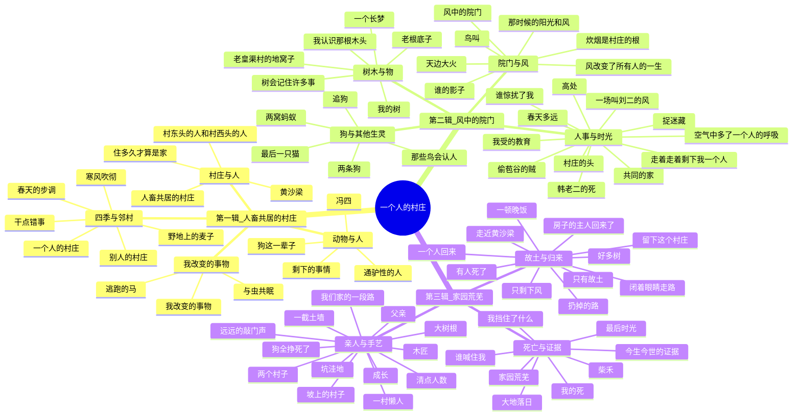

# 一个人的村庄 · 读书笔记

## 导览 · 全书脉络与书目(faithful 抽取)
- 书名 / 作者 / 译者 / 版本:《一个人的村庄》,刘亮程 著(无译者)。本书目据"写作的书"整理本;原书分三辑。
- 阅读日期 / 阅读目的:(留空,读者自填)
- 一句话总结: 以一个闲逛者的目光,写人畜共居的村庄里狗、驴、虫、树与风,把微小事物写成存在的证据,在时间流逝中打捞故乡与自我。
- 全书结构地图: 三辑——第一辑 人畜共居的村庄(人畜共生、微小事物与"我"的改变)、第二辑 风中的院门(风、院门、树木、记忆与人事)、第三辑 家园荒芜(故土、亲人、死亡与"今生今世的证据")。

## 全书大纲 · 思维导图(faithful 抽取)
用 mermaid `mindmap` 呈现三辑层级(篇目取自真实章节,略作主题归并以便鸟瞰)。

## 1. 核心论点(Core Arguments)
这本书最根本的主张是什么?用 3–7 条要点概括。
- 村庄是一个人的全部世界: 人畜共居、万物有灵,动物与自然都是人的镜像与命运共同体。
- "我"以闲逛者姿态改变着微小事物,又在时间中老去——个体与村庄彼此塑造、彼此记住。
- 时间是最本质的主题: 风、土墙、院门、树木都在记住 / 遗忘,时间无声地改变一切。
- 故乡不是固定坐标,而是不断消逝、需要"证据"去证明曾存在过的生活。
- 慢与凝视: 对一头驴、一只虫、一根木头的长久注视,胜过对"大事"的追逐。
- 家园终将荒芜,死亡与孤独是村庄的常态,但记忆与书写使其不朽。

## 2. 心智模型(Mental Models)
作者提供的、可复用的思维 / 行动框架。优先来自书里标志性的比喻或结构。
- 万物有灵透镜: 把狗、驴、虫、树当作有使命、有记忆的主体来写,而非静物。
- "我改变的事物"模型: 一锨、一根木头、一棵树——微小动作即命运(对牛一锨就是命运)。
- 时间—风模型: 用"风""土墙的裂缝""院门"作时间的具象刻度。
- 证据学视角: 用院墙、烟垢、木钉等"今生今世的证据"抵抗遗忘与消逝。
- 闲逛者姿态: 不抱目的,在荒野转悠,让意义从无聊与闲散中自己生长。

## 3. 论证证据(Evidence)
支撑上述论点的关键例子、原书引文、数据。标注出处章节以便回查。
- 狗这一辈子: 老狗是"村庄的一部分""人的一部分",狗命如梦、没人知它带什么使命而来(§狗这一辈子)。
- 我改变的事物: 一锨使落在最后的牛到队首被买走,"这一锨就是命运";拉直歪斜的胡杨,改变两棵树的长势(§我改变的事物)。
- 寒风吹彻: "冬天,有多少人放下一年的事情……用自己那只冰手,从头到尾地抚摸自己的一生";"当一个人的岁月像荒野一样敞开时,他便再无法照管好自己"(§寒风吹彻)。
- 人畜共居的村庄: "人出生时牲口也出世,傍晚人回家牲口也归圈"(§人畜共居的村庄)。
- 今生今世的证据: 院墙、烟垢、木钉、铁钉"这些都是我今生今世的证据啊"(§今生今世的证据)。
- 风中的院门: 院门承受荒芜,"几乎所有的院子不复存在,院门消失"(§风中的院门)。

## 4. 反例边界(Counterexamples / Boundaries)
作者自己承认的例外、明确说"不适用于"的情形、或你读出的适用边界。
- "我"是闲逛者而非劳动者: 村里人改建家园,他"永远不会为某一件事去忙碌"(§我改变的事物)——其视角本就非建功立业。
- 拟人化是方法不是断言: 万物"充满意义"是作者的信念投射,非客观事实。
- 村庄的"一个人"是文学主体,非真地理上的孤村,不宜当社会学样本读。
- 慢与凝视的前提是有闲: 作者自陈"年轻力盛""闲不住",此视角非人人可得。
- 家园荒芜是宿命书写,不提供挽救方案,重在感知与记忆而非行动。

## 金句摘录(Quotable Lines)—— faithful 抽取
- "一条狗能活到老,真是件不容易的事。"(§狗这一辈子)
- "我改变了一小片野草的布局和长势。"(§我改变的事物)
- "我老的时候,我会说,我是在时光中老的。"(§我改变的事物)
- "冬天,有多少人放下一年的事情,像我一样用自己那只冰手,从头到尾地抚摸自己的一生。"(§寒风吹彻)
- "当一个人的岁月像荒野一样敞开时,他便再无法照管好自己。"(§寒风吹彻)
- "这些都是我今生今世的证据啊。"(§今生今世的证据)

## 5. 与我连接(Connections)—— 以下为通用示例,读者按自己情况改写
- 它和我已有的知识 / 项目 / 习惯有什么关系?
  - 示例: 读者若写公众号 / 日记,可借"万物有灵透镜"重写自家窗外的树、楼下的猫,把写景变成写关系。
  - 示例: 读者正做"个人记忆 / 家族口述史"项目,本书"证据学视角"可启发: 用一件旧物(一把钥匙、一张票根)锚定一段被遗忘的时间。

## 6. 可执行下一步(Actionable Next Steps)—— 以下为通用示例,读者按自己情况改写
- [ ] 示例: 本周选一个常被忽略的微小对象(一只常来的鸟、路边一棵歪树),连续观察三天,写一段"它记住了什么"。
- [ ] 示例: 整理一张"我的今生今世的证据"清单——哪些旧物承载了只有自己懂的记忆?
- [ ] 示例: 把一个习以为常的地点(老巷、旧操场)当作"正在荒芜的家园"写 500 字,练习时间感的笔法。

## 7. 未解问题(Open Questions)—— 以下为通用示例,读者按自己情况改写
- 示例: 作者的"闲逛者"姿态带着旁观的奢侈,若换作必须劳作的村民视角,同一座村庄会写出什么?
- 示例: "万物有灵"是诗意还是认知方式?读者自己能在多大程度上真正"看见"非人主体的生命?
- 示例: 当记忆成为唯一证据,书写本身会不会反而加速对真实故乡的取代?

## 评价与适合人群(Verdict)—— 综合
- 总体评分(1–10)/ 一句话总体评价: 9 / 把村庄写成哲学与诗的土地之书,慢得从容、细得惊心。
- 适合谁读: 乡土文学 / 自然写作爱好者;想锤炼"凝视微小事物"笔力的写作者;在异乡怀念故乡、思考时间与记忆的读者。
- 不适合谁 / 局限性: 期待情节推进或明确观点的读者会觉"散";部分篇章情绪绵长、节奏极慢,需沉下心读。
- 延伸阅读 / 与已读其他书的对照: 汪曾祺《人间草木》、梭罗《瓦尔登湖》(自然与简朴的另一路);刘亮程《虚土》《在新疆》(同作者延展);与梁实秋《雅舍小品》对照: 一为乡土诗意、一为都市闲适,同写日常而气质迥异。
