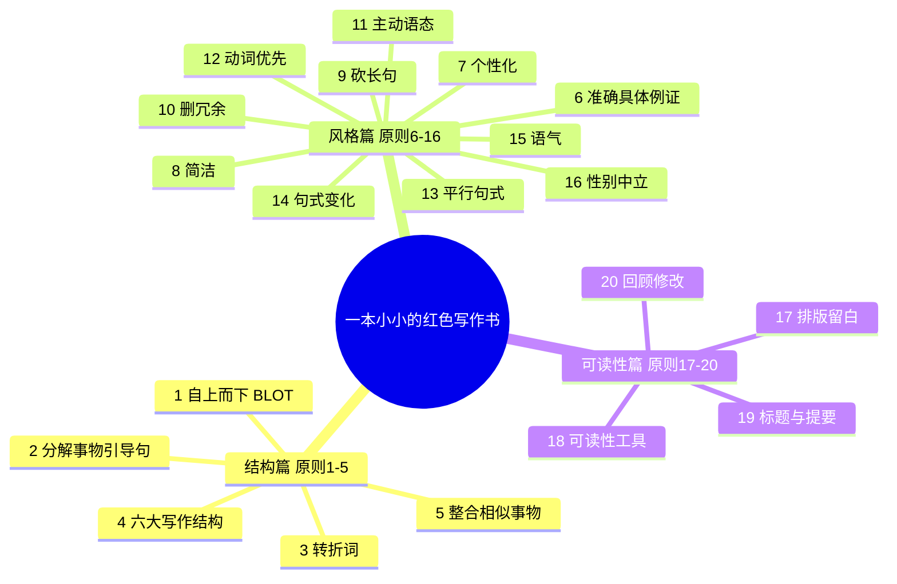

# 《一本小小的红色写作书》读书笔记

> 七块骨架抽取 · 来源:(加)布兰登·罗伊尔《一本小小的红色写作书》(周丽萍译,九州出版社 2017)
> 块 1–4 忠实抽取;块 5–7 留给读者本人填写(以下为草稿,待你确认/改写)。另含导览 / 金句 / 评价三个通用块。

## 导览 · 全书脉络与书目

- 书名 / 作者 / 译者 / 版本:(加)布兰登·罗伊尔《一本小小的红色写作书》,周丽萍 译,九州出版社 2017。
- 阅读日期 / 阅读目的:(读者填)
- 一句话总结:把"写清楚、写简洁、写有说服力"拆成 20 条放之四海皆准的原则,横跨结构、风格、可读性三大板块。
- 全书结构地图:
  - 结构篇(原则 1–5):自上而下 / BLOT、分解事物与引导句、转折词、六大写作结构、整合相似事物。
  - 风格篇(原则 6–16):准确具体的例证、个性化、简洁、砍长句、删冗余、主动语态、动词优先、平行句式、句式变化、语气、性别中立。
  - 可读性篇(原则 17–20):排版留白、可读性工具、标题与提要、回顾修改。

## 全书大纲 · 思维导图

## 1. 核心论点(Core Arguments)
- 写作是可被教授的技艺,由 20 条"放之四海而皆准"的原则组成,横跨**结构、风格、可读性**三大板块;好作品与普通作品最大的区别,在于是否用**准确、具体的例证**支撑所说内容。
- 说明文应"**自上而下**"写作:先把总结 / 结论放开头,再给支撑细节(BLOT:bottom line on top,末行上移);创造性写作(小说)可延迟总结、用意外结尾。
- 写作"**一半是科学,一半是艺术**":结构、规则、语法是科学(可建构、可遵循);具体情境下的变通是艺术。
- **简洁 ≠ 短**:简洁要求句子层面词语尽量少,但充分论证可能需要更多句子;准确具体的细节比砍词更重要——"砍掉多余词语固然重要,但充分论证所说内容更重要"。
- **修改是写作的一半**:极少有人一气呵成写出完美文章,多数需至少三稿;"完成"应加引号——文章改到"无可修改"才算成。

## 2. 心智模型(Mental Models)
- **倒三角 / 自上而下结构**:最重要的放最前(倒三角上宽基座=文章开端的总结论);报纸行业依赖此法——编辑从后往前砍,故结语不能压箱底。
- **"三"的魔力**:把主题分解为二到四个主要部分,通常推荐三个;**引导句(summary sentence)**放在开头,提示全文将讨论的事项与顺序,其下每项延展为至少一个自然段。
- **六大基本写作结构**:范畴、评价、时间、比较、线性、因果。强调(写得越多越重要)+ 顺序(时间/比较/线性/因果结构顺序重要,范畴/评价结构顺序不重要)。"结构预示内容"——动物学靠骨架判断动物,文章重要观点应给最多关注且最先讨论。
- **转折词 = 语言的交通灯**:对比(然而)、举例(比如/譬如)、接续(而且)、总结(因此)四类。最简单的写作万全法:选立场 → 写结论 → 陈述"有如下几个原因" → 用转折词。
- **主动优先 / 反名词化**:主动语态更直接、简练(施动者在前);把动词/形容词名词化(reduction→reduce、precision→precise)会弱化文章、使句子更长。
- **平行结构 + 句式变化**:连串事物用一致形式(肯尼迪就职演说、圣经八福为范);普通句序"主—谓—宾",但长短句、十种开头(主题/短语/从句/冠词/动词/副词/形容词/动名词/不定式/关联词)交错创造起伏。
- **语气**:大多数写作用**积极 + 个人化**语气更被接受;正式(无代词、无缩写)与非正式(加"你/我们"、缩写)决定距离感。

## 3. 论证证据(Evidence)
- **老师"BLOT"技巧**:让学生写任意短文,不看内容直接圈出最后一句挪到开头——因为结论常在后几行。(原则1)
- **商务写作两版(亚洲非洲基础消费品市场)**:"效果较好"版先把结论"亚洲和非洲代表未来最大国际市场"放开头,数据作细节;差版把结论埋在段尾。(原则1)
- **同事对话两版**:较优版先说"我需要一包 0.5mm 派通铅笔芯"再给路线;差版先给一长串路线,听者抓狂。(原则1)
- **苹果 / 公司利润例证梯度**:"利润下降了" → "因成本增加" → "降 10%、成本增 20%" → "高薪水是主因,时薪反降 5%";科学态度两文(怀特兄弟自行车铺发明飞行器/爱迪生 vs 无例证的版本2更让人记住)。(原则6)
- **牛仔节备忘录两版**:带 24 种游乐设施、迷你甜甜圈、烟花、套牛犊等细节的版本更能说服人参赛。(原则6)
- **传统书 vs 电脑广告**:无电线芯片电池、孩童可操作、目录索引+铅笔笔记——"这是电脑的终结吗?"(原则6)
- **两封推荐信**(理查德·泰勒学术推荐 / 朱迪工作推荐):评论都点出"错失具体细节支撑"——朱迪超额完成多少?香港销量增长多少?评审想看例子。(原则6)
- **奈杰尔个性化改写**:"奈杰尔很忙没时间玩" → "晚上在公司工作,回家还做家庭作业、预习第二天课程"。(原则7)
- **左右脑(斯佩里诺贝尔奖)杂糅原文 vs 先左脑后右脑的修正版**:说明"先结束一个主题再讨论下一个"= 整合相似事物。(原则5)
- **领导力长句拆分**:亚历山大(指挥+榜样)vs 甘地/特蕾莎(仅靠榜样激励)拆成三短句。(原则9)
- **肯尼迪就职演说平行句**:"pay any price, bear any burden, meet any hardship…";圣经八福排比"虚心的人有福了…哀恸的人有福了…"。(原则13)
- **鲍勃·穆尔黑德"我们时代的悖论"两版**:仅因增加页边空白与段落间距,可读性大增。(原则17)
- **钻石 4C 标题 / 提要范例**:Color/Clarity/Cut/Carat 用小标题引导;个人论文用斜体提要概述章节。(原则19)

## 4. 反例边界(Counterexamples / Boundaries)
- 创造性写作(小说等)可延迟总结、用意外结尾;"自上而下"**不适用于**需吊胃口的故事——"在没有目的地和飞行方向时,飞行员决不会将飞机驶离跑道"仅指说明文。(原则1)
- 正式写作(学术论文、商业报告)标准做法**避免人称代词"我"**;个性化例子需视文体而定。(原则7)
- **被动语态并非绝对禁用**:当需隐藏施动者(罪犯)、施动者不明/不重要(油被抽取、珍珠被发现)、受动者比施动者更重要(贝肯汉姆被授奖章)时,被动恰当地必要。(原则11)
- **简单词 ≠ 精确词**:原则8 主张用简单词,原则6 要求准确具体,二者需协调;"不错""多"仍应换更准的词。(原则6/8 的张力)
- **平行 / 句式变化是"艺术"**:并非所有句子都要短,长短句结合创造起伏;缩写形式在正式报告/论文中部分观点主张避免。(原则13/14/15)
- **修改永无止境**:已出版书也可再修订;"完成"应加引号,长作品(小说)可无限完善——"这个过程永远不会真正完成"。(原则20)

## 金句摘录(Quotable Lines)

- "写作一半是科学,一半是艺术。"——结构 / 规则可建构,情境变通靠艺术。
- "Bottom line on top(BLOT):把结论放最前。"(原则 1)
- "'完成'应加上引号——文章改到无可修改才算成。"(原则 20)
- "这个过程永远不会真正完成。"(原则 20,指修改永无止境)
- "准确具体的细节比砍词更重要——砍掉多余词语固然重要,但充分论证所说内容更重要。"(原则 6 / 8 张力)

## 5. 与我连接(Connections)—— 以下为通用示例,读者按自己情况改写
- 和《写作这回事》互补:金讲底层**姿态**(工具箱、有话直说、关门写开门改),罗伊尔给的是可操作的"说明书"——20 条原则 + 练习题,正好补金"然后呢怎么做"。对多数写作书收藏而言,这本最像"写作的 grammar/style 手册"。
- "**自上而下 / BLOT**"对写公众号推文、工作文档、读书笔记都直接相关:结论先行,别让读者猜。常犯"边写边自我审查 + 结尾才给结论"毛病的人,这条能直接治。
- "**三的魔力 / 引导句**"可套进本项目的笔记 skill 结构:每本书笔记用一句引导句点明"我将通过 X、Y、Z 呈现"。
- 原则6"准确具体的例证"与本项目**块3(论证证据)**方法论同源:拒绝空泛,用具体事例支撑。

## 6. 可执行下一步(Actionable Next Steps)—— 以下为通用示例,读者按自己情况改写
- [ ] 给每类写作(推文 / 工作文档 / 笔记)套一个"倒三角"模板:第一行 = 结论,下面 2–4 个支撑点,每点带一个具体例子。
- [ ] 下次写初稿刻意用"**主动语态 + 动词而非名词化**"(reduction→reduce);改稿时扫一遍被动句和"的"字堆砌。
- [ ] 用原则13/14 做"句式变化"练习:同一段文字故意用 10 种不同开头重写,治"我 / 我们"开头单调的毛病。
- [ ] 把"**修改三稿**"制度化:一稿放想法、二稿加细节串全文、三稿抛光;告诉自己"完成"加引号。

## 7. 未解问题(Open Questions)—— 以下为通用示例,读者按自己情况改写
- 罗伊尔偏说明文 / 商务写作;对叙事、"故事感"是否过刚?写既要清晰又要抓人的推文时,原则和"钩子"怎么平衡?
- 原则16 性别中立、原则15 积极语气偏西方职场语境;中文写作里"积极语气""人称代词"的对应做法是什么?本书译自英文,部分原则(阳性泛指)对中文多少错位。
- 20 条里"结构 5 条 vs 风格 11 条 vs 可读性 4 条"权重失衡?可读性(排版 / 标题 / 修改)对长文更重要,却只给 4 条,是否轻了?
- 和 McKee《故事》对照:罗伊尔几乎不谈"故事 / 情节 / 人物",只谈句子与段落层面;二者是不同尺度,写作书收藏该怎么分层使用?

## 评价与适合人群(Verdict)

- 总体评分 / 一句话评价:清晰实用 8/10,中文语境适配 7/10。像一本"写作的 grammar/style 使用说明书",系统、可操作、带练习;但偏说明文 / 商务写作,对叙事与"故事感"着墨极少,且部分原则(阳性泛指、积极语气)译自英文、对中文略有错位。
- 适合谁读:写说明文 / 商务报告 / 公众号推文的人;学生与职场写作入门;想要"可 Checklist 化"写作法的人。
- 不适合谁 / 局限:写小说 / 故事、追求文学性的人会觉得过刚;想要"怎么抓人 / 怎么有故事感",需另补 McKee《故事》或金《写作这回事》。
- 延伸对照:与《写作这回事》互补(罗伊尔给"然后怎么做"的说明书,金给底层姿态);20 条里结构 5 / 风格 11 / 可读性 4 的权重分布值得商榷(可读性对长文更重却只 4 条)。

## 本书提及书单(Books Mentioned)—— faithful 抽取
本书正文 / 注释中引用、提及的其他书目。用表格呈现(书名 / 作者 / 简介);简介一句话说明该书与本主题的关系或核心内容。本书为自成体系的写作说明书,对外引用书目极少,下表为忠实抽取所得。

| 书名 | 作者 | 简介 |
| --- | --- | --- |
| 《一本小小的金色语法书》 | 布兰登·罗伊尔 | 作者本人同系列语法配套书,本书提及可作延伸阅读 |
| 《圣经》 | (宗教经典) | 引用其著名句式,作平行结构 / 措辞范例 |
| 《金刚经》 | (佛教经典) | 文中举为"世界上记载日期最古老的书籍"作例证 |
| 《鲸鱼》 | (散文范文) | 用作句子重组与连贯性练习的范例文本 |
| 《危险年代》 | (电影,非书) | 节选片段作"观察动词保持平行"的范例;电影非书,附此备查 |
