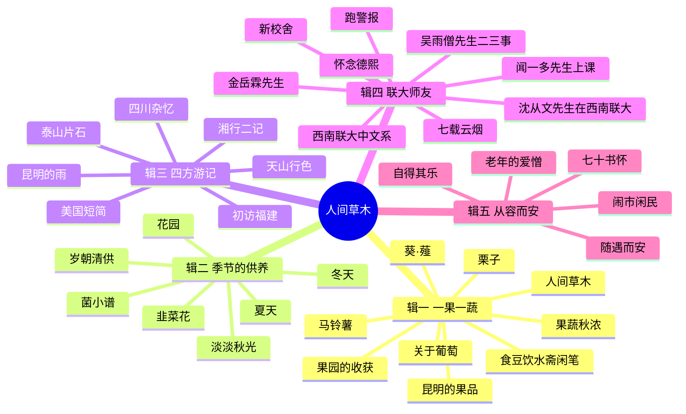

# 读书笔记 · 人间草木

## 导览 · 全书脉络与书目(faithful 抽取)
- 书名 / 作者 / 译者 / 版本:《人间草木》,汪曾祺 著;无译者。版本:北京时代华文书局,2017 年 4 月第 1 版(版权页 CIP 署 2017.2,ISBN 978-7-5699-1354-5)。本书为汪氏散文选集,分五辑。
- 阅读日期 / 阅读目的:(读者自填)
- 一句话总结:以草木、果蔬、四时、游记与西南联大故人为题,在平淡细碎的日常里写尽对生活的热爱、从容与通达——万物有灵,人间值得坐下来慢慢看。
- 全书结构地图(分几部分、每部分讲什么,便于回查):
  - 辑一 一果一蔬:葡萄、果品、果蔬、马铃薯、栗子、葵薤等草木瓜果随笔,兼及《人间草木》题旨篇。
  - 辑二 季节的供养:花园、韭菜花、菌子、夏/秋/冬与岁朝清供,写四时景物与吃食。
  - 辑三 四方游记:昆明、四川、福建、泰山、天山、湘西、美国等地的游记。
  - 辑四 联大师友:西南联大求学与诸先生(金岳霖、沈从文、闻一多、吴宓等)的怀人文章。
  - 辑五 从容而安:七十书怀、老年的爱憎、自得其乐、随遇而安、闹市闲民,集中呈现其人生观。

## 全书大纲 · 思维导图(faithful 抽取)

## 1. 核心论点(Core Arguments)
这本书最根本的主张是什么?用 3–7 条要点概括。
- 生活本身就是审美对象:最寻常的草木、果蔬、吃食、四时与陌生人里都藏着趣味与温情,值得"注视很多很多日子"。(题记/辑一·辑二)
- 文学要写"平平常常的人和事":强调真实、写亲身感受,不写重大题材与强烈戏剧冲突,风格自然成"淡";"淡"是经历、素养、气质使然,并非刻意。(§辑五 七十书怀)
- 人生态度是"随遇而安、从容、自得其乐":即便被划为右派、下放劳动,也以"三生有幸"看待,在平凡劳作与书画菜羹中自得。(§辑五 随遇而安 / 自得其乐)
- 万物有灵、人间有情:草木记得自己的岁数,仙人掌倒挂亦能开花,普通劳动者与老夫妻都敦厚可爱——以善意与好奇待人接物。(§辑一 人间草木 / 辑三 昆明的雨)
- 艺术与生活在根本上是一回事:写字、画画、做菜皆为"遣兴自娱",从生活中寻找乐趣远比炫技重要。(§辑五 自得其乐)

## 2. 心智模型(Mental Models)
作者提供的、可复用的思维 / 行动框架。优先来自书里标志性的比喻或结构。
- "淡"的写作观:不是"淡化"(把浓的硬化淡),而是本就平淡——只写熟悉平常的人事,用平常的思想感情去了解、用平常的方法去表现,结果就是淡。(§七十书怀)
- 随遇而安 / 从容模型:把逆境当阅历,不怨天、不记恨,"遇"什么环境便安然处之,从困苦中也能看出好玩与值得。(§随遇而安)
- 生活审美化模型:逛菜市比逛百货更有"生活气息";做菜是构思过程,看对象下料;从草木虫鱼、街头老夫妻、养蜂人处得趣。(§自得其乐 / 人间草木)
- 遣兴自娱模型:书画、做菜、写字都是"自怡悦",刻闲章"只可自怡悦",不刻意求工、不倚仗头衔。(§自得其乐 / 七十书怀)
- 草木有情 / 万物有灵模型:观察自然细微处(山丹丹一年多开一朵花、仙人掌悬空倒挂开花),以平等好奇待物待人。(§人间草木 / 昆明的雨)

## 3. 论证证据(Evidence)
支撑上述论点的关键例子、原书引文、数据。标注出处章节以便回查。
- "山丹丹长一年,多开一朵花。……山丹丹记得自己的岁数。"以草木记岁写万物有灵、时间可感。(§辑一 人间草木)
- "昆明的雨季是明亮的、丰满的,使人动情的。……带着雨珠的缅桂花使我的心软软的,不是怀人,不是思乡。"以雨季菌子、杨梅、缅桂写一方风物的温润。(§辑三 昆明的雨)
- 下放沙岭子农科所画《中国马铃薯图谱》,"坐对一丛花,眸子炯如虎",吃遍百来种马铃薯,"像我一样吃过那么多品种的马铃薯的,全国盖无第二人"——于困顿中自得其乐。(§辑五 随遇而安)
- "我当了一回右派,真是三生有幸。要不然我这一生就更加平淡了。"把苦难化为豁达的反说。(§辑五 随遇而安)
- "我只能用平平常常的思想感情去了解他们,用平平常常的方法表现他们。这结果就是淡。""你不能改变我"——自陈"淡"之来由与不可强改。(§辑五 七十书怀)
- "人生行乐耳,须富贵何时"(引杨恽《报孙会宗书》),用来佐证洒脱的生活态度。(§辑五 自得其乐)

## 4. 反例边界(Counterexamples / Boundaries)
作者自己承认的例外、明确说"不适用于"的情形、或你读出的适用边界。
- 不认同"淡化"说:被人划入"淡化"一类,但他反驳——"我的作品确实是比较淡的,但它本来就是那样,并没有经过一个'化'的过程",是生活经历、文化素养、气质所决定,非刻意淡化。(§七十书怀)
- "回炉"之不可能:评论家让他照另一种样子写,他说"除非把我回一次炉,重新生活一次",七十岁难回炉,不能下命令改写。(§七十书怀)
- 不主张青年学他之"淡":"三四十岁就写得很淡,那,到我这样的年龄,怕就什么也没有了",劝青年写得新一点、怪一点、朦胧一点、荒诞一点、狂妄一点。(§七十书怀)
- 做菜待客须看对象:给云南人炒干巴菌、给扬州人煮干丝是"鲁迅请曹靖华吃柿霜糖",即投其所好而非炫技;给同乡人做则失趣。(§自得其乐)
- 画"只能自己玩玩,送人是不够格的",自刻闲章"只可自怡悦"——艺术自娱而非讨好外界的边界。(§自得其乐)

## 金句摘录(Quotable Lines)—— faithful 抽取
写推文 / 笔记时最想直接抄的原句。每条附出处章节。
- "如果你来访我,我不在,请和我门外的花坐一会儿,它们很温暖,我注视它们很多很多日子了。"(题记)
- "昆明的雨季是明亮的、丰满的,使人动情的。"(§辑三 昆明的雨)
- "带着雨珠的缅桂花使我的心软软的,不是怀人,不是思乡。"(§辑三 昆明的雨)
- "山丹丹长一年,多开一朵花。……山丹丹记得自己的岁数。"(§辑一 人间草木)
- "我当了一回右派,真是三生有幸。要不然我这一生就更加平淡了。"(§辑五 随遇而安)
- "我只能用平平常常的思想感情去了解他们,用平平常常的方法表现他们。这结果就是淡。"(§辑五 七十书怀)

## 5. 与我连接(Connections)—— 以下为通用示例,读者按自己情况改写
它和我已有的知识 / 项目 / 习惯有什么关系?
- 我做内容 / 写周报常追求"亮点"和"冲突",可借"淡"的写作观回看:是否忽略了手边平平常常却真实的人和事。
- 我在压力下容易焦虑,可借鉴"随遇而安":把不确定的一段经历当阅历,从中找能做的、好玩的事。
- 我的业余爱好若只剩"刷"和"消费",可学"生活审美化":去菜市、养一盆植物、认真做一顿饭,把日常过出趣味。

## 6. 可执行下一步(Actionable Next Steps)—— 以下为通用示例,读者按自己情况改写
基于这本书,我具体能做的一件小事?
- [ ] 本周挑一种身边草木 / 食物,写一篇 300 字"平平常常"的观察,不煽情、不硬立主旨。
- [ ] 遇到一件不顺的事,试着用"三生有幸 / 随遇而安"的语气写一段话,看能否转换心情。
- [ ] 下次做饭 / 散步时,刻意留意一个以前忽略的细节,记一句下来。
- [ ] 把"只可自怡悦"当作一条原则:做一件不为展示、只为自己开心的小事。

## 7. 未解问题(Open Questions)—— 以下为通用示例,读者按自己情况改写
我哪里不同意?还想追问什么?
- "淡"在今天的自媒体语境里是否会被算法淘汰?不写冲突与强情绪,平稳的文字如何被看见?
- 随遇而安与"争取 / 改变"的边界在哪?何时该安,何时该争,书里没有给出操作标准。
- 汪老把苦难写得云淡风轻,这是通达还是一种叙述策略?读者会不会因此低估时代之重?

## 评价与适合人群(Verdict)—— 综合
- 总体评分(1–10)/ 一句话总体评价:9 / 把"好好过日子"写成一门艺术,平淡里有深情与筋骨,是随时能翻、越读越暖的生活美学读本。
- 适合谁读:喜欢散文与随笔的人、想学"把寻常写得好看"的写作初学者、在忙碌里想找回生活兴致的人、做内容 / 文案需要"人情味"的人。
- 不适合谁 / 局限性:寻求强情节、强观点或系统方法论的读者会觉得"散";部分饮食风物带有 1980–90 年代地域与时代印记,年轻读者需自行想象语境。
- 延伸阅读 / 与已读其他书的对照:同作者《汪曾祺散文》各集、《受戒》《晚饭花集》;可与《雅舍小品》(梁实秋)对照"闲适散文"一脉,与《文章作法》《文话七十二讲》对照"怎样把平淡写妥当"的写作面。

## 本书提及书单(Books Mentioned)—— faithful 抽取
本书正文 / 注释中引用、提及的其他书目。用表格呈现(书名 / 作者 / 简介),挑重点、去重,8–15 条为宜;简介一句话说明该书与本主题的关系或核心内容。
| 书名 | 作者 | 简介 |
| --- | --- | --- |
| 《红楼梦》 | 曹雪芹(清) | 古典小说巅峰;汪曾祺多处引其饮食、人物与对话描写,作为"写活寻常"的范本。 |
| 《水浒传》 | 施耐庵(明) | 古典小说;引其市井人物与白描笔法,谈怎样把人物写生动。 |
| 《楚辞》 | 屈原、宋玉等(战国) | 先秦诗歌总集;书中引《离骚》《九歌》等谈香草草木与楚地风物。 |
| 《庄子》 | 庄周(战国) | 道家经典;引其文谈草木意象、养生与闲适的人生态度。 |
| 《论语》 | 孔子及其弟子(春秋) | 儒家语录;书中引述以印证日常人情与礼俗。 |
| 《齐民要术》 | 贾思勰(北魏) | 古代农学百科全书;谈物产、吃法与农事时多次引用其记载。 |
| 《植物名实图考》 | 吴其濬(清) | 清代植物学专著(含《长编》);汪曾祺辨识草木时的重要参考。 |
| 《梦溪笔谈》 | 沈括(宋) | 宋代笔记中的科学见闻;引其物产、技艺记载佐证书中说法。 |
| 《东京梦华录》 | 孟元老(宋) | 北宋汴京风物笔记;引其市井饮食、节令以写吃食风貌。 |
| 《容斋随笔》 | 洪迈(宋) | 宋代考据随笔;引其疏证以谈名物与掌故。 |
| 《昭明文选》 | 萧统(梁)编 | 现存最早诗文总集;书中引其篇目谈文章源流。 |
| 《闻一多论唐诗》 | 闻一多(现代) | 唐诗研究专著;引其说以谈唐诗中的草木与意境。 |
| 《泰山女神的神话、信仰与宗教》 | 车锡伦(现代) | 民俗学专著;书中谈泰山信仰与民间祭祀时引用。 |
| 《十驾斋养新录》 | 钱大昕(清) | 清代考据笔记;引其训诂以辨名物字义。 |
