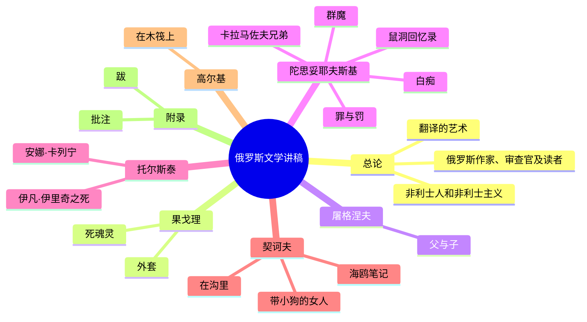

# 读书笔记 ·《俄罗斯文学讲稿》(纳博科夫)

## 导览 · 全书脉络与书目(faithful 抽取)
- 书名 / 作者 / 译者 / 版本: 《俄罗斯文学讲稿》 / 弗拉基米尔·纳博科夫(Vladimir Nabokov,1899–1977) / 丁骏、王建开 译;原编者前言由弗莱德森·鲍尔斯撰写。本书据纳博科夫 1940–1950 年代在美国高校(卫斯理、斯坦福、康奈尔、哈佛)的俄罗斯文学课讲稿整理而成。
- 阅读日期 / 阅读目的: (留空,读者自填)
- 一句话总结: 小说大师纳博科夫以同为作家的灵感和天才之光,带读者重返俄罗斯文学黄金年代,并以"纯粹艺术性"为尺,对六大作家及其代表作作出极具个人风格的褒贬。
- 全书结构地图:
  - 序跋与体例: 关于本书 / 关于作者 / 目录 / 原编者前言(编辑方法说明)
  - 总论(公开演讲): 俄罗斯作家、审查官及读者
  - 作家专论(各含生平 + 作品细读):
    - 尼古拉·果戈理 →《死魂灵》《外套》
    - 伊凡·屠格涅夫 →《父与子》
    - 费奥多尔·陀思妥耶夫斯基 →《罪与罚》《鼠洞回忆录》《白痴》《群魔》《卡拉马佐夫兄弟》
    - 列夫·托尔斯泰 →《安娜·卡列宁》《伊凡·伊里奇之死》
    - 安东·契诃夫 →《带小狗的女人》《在沟里》《海鸥》笔记
    - 马克西姆·高尔基 →《在木筏上》
  - 通论两篇: 非利士人和非利士主义 / 翻译的艺术
  - 附: 跋 / 附录 / 批注

## 全书大纲 · 思维导图(faithful 抽取)

## 1. 核心论点(Core Arguments)
这本书最根本的主张是什么?用 3–7 条要点概括。
- 俄罗斯文学(19 世纪)是一次"文艺复兴",在短短一个世纪内迸发出足以与英法比肩的艺术奇迹;它是纳博科夫失落的家园与精神养分。§俄罗斯作家、审查官及读者
- 艺术性(aesthetic value)高于一切:文学应追求纯粹的艺术价值,而非社会评论、道德说教或政治用途;谁用"实用主义"绑架艺术,谁就是非利士人。§原编者前言
- 对"庸俗"(poshlust)的深刻洞见与嘲讽:真正的艺术家能识别并剔除虚假的重要、虚假的美丽、虚假的聪明与虚假的魅力。§非利士人和非利士主义
- 争夺艺术家灵魂的两股势力同等危险:其一是政府(命令作家做国家的仆人),其二是激进的实用主义批评家(命令作家做大众的仆人);二者在艺术上都是非利士人,所有 19 世纪俄国作家都经历这"双重炼狱"。§俄罗斯作家、审查官及读者
- 明确的作家座次与褒贬:托尔斯泰第一、果戈理第二、契诃夫第三、屠格涅夫第四;陀思妥耶夫斯基被贬为"相当平庸"(推崇其早期《双重人格》);高尔基则被猛烈抨击。§《安娜·卡列宁》/陀思妥耶夫斯基/高尔基
- 细节是通往伟大作品内在生命的钥匙:对细节"科学而又艺术的欣赏"是其教学法精髓,好的读者要在脑中构想出具体场景。§原编者前言

## 2. 心智模型(Mental Models)
作者提供的、可复用的思维 / 行动框架。优先来自书里标志性的比喻或结构。
- **poshlust(庸俗)识别模型**:识别"虚假的重要 / 美丽 / 聪明 / 魅力"——这既是美学判断也是道义控诉;真实、不加掩饰的好东西永远不可能是 poshlust。何时用:评判任何作品、言论或文化现象是否"伪"。§非利士人和非利士主义
- **细节的火花模型**:细节的结合产生感官的火花,一本书才得以获得生命;"图表在这里是最有用的"——用图表还原场景(如安娜的卧铺车厢、巴扎洛夫的旅程)。何时用:细读文本、做文本分析时先抓可感的具体细节。§原编者前言
- **把文学敲碎捣烂模型**:文学不能囫囵吞枣,要"敲成小块、粉碎、捣烂——在掌心里闻到芳香,咀嚼、品尝",被碾碎的部分会在脑中重新拼合成整体美。何时用:面对真正的好书(或讨厌的书,反向想象更好的写法)。§陀思妥耶夫斯基
- **艺术是一场神圣的游戏**:神圣(人通过创造接近上帝)+ 游戏(清楚一切是在做戏)二者同等重要;平衡一旦打破,舞台上只剩闹剧,书中只剩骇人谋杀案。何时用:判断一部作品是否仍是"艺术"而非报道/说教。§陀思妥耶夫斯基
- **双重审查炼狱模型**:沙皇政府(国家仆人)与激进批评家(大众仆人)两股力量夹击艺术家;苏联则把二者"合"二为一。何时用:理解 19 世纪俄国作家的处境与创作张力。§俄罗斯作家、审查官及读者
- **契诃夫"面具"分析法**:在《在沟里》中层层揭示人物的"面具"(欺骗主题)与"浸泡在虚假中"的母题,对照唯一未被污染的天真者。何时用:拆解以虚伪/欺骗为核心的小说结构。§《在沟里》

## 3. 论证证据(Evidence)
支撑上述论点的关键例子、原书引文、数据。标注出处章节以便回查。
- 果戈理《死魂灵》根本不是社会控诉,而是 poshlust 的"浑圆性"的艺术呈现;乞乞科夫不过是"给魔鬼跑腿的……来自冥府的旅行推销员",其世界"基本上不真实"。§《死魂灵》
- 作家座次原话:"第一,托尔斯泰;第二,果戈理;第三,契诃夫;第四,屠格涅夫。"陀思妥耶夫斯基与萨尔蒂科夫"正等在我的办公室门口,想为他们自己的低分讨个说法"。§《安娜·卡列宁》
- 安娜的双重噩梦预示其死;安娜—伏伦斯基之爱激情却精神贫瘠、以自我为中心,注定悲剧;吉娣—列文则寄托托尔斯泰关于和谐、责任、温情、真理与天伦之乐的理想。§《安娜·卡列宁》
- 托尔斯泰的"时间钟"与读者一致,制造终极现实感,纳博科夫"没有追问究竟,而是称之为一个不解之谜";并指出安娜自杀前马车穿过莫斯科的描写预示了乔伊斯的意识流。§《安娜·卡列宁》
- 陀思妥耶夫斯基:《双重人格》才是"一部完美的艺术作品",而《卡拉马佐夫兄弟》"本可以成为一个伟大的剧作家,却偏偏挣扎着写了一部失败的小说"。§陀思妥耶夫斯基
- 契诃夫价值:拒绝让社会评论干涉对人的细致描摹;《在沟里》"艺术地再现了生活的原貌,以及人的原貌,毫无扭曲"。§原编者前言 /《在沟里》
- 高尔基:纳博科夫"全部作品被猛烈抨击",除政治因素外更因高尔基"缺乏再现人物和情景的能力"及其劳动人民风格。§高尔基 / 原编者前言
- 题词原句:"自由的人写下真正的书,给自由的人读,这何其珍贵。"§关于作者(题词)

## 4. 反例边界(Counterexamples / Boundaries)
作者自己承认的例外、明确说"不适用于"的情形、或你读出的适用边界。
- 读者分层:对"读书不多"的读者,陀思妥耶夫斯基或许比美国历史小说"重要得多、更具艺术性";但纳博科夫坚持从"艺术永恒性与个人天才"角度评判,其低分不适用于"通俗可读性"维度。§陀思妥耶夫斯基
- "神圣的游戏"的边界:平衡一旦打破,舞台上只剩荒谬闹剧、书中只剩骇人谋杀案——此时已不是艺术。§陀思妥耶夫斯基
- 托尔斯泰说教的边界:大段农业、zemstvo(地方自治)说教是"艺术上的错误",会随时代过时;艺术家与说教者虽"均质"难分,但说教确会中断艺术魅力。§《安娜·卡列宁》
- 苏联文学作为反例:结尾由法律决定、国家才是真正主角、强制欢喜结局——证明"非艺术性"文学如何被体制生产。§俄罗斯作家、审查官及读者
- 翻译的第三等级罪恶:把杰作"辗轧拍压"、按大众偏见粉饰美化,是犯罪(几百年前会被当剽窃者披枷戴锁)——标出"理想翻译"的边界。§翻译的艺术
- 契诃夫的"儿童/天真"主题仅作为被欺骗世界中的微弱光亮存在,并非普世解法;纳博科夫并未主张所有小说都该如此结构。§《在沟里》

## 金句摘录(Quotable Lines)—— faithful 抽取
写推文 / PRD / 笔记时最想直接抄的原句。每条附出处章节。
- "自由的人写下真正的书,给自由的人读,这何其珍贵。"(§关于作者 / 题词)
- "艺术是一场神圣的游戏。"(§陀思妥耶夫斯基)
- "在我教书的那几年里,我努力为学文学的学生们提供有关细节的确切信息,细节的结合产生感官的火花,一本书才得以获得生命。"(§原编者前言)
- "文学,真正的文学,是不能囫囵吞枣地对待的,它就像是对心脏或者大脑有好处的药剂似的……"(§陀思妥耶夫斯基)
- "poshlism 不仅指显而易见的垃圾般的废物,主要还指虚假的重要,虚假的美丽,虚假的聪明,以及虚假的魅力。"(§非利士人和非利士主义)
- "一个几乎没有内生的文学传统的国家,只用了一个世纪的时间,一个十九世纪,便创造出了……足以与英国或是法国的光辉作品相提并论的文学。"(§俄罗斯作家、审查官及读者)

## 5. 与我连接(Connections)—— 以下为通用示例,读者按自己情况改写
- 它和我已有的知识 / 项目 / 习惯有什么关系?
- 示例:若你也在做"文本细读 / 内容创作",可把"细节的火花"模型当作检验清单——我写 / 读一段时,能否在脑中构想出具体可感的场景?
- 示例:当你在评审一份方案或文章时,可用 poshlust 识别模型追问:这里有没有"虚假的重要 / 美丽 / 聪明 / 魅力"?
- 示例:把"艺术是一场神圣的游戏"用于区分"在做戏般的创作愉悦"与"沦为报道 / 说教"的边界。

## 6. 可执行下一步(Actionable Next Steps)—— 以下为通用示例,读者按自己情况改写
基于这本书,我具体能做的一件小事?
- [ ] 选一本你正在读的小说,用"把书敲碎捣烂"法重读其中一章:标记 3 个关键细节,写下它们在你脑中拼出的整体画面。
- [ ] 用 poshlust 模型重看一部近期热门作品 / 一则广告,列出其中"虚假的重要 / 美丽 / 聪明 / 魅力"各一例。
- [ ] 对照"双重审查炼狱"框架,梳理你所在领域里"命令你服务国家 / 服务大众"的两种外部压力分别是什么。
- [ ] 挑纳博科夫贬低的陀思妥耶夫斯基《双重人格》或推崇的《安娜·卡列宁》,亲自验证他的判断。

## 7. 未解问题(Open Questions)—— 以下为通用示例,读者按自己情况改写
我哪里不同意?还想追问什么?
- 纳博科夫把"艺术性"置于社会价值之上,若一部作品兼具伟大艺术与深刻社会批判(如他所否定的某些读法),他的框架是否过窄?
- 他对陀思妥耶夫斯基"感伤主义 / 平庸"的判词,是否因个人气质(贵族性、反感虚假感伤)而低估了其思想小说的独特价值?
- 他极度推崇"细节",却几乎不谈作品结构 / 叙事节奏的宏观设计,二者如何调和?
- 在"自由的人写真正的书"之外,非自由语境下创作出来的作品是否注定不入他的法眼?边界在哪?

## 评价与适合人群(Verdict)—— 综合
- 总体评分(1–10)/ 一句话总体评价: 9 / 以作家之眼重读大师,锋利、私人、充满细节火花,是俄罗斯文学与纳博科夫研究不可错过的经典讲稿(对厌恶主观褒贬者另当别论)。
- 适合谁读: 文学爱好者与写作者;想学"文本细读"与艺术性判断的人;纳博科夫作品(《洛丽塔》《微暗的火》等)的读者;对 19 世纪俄国小说感兴趣的人。
- 不适合谁 / 局限性: 想要客观、中立文学史或作家传记的读者;寻求社会 / 历史解读的人(纳博科夫明确拒绝"寓意"读法);陀思妥耶夫斯基或高尔基的忠实粉丝可能会对贬抑感到不适;讲稿为课堂口吻,部分章节为笔记片段、结构存疑。
- 延伸阅读 / 与已读其他书的对照: 纳博科夫《文学讲稿》(欧洲作家:奥斯丁、福楼拜、狄更斯、乔伊斯等);别林斯基 / 车尔尼雪夫斯基的激进批评(本书的对照靶子);福楼拜"作者隐形却无处不在"主张;乔伊斯《尤利西斯》、普鲁斯特《追忆似水年华》(书中提及的时间处理对照)。
