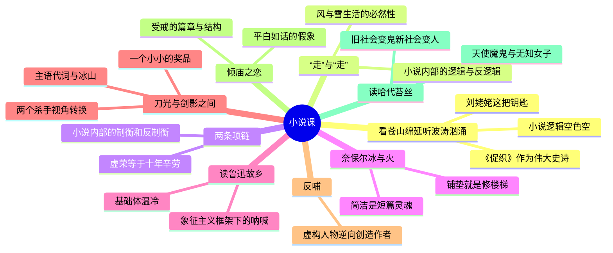

# 读书笔记 ·《小说课》

## 导览 · 全书脉络与书目(faithful 抽取)

- **书名** / **作者** / **译者** / **版本**:
  - 书名:小说课
  - 作者:毕飞宇(当代作家)
  - 译者:(无,中文原创)
  - 版本:人民文学出版社,2017 年 2 月北京第 1 版第 1 次印刷(丛书"大家读大家";ISBN 978-7-02-012273-8)。
- **阅读日期** / **阅读目的**:(留空,读者自填)
- **一句话总结**:一位小说家以"写作者"而非"批评家"的身份,回到小说内部,用逻辑与反逻辑、制衡与反制衡、铺垫、视角、结构比例等"手艺",重新细读《促织》《水浒》《项链》《故乡》《杀手》《受戒》《苔丝》等经典。
- **全书结构地图**(分几部分、每部分讲什么,便于回查):
  - 看苍山绵延,听波涛汹涌——读蒲松龄《促织》/ 兼及《红楼梦》。
  - "走"与"走"——读《水浒》林冲、李逵,谈小说内部的逻辑与反逻辑。
  - 两条项链——读莫泊桑《项链》,谈小说内部的制衡和反制衡。
  - 奈保尔,冰与火——读《布莱克·沃滋沃斯》,谈铺垫。
  - 读鲁迅先生的《故乡》——谈"基础体温·冷"与象征主义。
  - 刀光与剑影之间——读海明威《杀手》,含"主语代词与冰山""两个杀手""一个小小的奖品"等小节。
  - 反哺——虚构人物对小说作者的逆向创造。
  - 倾"庙"之恋——读汪曾祺《受戒》,谈篇章结构与"平白如话的假象"。
  - 读哈代《德伯家的苔丝》——天使、魔鬼与无知的女子。

## 全书大纲 · 思维导图(faithful 抽取)

## 1. 核心论点(Core Arguments)

- 读小说要回到"小说内部":逻辑与反逻辑、制衡与反制衡、铺垫、视角、结构比例等"手艺"层面,而非套用"虚伪/腐朽/垄断资本主义"式政治道德标签。
- 《促织》是伟大史诗(体量仅 1700 字却可比屈原、杜甫、曹雪芹);《红楼梦》用刘姥姥这把"钥匙"把"白玉为堂金作马"落到实处。
- 林冲之"走"体现生活的必然性(风与雪推动逻辑):李逵是自然性,林冲是社会性;"逼上梁山"无一处偶然,否则人物即被写坏。
- 《项链》的"制衡":拜金与虚荣自带寓言式、宿命般的霉运;(女人)一晚的虚荣=(女人)十年的辛劳——并批判公式化的语文教学。
- 奈保尔靠"铺垫"(修楼梯)化解"诗人难写"的麻烦;简洁是短篇小说的灵魂与秘密。
- 鲁迅《故乡》的"冷"是其辨别度;呐喊是"一语道破"而非扯嗓子,须在象征主义框架内理解。
- 海明威的"冰山"是刻意的:代词必须清晰指代,客观/主观视角可随时转换;用"床小"写大个子拳击手才是好小说。
- 作者与人物彼此创造:人物会"反哺"作者,逆向逼出新的小说(玉秀逼出《玉秀》)。
- 《受戒》结构呈畸形比例(7:6:2)成就特殊味道;"平白如话"在汪曾祺笔下常是假象。
- 《苔丝》可被简化为《白毛女》式"旧社会使人变成鬼,新社会使鬼变成人",但这一概括回避了更必然、更婆婆妈妈的问题。

## 2. 心智模型(Mental Models)

- **小说内部逻辑 vs 反逻辑**(施耐庵写林冲):人物每一步都有生活必然性——何时用:判断情节是否"假"。
- **制衡与反制衡**(莫泊桑《项链》):一个要素被设立,必有相反要素牵制——何时用:设计人物动机与反转。
- **铺垫=修楼梯**(奈保尔):特殊人物先以群像铺垫,使其不再突兀——何时用:引入反常角色。
- **冰山理论(海明威)**:刻意把内容摁到"水下",但代词必须有所指代——何时用:处理对话与省略。
- **客观视角↔主观视角转换**:镜头由"其中的一个"变"第一个"即主观介入——何时用:分析叙事视角。
- **结构比例即态度**(《受戒》7:6:2):篇幅分配本身就是立场——何时用:审视篇章结构。
- **反哺**:人物逆向创造作者——何时用:理解创作中"角色脱离控制"的现象。

## 3. 论证证据(Evidence)

- 《促织》仅 1700 字,"8 条微博的体量",毕飞宇称其为伟大史诗,艺术才华可比屈原、杜甫、曹雪芹(§看苍山绵延,听波涛汹涌)。
- 林冲:正因为有雪才烤火、才仔细处理火,证明草料场大火与林冲无关;风与雪推动他走到山神庙(§"走"与"走")。
- 《项链》等式:(女人)一晚的虚荣=(女人)十年的辛劳;并指出语文老师"光荣劳动惩罚虚荣"的自相矛盾(§两条项链)。
- 奈保尔写第三个乞丐:"下午两点,一个盲人由一个男孩引路,来取走他的那一分钱"——一个乞丐的性格塑造(§奈保尔,冰与火)。
- 海明威《杀手》第一行两杀手进餐厅,第三行"其中的一个说道",第八行才出现名字"阿尔"(§两个杀手,一只鹦鹉)。
- 安德烈松"床对他来说显得太小了"——用"床小"写重量级拳击手的大个子(§一个小小的奖品)。
- 《受戒》十五页分三部分,篇幅比例 7:6:2,毕飞宇称此结构"畸形、很特殊"(§倾"庙"之恋)。
- 玉秀在《玉米》写到一半时"站在树后盯着"作者,逼出后来的《玉秀》(§反哺)。

## 4. 反例边界(Counterexamples / Boundaries)

- 海明威"只写八分之一、八分之七在水下"被毕飞宇质疑:小说有硬指标、硬任务,不可能只写八分之一(诗歌散文才可能);但承认其"刻意"特殊(§主语、代词与冰山)。
- 鲁迅的"呐喊"不等于脸红脖子粗,不能按字面理解,须在象征主义框架内把握(§读鲁迅先生的《故乡》)。
- 语文教学对《项链》的"光荣劳动"解读自相矛盾——父亲讲"凤头猪肚豹尾"、老师讲"劳动光荣",毕飞宇直言"离谱"(§两条项链)。
- 《白毛女》式概括抓住故事全貌却回避"喜儿和大春最后怎样"这一必然问题(§读哈代《德伯家的苔丝》)。
- 短篇小说单篇好看,放进集子可能暴露套路;好集子如《呐喊》千姿百态、内在有死心眼般的逻辑(§读鲁迅先生的《故乡》)。

## 金句摘录(Quotable Lines)—— faithful 抽取

- "简洁是短篇小说的灵魂,也是短篇小说的秘密。"(§奈保尔,冰与火)
- "(女人)一晚的虚荣=(女人)十年的辛劳"(§两条项链)
- "铺垫就是修楼梯。二楼到一楼有三米高,大妈如果从二楼直接跳到一楼,大妈的腿就得断。"(§奈保尔,冰与火)
- "鲁迅的特点不是嗓子大,是'一语道破',也就是'一针见血'。"(§读鲁迅先生的《故乡》)
- "平白如话通常是一个假象。"(§倾"庙"之恋)
- "一个小说家的短篇小说到底怎么样,有时候,单篇看不出来,有一本集子就一览无余了。"(§读鲁迅先生的《故乡》)
- "海明威是一个爱虚荣的家伙,海明威也是一个喜欢夸张的家伙……他喜欢和读者较量智力。"(§主语、代词与冰山)

## 5. 与我连接(Connections)—— 以下为通用示例,读者按自己情况改写

- 读者若也在写作,可借用"铺垫=修楼梯"检视自己笔下的特殊人物是否过于突兀。
- 读者重读中学课本里的《故乡》《项链》时,可对照本书跳出"中心思想"式解读,改看小说内部逻辑。
- 读者做文本分析/读书分享时,可用"结构比例即态度"去审视一篇作品的篇幅分配。

## 6. 可执行下一步(Actionable Next Steps)—— 以下为通用示例,读者按自己情况改写

- [ ] 挑一篇自己熟悉的小说,列出它的"逻辑与反逻辑"各一处。
- [ ] 仿"制衡"思路,给手头一个故事设计一组相互牵制的动机。
- [ ] 重读《受戒》或《杀手》,专门标记其中的视角转换与代词指代。

## 7. 未解问题(Open Questions)—— 以下为通用示例,读者按自己情况改写

- 毕飞宇重"作家感悟"轻"学院理论",这种读法在多大程度上可推广到非经典文本?
- "结构畸形比例"(如 7:6:2)是天才偶得还是可刻意训练的写作手艺?
- 当"冰山理论"被证伪(小说不可能只写八分之一),我们该保留海明威的哪一种启示?

## 评价与适合人群(Verdict)—— 综合

- **总体评分(1–10)/ 一句话总体评价**:9/10。作家本人的细读既"毛茸茸"又直指小说手艺,是把经典读出新意的典范读本;缺点是偏重个人趣味、非体系化。
- **适合谁读**:文学爱好者;写作/编剧学习者;中学生大学生重读经典;想学"文本细读"的人。
- **不适合谁 / 局限性**:追求体系化文学理论或学术研究的读者(此为作家个人感悟,非学院派);对现当代文学无兴趣者可能觉得零散。
- **延伸阅读 / 与已读其他书的对照**:所谈原著《促织》《红楼梦》《水浒》《项链》《故乡》《杀手》《受戒》《德伯家的苔丝》;毕飞宇《写小说的毕飞宇》;《文心》《小说课》(其他版本)可作对照。
