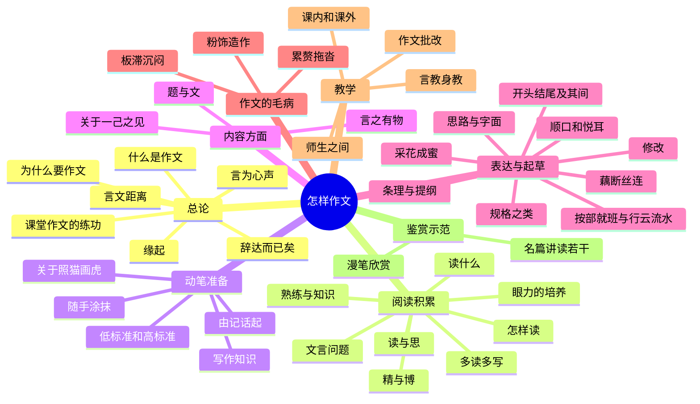

# 读书笔记 · 怎样作文——跟大师学语文（张中行著）

## 导览 · 全书脉络与书目(faithful 抽取)
- 书名 / 作者 / 译者 / 版本:《怎样作文——跟大师学语文》,张中行 著;属"跟大师学语文"丛书,中华书局(2017 年 1 月北京第 1 版)。无译者。本书是张中行对作文各个方面加以剖析和论证的随笔集,凡四十八题,语言亲切,道理平实。
- 阅读日期 / 阅读目的:(读者自填)
- 一句话总结:张中行以"愚者千虑,必有一得"的谦逊,把作文从"象牙之塔"拉到"十字街头"——先破除"作文=课堂命题作文"的框框、讲清作文是"经过构思与组织的话的书面活动",再从内容(言为心声、言之有物、一己之见)与表达(辞达、题与文、条理提纲、开头结尾、思路字面、修改)两面,配合阅读积累(多读多写、精与博、读与思、眼力培养)与教学(师生之间、批改),为作文者指明门径,并附名篇讲读示范。
- 全书结构地图(分几部分、每部分讲什么,便于回查):
  - 一、缘起与总论(一—七):缘起、什么是作文、为什么要作文、言为心声、辞达而已矣、言文距离、课堂作文的练功。
  - 二、阅读积累(八—一五):多读多写、熟练与知识、读什么、怎样读、精与博、读与思、眼力的培养、文言问题。
  - 三、动笔的准备与态度(一六—二〇):由记话起、随手涂抹、低标准和高标准、关于照猫画虎、写作知识。
  - 四、内容方面(二一—二三):言之有物、关于一己之见、题与文。
  - 五、表达与起草(二四—三二):条理与提纲、按部就班与行云流水、开头结尾及其间、思路与字面、藕断丝连、顺口和悦耳、采花成蜜、规格之类、修改。
  - 六、作文的毛病(三三—三五):粉饰造作、累赘拖沓、板滞沉闷。
  - 七、教学(三六—三九):师生之间、言教身教、课内和课外、作文批改。
  - 八、鉴赏示范(四〇—四八):漫笔欣赏一/二、读《岳阳楼记》、《游褒禅山记》读后、《记王忠肃公翱事》考实、《口技》漫谈、《黄生借书说》讲读备考、《过香积寺》讲解、《登金陵凤凰台》讲解。

## 全书大纲 · 思维导图(faithful 抽取)

## 1. 核心论点(Core Arguments)
这本书最根本的主张是什么?用 3–7 条要点概括。
- 作文不是课堂命题作文的专利,而是"把经过自己构思、自己组织的话写为书面形式的活动",范围远超课堂,在课堂之外时时处处都有;化敬畏为亲近才易教易学。(§二 什么是作文)
- 文是话的书面形式却又超过话:更精确(简练、有条理、确切)、更深远(难明之理、难表之情)、更优美;所以"学会使用它就会有大成就"。(§三 为什么要作文)
- 内容首要,"言为心声":评文章高低看内容(知识、思想感情)与表达两方面,内容以真实、通达、恳挚为尺。(§四 言为心声)
- 表达的总要求是"辞达而已矣"——能达(语言文字)与所达(心思)一致,用确切、简练、朴实的通用语言写,恰好与心里所想一模一样。(§五 辞达而已矣)
- 学作文的"灵丹妙药"是"多读多写":语言学习主要靠"熟"(习惯),理性知识是辅助,宜"熟重知轻、熟先知后"。(§八 多读多写 / §九 熟练与知识)
- 内容要"言之有物":记实、说理、抒情都须有价值——记实须确而有主从,说理须不荒谬且新颖有用,抒情须真挚健康。(§二一 言之有物)
- 表达靠"思路有条理"与"提纲":条理是思路的条理(以客观事物条理为基础),先写提纲可使思路明晰、避免缺漏轻重失宜。(§二四 条理与提纲);起草可"按部就班"(有提纲)或"行云流水"(随思路),后者更难却更自然、更能见个性。

## 2. 心智模型(Mental Models)
作者提供的、可复用的思维 / 行动框架。优先来自书里标志性的比喻或结构。
- "象牙之塔→十字街头"模型:把作文由敬畏的课堂专利拉回日常书写(便条、书信、日记皆作文),减少胶柱鼓瑟,思路才灵活奔放。(§二 什么是作文)
- "文超乎话"三维模型:精确(简练/有条理/确切)、深远(难明之理、难表之情)、优美——以此解释为何要作文。(§三 为什么要作文)
- "真实/通达/恳挚"三标尺模型:评价内容好坏的三个维度,虚假、陈腐愚昧、轻薄分别为其反面。(§四 言为心声)
- "辞达=信+达"模型:信=书面与心里所想一致;达=受者一见即明。写的同想的一模一样,即"增之一分则太长,减之一分则太赤"。(§五 辞达而已矣)
- "多读多写→熟"模型:学语言主要学"习惯"而非"理";熟读使可用表达框架蜂拥而至,随手拈来;多写整理并巩固思路。(§八 多读多写)
- "熟重知轻、熟先知后"模型:理性知识(语法修辞)是辅助,不宜喧宾夺主;宜在语言大致通了之后借理性认识使之更严密。(§九 熟练与知识)
- "精与博融合"模型:以可取法者为本精读(由喜爱而重复、由理解而感情渗入),并据本向外博览,文思泉源主要由此中来。(§一二 精与博)
- "提纲/行云流水"双模:先写提纲=按部就班(减失误、易动笔);不写提纲、随思路=行云流水(灵活、自然、见个性,但难,须长期练习)。(§二四—二五)

## 3. 论证证据(Evidence)
支撑上述论点的关键例子、原书引文、数据。标注出处章节以便回查。
- "作文,不过是把经过自己构思、自己组织的话写为书面形式的一种活动。"并举例:司马光等写《资治通鉴》近三百卷是作文,《红楼梦》凤姐"一夜北风紧"五个字也是作文。(§二 什么是作文)
- "言之无文,行而不远"(《左传》引孔子),发挥为:写下来能打破空间(千里外、全世界)与时间(千百年后)的限制。(§三 为什么要作文)
- 以《史记》与《韩非子》《论衡》对比:内容表达协调与否不同——孟子协调、韩非子思想差而文好、论衡思想高而文差,示"内容与表达不可偏废"。(§四 言为心声)
- 严复译《天演论》"译事三难:信、达、雅",作者撇开"雅"只留信与达,分析"辞达"即能达与所达一致。(§五 辞达而已矣)
- "千古文章一大抄"——就"读他人文章以学习表达"说有道理;多读熟了,笔未着纸可用框架已蜂拥而至。(§八 多读多写)
- 小孩子学话"不上课堂、不查词典……绝不会把'坐车'说成'车坐'",证语言学习靠"熟"而非语法分析。(§九 熟练与知识)
- 读《史记·项羽本纪》"太史公曰"与鲁迅《呐喊·自序》,作者由喜爱而重复背诵、由理解而感情渗入,成精读两例。(§一二 精与博)
- 元好问《市隐斋记》依通例应颂扬却偏讽刺市隐乃假清高,是"正题反作"出于心声而成名文。(§二三 题与文)

## 4. 反例边界(Counterexamples / Boundaries)
作者自己承认的例外、明确说"不适用于"的情形、或你读出的适用边界。
- 并非所有书写都算作文:抄杜牧诗《山行》、填固定格式报表、思路不清的"很不像话"都不算——须经过自己构思与组织。(§二 什么是作文)
- "文不文与篇幅长短无关",便条写得简练明白得体同样是优秀;不当因体裁篇幅分高下。(§二 什么是作文)
- 小说、戏剧是创作,其"真实"可名之为"艺术的真实",性质不同,须另作处理。(§四 言为心声)
- 学语言"死背办法往矣";但以知统熟、以知代熟(只分析语句结构而放松多读多写)效果并不好,因语法规律容许例外、常不能判定具体对错。(§九 熟练与知识)
- 理性知识"知是辅助力量,不宜于喧宾夺主";司马迁、鲁迅都没学过语法,却因精熟而心中有清清楚楚的法。(§九 熟练与知识)
- "按部就班"非绝对原则:不少大作家大作品(如鲁迅杂感、《阿Q正传》)下笔前并无提纲;篇幅短、抒情随感、日用文字通常不写提纲。(§二五 按部就班与行云流水)
- 文言"一般不要求能写",只在日记、信札等"足不出户"处偶一为之未可厚非;说话写作经常仍须用现代汉语。(§十 行文借鉴,本书体系内)

## 金句摘录(Quotable Lines)—— faithful 抽取
写推文 / 笔记时最想直接抄的原句。每条附出处章节。
- "所谓作文,不过是把经过自己构思、自己组织的话写为书面形式的一种活动。"(§二 什么是作文)
- "文是话的书面形式,却又超过话的书面形式;它有大本领,有大成就。"(§三 为什么要作文)
- "作文,评高分,先要内容好……内容是首要的,但过分强调,至少就谈论作文说,也许会产生轻视表达的偏向,所以不如用个不左右袒的圆通说法,二者不可偏废。"(§四 言为心声)
- "辞达而已矣……能达与所达一致,换句话说,语言文字所表达的与心里想的一模一样。"(§五 辞达而已矣)
- "学作文的灵丹妙药……是'多读多写'。"(§八 多读多写)
- "功到也许是个笨办法;不过,如果笨办法确是有效,那我们还是把它看作灵丹妙药的好,虽然这药不是速效的。"(§八 多读多写)
- "知是辅助力量,不宜于喧宾夺主。"(§九 熟练与知识)
- "初学作文,常见的一个缺点是没有内容,即言之无物……补救之道是学习历代的名射手,要箭不虚发。"(§二一 言之有物)

## 5. 与我连接(Connections)—— 以下为通用示例,读者按自己情况改写
它和我已有的知识 / 项目 / 习惯有什么关系?
- 我写文档/周报常陷"无话可说":可用"由记话起/随手涂抹"先放开写,再"以提纲收束",把日常所想当作文素材。
- 我做 PPT/汇报本质是"表达",可对照"辞达=信+达":先确认写的是否与想的完全一致,再求读者一见即明。
- 我读专业书常"读而不思":可用"读与思"的聚集—比较—验证—推衍—融会五步,把外来知识化为自己的思路。
- 我改自己文章总舍不得删:可用"修改=整理思路"模型,把"可不说而写上的"删去、"次序混乱"的调整。

## 6. 可执行下一步(Actionable Next Steps)—— 以下为通用示例,读者按自己情况改写
基于这本书,我具体能做的一件小事?
- [ ] 接下来一周,每天就真实经验写一段"随手涂抹"的短文字,不命题、不修饰。
- [ ] 下次写正式文档前,先用"细目式提纲"写明开头、要点、转折、收束,再动笔。
- [ ] 选一本可资取法的书(如《史记》选或鲁迅杂感),用"由喜爱而重复、由理解而感情渗入"法精读一篇并背诵。
- [ ] 把最近一篇习作按"真实/通达/恳挚"三标尺自评,标出哪条不达标并重写。

## 7. 未解问题(Open Questions)—— 以下为通用示例,读者按自己情况改写
我哪里不同意?还想追问什么?
- 作者主张"多读多写"是笨办法却最有效,但今天信息过载,怎样在"多"与"精"之间不沦为低效的苦读?
- "辞达而已矣"以"通用普通话"为达的标准,那么方言写作、刻意陌生化的文学表达是否被不当贬低?
- 书中把语法知识定为"辅助、不宜喧宾夺主",但在对外汉语/少儿启蒙等场景,结构化知识是否可能权重更高?

## 评价与适合人群(Verdict)—— 综合
- 总体评分(1–10)/ 一句话总体评价:9 / 一位与语文打了半个多世纪交行的行家,把作文的门径拆成四十八个平易亲切的题目,既破框框又给路径,是作文通识读物里的"老辈谈心"之作。
- 适合谁读:中学生与语文教师、写作初学者、想系统理清"内容—表达—阅读积累"关系的写作者、做文档/文案需要打底的人。
- 不适合谁 / 局限性:想找纯文学创作灵感或前沿写作理论的人会觉得偏传统;部分篇目(文言问题、八股提及、1980–90 年代语境)已随时代变迁,需读者自行转换;四十八题随笔体,体系性不如教材式写作指南。
- 延伸阅读 / 与已读其他书的对照:同作者《怎样学习文言文》;丛书中叶圣陶《怎样写作》《语文随笔》、夏丏尊叶圣陶《文话七十二讲》《文章讲话》,可互为补充构成"跟大师学语文"写作方法论体系。

## 本书提及书单(Books Mentioned)—— faithful 抽取
本书正文 / 注释中引用、提及的其他书目。用表格呈现(书名 / 作者 / 简介),挑重点、去重,8–15 条为宜;简介一句话说明该书与本主题的关系或核心内容。
| 书名 | 作者 | 简介 |
| --- | --- | --- |
| 《文章作法》 | 夏丏尊、刘薰宇 | 同属"跟大师学语文"系列,分体裁讲作法基础,与本书参照。 |
| 《文章讲话》 | 夏丏尊、叶圣陶 | 同系列,专论文章组织与修辞,书中呼应。 |
| 《文话七十二讲》 | 夏丏尊、叶圣陶 | 同系列,系统讲读写知识,书中提及。 |
| 《文心》 | 夏丏尊、叶圣陶 | 同系列,故事体讲国文读写,书中并列推荐。 |
| 《怎样写作》 | 叶圣陶 | 同系列姊妹篇,讲写作方法,书中对照。 |
| 《语文随笔》 | 叶圣陶 | 同系列语文随笔集,书中并列提及。 |
| 《国文百八课》 | 夏丏尊、叶圣陶 | 同系列国文教材,书中提及。 |
| 《文心雕龙》 | 刘勰 | 古代文论名著,书中论作文法度与章句时引证。 |
| 《人间词话》 | 王国维 | 词学批评名著,书中论鉴赏与行文时提及。 |
| 《文选》 | 萧统 编 | 文章总集,书中引其篇目为范文。 |
| 《史记》 | 司马迁 | 纪传体史书,书中引其文讲叙事笔法。 |
| 《岳阳楼记》 | 范仲淹 | 宋文名篇,书中引为行文布局与议论范例。 |
| 《滕王阁序》 | 王勃 | 骈文名篇,书中讲对仗、用典时提及。 |
| 《红楼梦》 | 曹雪芹 | 古典小说,书中论描写与对话时引例。 |
| 《朝花夕拾》 | 鲁迅 | 鲁迅散文集,书中引《从百草园到三味书屋》《阿长与〈山海经〉》等为例。 |
