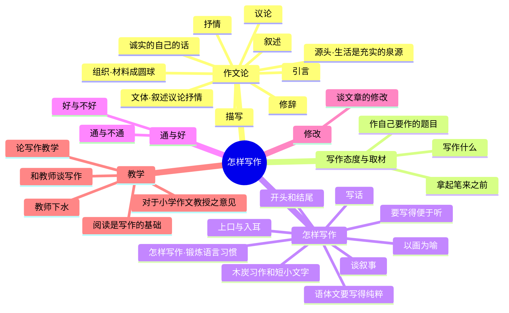

# 读书笔记 · 怎样写作（跟大师学语文）叶圣陶

## 导览 · 全书脉络与书目(faithful 抽取)
- 书名 / 作者 / 译者 / 版本:《怎样写作（跟大师学语文）》,叶圣陶 著;属"跟大师学语文"丛书,中华书局。无译者。本书为叶圣陶有关写作的文章专集,共收录二十一篇长短文字。
- 阅读日期 / 阅读目的:(读者自填)
- 一句话总结:叶圣陶以二十一年写作经验与教学心得,把"怎样写得通、写得诚实而精密"拆成可逐一留意的题目——从作文的本质(诚实、生活为源头、组织成圆球)、到动笔前的准备(观察、认识、推理、正确语言习惯)、到具体写法(写作什么、作自己要作的题目、开头结尾、谈叙事、写话、通与不通、好与不好、修改),再到教学(阅读是写作的基础、教师下水),系统讲清写作成功的诀窍与失败的根源。
- 全书结构地图(分几部分、每部分讲什么,便于回查):
  - 一、写作总论(作文论):引言、诚实的自己的话、源头、组织、文体、叙述、议论、抒情、描写、修辞——系统论述作文的原料与法度。
  - 二、写作态度与取材:写作什么(以经验为范围)、作自己要作的题目(文在题先、课外多作)、拿起笔来之前(实际生活与语言习惯的准备)。
  - 三、怎样写作(技术):怎样写作(锻炼语言习惯)、开头和结尾、谈叙事、以画为喻、木炭习作和短小文字、语体文要写得纯粹、写话、要写得便于听、"上口"和"入耳"。
  - 四、通与好(评判标准):"通"与"不通"、"好"与"不好"。
  - 五、修改:谈文章的修改。
  - 六、教学相关:和教师谈写作、论写作教学、阅读是写作的基础、"教师下水"、对于小学作文教授之意见。

## 全书大纲 · 思维导图(faithful 抽取)

## 1. 核心论点(Core Arguments)
这本书最根本的主张是什么?用 3–7 条要点概括。
- 写作的原料是思想、情感,而原料须合理、完好;作文=获得完美原料(诚实的生活)+ 把原料写作成文字,二者缺一不可,且须兼论。(§作文论 引言)
- "我们试问自己,最爱说的是哪一类的话?这可以立刻回答,我们爱说必要说的与欢喜说的话。"作文要写"诚实的自己的话",不虚伪、不浮夸、不玩戏。(§二 诚实的自己的话)
- 诚实的话来自源头——充实的生活;生活充实,情思自然倾注,"必须寻到源头,方有清甘的水喝"。(§三 源头)
- 既经组织,材料方是实在的、可写下来的;组织是把材料剪裁、排次成"圆球"(各部环拱中心、密合无间),是写作的第一步工夫。(§四 组织)
- 写作材料应以自己的经验为范围,经验须深切、正确,并加洗炼;作文是极寻常(人人要写)又极严正(不能超出经验)的事。(§写作什么)
- "通"=词使用得适合、篇章组织得调顺;"好"=诚实(内面怎样想怎样感笔下便怎样写)且精密(深至地发见、不漏失本真)。(§通与不通 / 好与不好)
- 阅读是写作的基础:老师教得好、学生读得好,才写得好;写作基于阅读,须"不需要教"地养成能力。(§阅读是写作的基础)

## 2. 心智模型(Mental Models)
作者提供的、可复用的思维 / 行动框架。优先来自书里标志性的比喻或结构。
- 源头—泉水模型:生活是写作的源头,充实的生活(阅历广、推断方法、情性丰厚)才倾注出真实的水;干涸的源头写不出真实的话。(§三 源头)
- 圆球模型:组织到完成的地步,材料须组成"圆球"——有一个中心,各部向中心环拱、密合无间、不容更动;先列材料、剪裁、排次,制定全篇纲要。(§四 组织)
- 文体三分模型:文字分叙述(客观事物,传述)、议论(作者见解,表示)、抒情(作者情感,发抒)三类;看全篇总旨定类,单篇常兼具数类性质。(§五 文体)
- 语言—文章同源模型:"语言是有声无形的文章,文章是有形无声的语言";文章同说话一样,是把"线"(语言文字)表"球"(浑凝的意思情感),故锻炼语言习惯是根源办法。(§怎样写作)
- 写话—上口标准:语体文要"写话",标准是"上口不上口";通篇上口的文章念出来就是一番话,可念亦可听。(§语体文要写得纯粹 / 写话 / 上口与入耳)
- 修改=修改思想模型:"写文章就是说话,也就是想心思",修改文章其实是修改思想,要它想得更正确更完美;思想是脑子里在说话,清明思想即有条有理的语言。(§谈文章的修改)
- 教师下水模型:教游泳要熟谙水性跳下水示范;语文老师常动笔("下水"),才深知作文甘苦,能给学生最切用的引导。(§教师下水)

## 3. 论证证据(Evidence)
支撑上述论点的关键例子、原书引文、数据。标注出处章节以便回查。
- "作文与说话本是同一目的,只是所用的工具不同而已。所以在说话的经验里可以得到作文的启示。"(§二 诚实的自己的话)
- "生活的充实是没有止境的……若说要待充实到极度之后才得作文,则这个时期将永远不会来到。而写作的欲望却是时时会萌生的。"——故作文原是生活的一部份,生活充实到某程度自然要说某种话。(§三 源头)
- 刘勰"方其搦翰,气倍辞前;暨乎篇成,半折心始"——解释成篇后不如初想,一在材料空浮,一在表达未得其道,故须组织。(§四 组织)
- "凡是贤明的国文教师,他出的题目应当不超出学生的经验范围……学生同写一封信、作一篇游记一样,仍然是为着发表自己的经验而写作。"(§写作什么)
- "拿起笔来之前"之喻:"语言好比通货,通货不能各人发各人的,必须是大家公认的通货才有价值"——正确的语言习惯须合约定俗成。(§拿起笔来之前)
- 评"好与不好":"杜甫的感慨悲凉的诗是'好'的,陶渊明的闲适自足的诗是'好'的,正因为他们所作各与他们的思想、性情、环境等一致,具有充分的'诚实'。"(§好与不好)
- 柳宗元《小石潭记》"潭中鱼可百许头,皆若空游无所依……"——"能传潭鱼的神"即"精密",故为好文字。(§好与不好)
- "阅读是写作的基础……老师教得好,学生读得好,才写得好。"写作不能只靠"怎样作文"一类书。(§阅读是写作的基础)

## 4. 反例边界(Counterexamples / Boundaries)
作者自己承认的例外、明确说"不适用于"的情形、或你读出的适用边界。
- 纯单一性质的文章"不能说没有,可是很少见";实际一篇普通文往往含两种以上性质,或以某成份较多而定类。(§五 文体)
- "通"只就文字而言,假定内面的思想情感没有什么毛病;但"思想情感方面的毛病尤其要避免"——如"中国的不强皆由于鸦片/赌博"之类,根子在生活内容不充实。(§通与不通)
- 有人主张写文章只该顺其自然、不在一字一语小节上留意,否则"像个规矩人,缺乏活力";作者说"不能一概而论",学习写作的人不该以此纵容马虎。(§谈文章的修改)
- "好与不好"若转到写作者观点,并不能因"不诚实也能写好文"的阅读观点宽恕自己;虚构描叙须"观察得周至"才是另一意义的诚实。(§好与不好)
- 大作家技术纯熟,能在意念中组织甚至"腹稿""宿构",并非不须组织;初学不可误以为"纯任机缘便成妙文"。(§四 组织)
- 文言与语体:"我们既是现代人……能写语体,已经有了最便利的工具,为什么还要去学一种不切实用的文言?"除升学考试等不得已,实无学文言必要。(§怎样写作)

## 金句摘录(Quotable Lines)—— faithful 抽取
写推文 / 笔记时最想直接抄的原句。每条附出处章节。
- "我们试问自己,最爱说的是哪一类的话?这可以立刻回答,我们爱说必要说的与欢喜说的话。"(§二 诚实的自己的话)
- "生活充实到什么程度,才会做成什么文字。"(§三 源头)
- "必须寻到源头,方有清甘的水喝。"(§三 源头)
- "经过组织的材料就譬如建筑的图样,依着兴筑,没有不成恰如图样所示的屋宇的。"(§四 组织)
- "'词'使用得适合,'篇章'组织得调顺,便是'通'。"(§通与不通)
- "在写作上,'诚实'是'有什么说什么',或者是'内面怎样想怎样感,笔下便怎样写'。"(§好与不好)
- "凡是文章须有中心思想……他们就彷佛跟作者一块儿想过考虑过,到他们自己作文的时候……也比较容易抓住中心思想了。"(§阅读是写作的基础)
- "语文老师教学生作文,要是老师自己经常动动笔……就能更有效地帮助学生,加快学生的进步。"(§教师下水)

## 5. 与我连接(Connections)—— 以下为通用示例,读者按自己情况改写
它和我已有的知识 / 项目 / 习惯有什么关系?
- 我写文档/周报常只堆事实而缺"组织":可用"圆球模型"先定中心、再剪裁排次,制定一个全篇纲要再动笔。
- 我的"通与不通"常出在语言习惯:可用"上口"标准,把写好的文字念一遍,凡念不顺处即不通处。
- 我做产品说明、需求文档本质是"说明/议论",可对照"诚实+精密"两条,检查是否写了自己并未真信、或流于"桃红柳绿"的粗疏。
- 我和同事争论方案是"议论文",可借"叙述是议论的基本"提醒自己先把客观事实说清楚,再下判断。

## 6. 可执行下一步(Actionable Next Steps)—— 以下为通用示例,读者按自己情况改写
基于这本书,我具体能做的一件小事?
- [ ] 下次动笔前,先用一句话写出"中心",再列 3–5 条材料并排次序,做成细目式提纲。
- [ ] 把最近一篇自己写的文字念出声,标出所有"不上口"的句子并改写。
- [ ] 连续一周,每天就自己真实经验写一段"短小文字"(木炭习作),不虚构、不模仿腔调。
- [ ] 读一篇文章时刻意找它的"中心"与"组织",仿《阅读是写作的基础》说的"跟作者一块儿想"。

## 7. 未解问题(Open Questions)—— 以下为通用示例,读者按自己情况改写
我哪里不同意?还想追问什么?
- 书中把"普通文与文学"界限说得很模糊、主张不必分,今天网络短文、多模态表达下,这个"不分"是否仍能成立?
- "生活充实自然会写"对专业写作者成立,但对需要定期产出、题材受限(如公文、技术文档)的人,如何补上"原料"缺口?
- "好=诚实+精密"高度依赖作者真诚;若训练学生只求"通"与"好",会不会反而压抑必要的想象与虚构训练?

## 评价与适合人群(Verdict)—— 综合
- 总体评分(1–10)/ 一句话总体评价:9 / 把"为何写、写什么、怎样写、怎样算通与好、怎样改、怎样教"讲成一条清澈的写作教学脉络,平实可操作,是中文写作入门的标杆性读物。
- 适合谁读:中学生与语文教师、写作初学者、想系统理清"通/好/组织/文体"等基本概念的人、做文档/运营文案需要打底的人。
- 不适合谁 / 局限性:想找文学性创作灵感或纯文学赏析的人会觉得偏"工具理性";部分语境(书信敬语、文言/语体对照、1930–50 年代语境)已随时代变迁,需读者自行转换。
- 延伸阅读 / 与已读其他书的对照:同作者《文心》《语文随笔》《文章讲话》;可与《怎样学习文言文》《怎样作文》(张中行)、《文话七十二讲》(夏丏尊、叶圣陶)互为补充,构成"跟大师学语文"丛书的写作方法论体系。
