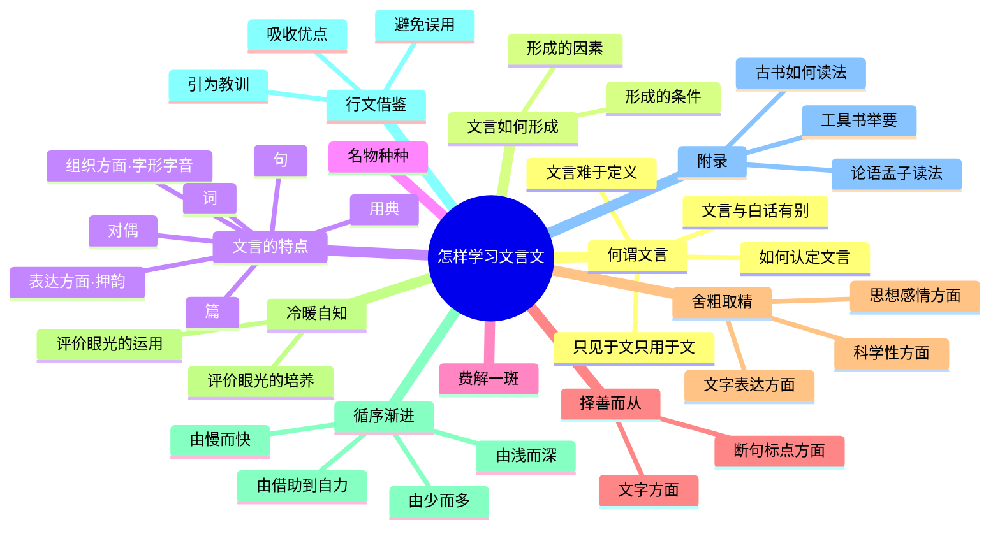

# 读书笔记 · 怎样学习文言文（跟大师学语文）张中行

## 导览 · 全书脉络与书目(faithful 抽取)
- 书名 / 作者 / 译者 / 版本:《怎样学习文言文（跟大师学语文）》,张中行 著;属"跟大师学语文"丛书,中华书局(2017 年 1 月北京第 1 版)。无译者。本书文章成书于上世纪八十年代,张中行以其五十余年从事语文教学及编辑工作的学养写成。
- 阅读日期 / 阅读目的:(读者自填)
- 一句话总结:张中行以"障碍跑运动员指点后来者过障碍"的亲切笔调,先讲清文言是什么、怎么形成、有何特点(字形字音词句篇、押韵对偶用典)、有哪些名物与费解处,再给出学文言的门径——择善而从、舍粗取精、冷暖自知、循序渐进、行文借鉴,为初学文言者一一道破困难并指明克服之法。
- 全书结构地图(分几部分、每部分讲什么,便于回查):
  - 一、认识文言(第一—三章):何谓文言(与白话有别、难于定义、如何认定、只见于文只用于文)、文言如何形成(条件与因素)、文言的特点(组织方面字形字音词句篇、表达方面押韵对偶用典)。
  - 二、文言的疑难(第四—五章):名物种种、费解一斑。
  - 三、学文言的门径(第六—十章):择善而从(文字/断句/解释取舍)、舍粗取精(读物与版本选择、精华糟粕分辨)、冷暖自知(评价眼光的培养与运用)、循序渐进(由浅入深、由少而多、由慢而快、由借助到自力)、行文借鉴(现代文如何取文言之长、避其之短)。
  - 四、附录:工具书举要、古书如何读法(胡怀琛)、论语孟子读法(梁启超)。

## 全书大纲 · 思维导图(faithful 抽取)

## 1. 核心论点(Core Arguments)
这本书最根本的主张是什么?用 3–7 条要点概括。
- 文言是"只见于文、只用于文的语言",它以战国到两汉作品为标本,是一套相当严格的、基本不随时间与地域而变的词汇句法系统;不能简单地用"脱离口语"或"不同于现代语"来定义。(§第一、三章)
- 文言的形成是书面语逐渐离开口语的历程,根本推动力是"汉字不随口语变";文人笔下学书面语、求典雅,加上文趋精简、文的惰性,终使文言成形并经久不衰。(§第二章)
- 文言的积极价值在于"打破时空限制的优越性"——通文的人无论方言、时代相隔多远都能读懂,故能"行远"且传后。(§第二章 七)
- 学文言要"择善而从":讲读遇到不同版本、不同标点、不同解释,要辨明是非、分别好坏、选取一种而放弃另一种。(§第六章)
- 典籍浩如烟海,要"舍粗取精":分辨思想感情、科学性、文字表达三方面的精华与糟粕,取其精华而舍其糟粕。(§第七章)
- 提高要靠"冷暖自知":培养自己的评价眼光(由感性到理性、参考他人尤其相反意见、不长期停留于感性),自己辨别方向才能事半功倍。(§第八章)
- 学习须"循序渐进":由浅而深、由少而多、由慢而快、由借助(教师/注解/辞书)到自力;并先今而后古、先记事而后说理、先散体而后辞赋骈体、先选本而后全集、先今注而后古注。(§第九章)

## 2. 心智模型(Mental Models)
作者提供的、可复用的思维 / 行动框架。优先来自书里标志性的比喻或结构。
- "障碍跑"模型:学文言如障碍跑,作者是有经验的运动员,指点后来者怎样通过花样繁多的重重障碍。(§出版说明/全书立意)
- "标本"模型:文言以战国到两汉作品为标本(文必秦汉),凡笔下不纯者,可分辨哪部分是文言、哪部分"跑了野马"成白话。(§三 如何认定)
- "京剧角色穿戴"模型:文言白话各有独占性的词汇句法,像京剧角色穿戴表现主人身份,一望而知;(文言的)词汇句法系统如旦角服装——可穿青衣或红挂绿,绝不许穿生角净角的长袍,灵活性只在系统之内。(§一 / 二)
- "龟兔竞走"模型:口语如兔跳跃向前,书面语如龟在原地慢爬,二者距离渐大,文言成形后原地踏步而成另一套语言。(§二 文的惰性)
- "舍粗取精"三分类模型:糟粕分思想感情方面、科学性方面、文字表达方面三类,逐一举例识别。(§第七章)
- "评价眼光"模型:读一首诗觉得"真好"却说不出,是初步冷暖自知(偏感性);要进一步能说"为什么好",使感性系统化、理论化,才是理性的评价眼光。(§第八章)
- "循序渐进"四维模型:由浅而深、由少而多、由慢而快、由借助到自力;并给出"读什么"的七条先后的具体建议。(§第九章)

## 3. 论证证据(Evidence)
支撑上述论点的关键例子、原书引文、数据。标注出处章节以便回查。
- 以独占性词汇句法辨文言白话:欧阳修《丰乐亭记》"按其图记"之"按"白话不用、"还了房宿钱"之"还"文言不用;虚词表完成文言用"矣"不用"了"——故"文言和白话的界限总是泾渭分明的"。(§一 文言与白话有别)
- 《尚书·汤誓》《论语·为政》记言近口语却仍被公认为文言,说明"脱离当时口语"作定义有例外,不能成定义。(§二 以脱离口语为标准有例外)
- 《史记》引《论语》几乎照抄、《岳阳楼记》"微斯人吾谁与归"同《论语》"微管仲"模式、郑板桥"吾其长为农夫以没世乎"同杨恽模式——证文言"不随时间变"。(§二 系统不随时间变)
- 司马相如《上书谏猎》与杨恽《报孙会宗书》对比:宁可势利气重,作者更喜后者直写苦闷志趣,因"耿介或近于耿介的行径是好的"——示评价眼光之运用。(§八 冷暖自知)
- 韩愈《祭鳄鱼文》新旧《唐书》皆收、后人捧为"近于六经",作者却撇开传统,认为远不如《祭十二郎文》出于至性、"语句中含有泪水"。(§八 冷暖自知)
- 成语误用例:"公诸于世"(诸=之于,重复)、"凯旋而归"(旋已含归)、"按步就班"(当作按部就班)、"固步自封"(当作故步自封)——示熟悉文言可避免现代文误用。(§十 避免误用)
- 张中行评顾炎武平实少疵、龚自珍诘屈聱牙:"自然比造作好"——其理为评价尺度之一。(§八 冷暖自知)

## 4. 反例边界(Counterexamples / Boundaries)
作者自己承认的例外、明确说"不适用于"的情形、或你读出的适用边界。
- 文言与白话"通常泾渭分明,但不是处处如此";吕叔湘举十二段文字,有些半文半白、算文算白都有困难。(§一 文言与白话有别)
- "脱离口语"作文言定义有例外:《尚书》《论语》之类并不脱离当时口语,却仍被公认为文言;且古白话(敦煌变文、景德传灯录)虽不全通仍被承认是白话。(§二)
- 文言系统之内允许灵活性(如"走"指跑、"贫"指穷,不能用"穷""猪"),但"只能在系统之内变,不能闯到系统之外"。(§三 文言有严格词汇句法系统)
- 骈文、格律诗、词是文言"爱美的子孙",主要在声音方面精雕细琢,词汇句法仍在旧系统内,故同样算文言。(§三 求美的子孙仍是文言)
- 学文言"一般不要求能写",只为阅读、通晓历史文化、吸收积极成分、欣赏作品、把写作优点融于现代文;若硬要写,也只在日记信札等"足不出户"处。(§十 行文借鉴)
- "循序渐进"之"由浅而深"难绝对:宋《近思录》反比《论语》难读,《左传》反比《孟子》难读——任何概括论断都有例外,只能信任自己的感触。(§九 由浅而深)

## 金句摘录(Quotable Lines)—— faithful 抽取
写推文 / 笔记时最想直接抄的原句。每条附出处章节。
- "文言,像其他事物一样,长成或制成以后要具备某些条件……一是有相当严格的统一的词汇句法系统,二是这系统基本上不随时间的移动而变化,三是这系统基本上不随地域的不同而变化。"(§二 文言形成的条件)
- "文言是有文,所以能够行远。这'远',当时大概是指空间,我们现在还要给它加上一项内容,时间。"(§二 文言有不受时空限制的优越性)
- "文言这个系统就是这样,它定了形,就可以不随地域的不同而变化。"(§二 系统不随地域变)
- "我们不只要重视(前人的评论),还要把它看作培养眼光的课本,不停止于记住论断,要更向前,学习前人所以作出此种论断的理论和方法。"(§八 冷暖自知)
- "前人评论……甲、乙的意见打架。打架不能都对,在长短得失的衡量中,我们更容易把分辨的能力提高一步。"(§八 冷暖自知)
- "借鉴,要取其神而遗其形;或者偶尔采用少数词语……要把来自文言的东西'融会'到自己的笔下,而不是'搀杂'在自己的文章里。"(§十 行文借鉴)
- "自然比造作好。"(§八 冷暖自知,评顾文与龚文)

## 5. 与我连接(Connections)—— 以下为通用示例,读者按自己情况改写
它和我已有的知识 / 项目 / 习惯有什么关系?
- 我读古文常卡在"一词多义/通假",可用"标本+系统之内变"的思路:先确认该词属文言系统哪一义项,再判断此处是否通假。
- 我做文献摘录/读书笔记,可借"舍粗取精三分类":读到古人的思想偏见、科学谬误、文字造作时,明确标注是哪一类糟粕,避免照单全收。
- 我写现代文爱掉书袋,可对照"融会而非搀杂"标准,把念不顺的文白搀杂句子改掉。
- 我学任何新领域都可用"由借助到自力"四步:先靠老师/注解/工具书,逐步撤拐杖。

## 6. 可执行下一步(Actionable Next Steps)—— 以下为通用示例,读者按自己情况改写
基于这本书,我具体能做的一件小事?
- [ ] 挑一篇短古文(如《项脊轩志》),用"择善而从"法比对两个版本异文,判断孰优孰误并写一句理由。
- [ ] 建立自己的"糟粕三分类"标记法:读古籍时遇到思想/科学/文字三类问题各记一例。
- [ ] 用"评价眼光"模型重读一首熟悉的古诗,逼自己写出"为什么好"的三条根据,不止于"真好"。
- [ ] 按"先今注后古注、先选本后全集"的顺序,给接下来半年的文言阅读排一个书单。

## 7. 未解问题(Open Questions)—— 以下为通用示例,读者按自己情况改写
我哪里不同意?还想追问什么?
- 作者说学文言"一般不要求能写",但今天高考/职称仍考文言句式,这种"不要求写"是否过于理想化?
- "以战国两汉为标本"的认定法,对先秦金文、《诗经》等更早文献是否仍能自洽?
- 书中强调"冷暖自知"靠多读多比较,但初学者缺乏对照样本时,会不会把错误读法固化成"自己的眼光"?

## 评价与适合人群(Verdict)—— 综合
- 总体评分(1–10)/ 一句话总体评价:9 / 把"文言是什么、怎么来的、难在哪儿、怎样学"讲得既严谨又平易,像一位老教练陪你跑障碍赛,是文言入门最体贴的向导。
- 适合谁读:初学文言的中学生与大学生、语文教师、古典文学爱好者、想系统弄清"文言/白话/古汉语"区别的人。
- 不适合谁 / 局限性:已有相当文言功力、想深入训诂考据的人会觉得偏入门;部分例子与 1980 年代出版语境相关,个别字形/版本举例已随新整理本变化,需读者自行更新。
- 延伸阅读 / 与已读其他书的对照:同作者《怎样作文》;丛书中叶圣陶《怎样写作》《语文随笔》、夏丏尊叶圣陶《文话七十二讲》《文章讲话》;工具书可参本书附录《工具书举要》及王力《古代汉语》。
