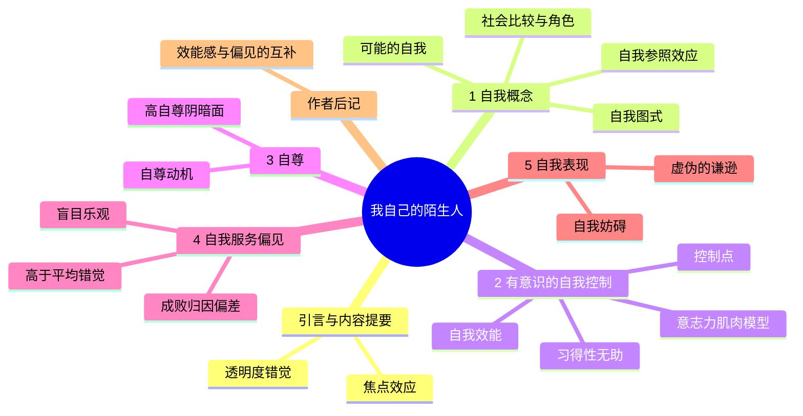

# 读书笔记 ·《我自己的陌生人》

## 导览 · 全书脉络与书目(faithful 抽取)

- **书名** / **作者** / **译者** / **版本**:
  - 书名:我自己的陌生人
  - 作者:戴维·迈尔斯(David Myers)原著《社会心理学》的改编普及本;编者后记署名"刘力",由新曲线公司策划出品。
  - 译者:本改编本未单列译者署名(原著名中译本由侯玉波等译)。
  - 版本:新曲线改编普及本(正文未载具体出版社与出版年;据编者后记由新曲线公司策划)。
- **阅读日期** / **阅读目的**:(留空,读者自填)
- **一句话总结**:我们常以为最了解自己,却屡屡在"焦点效应、自我服务偏见、自我表现"中成了"自己最熟悉的陌生人"——本书用社会心理学五条主线,拆解"自我"这台既中心又不可靠的机器。
- **全书结构地图**(分几部分、每部分讲什么,便于回查):
  - 内容提要 + 引言:提出"自我"是心理学最热门主题,引出焦点效应、透明度错觉。
  - 第 1 章 自我概念:自我图式、自我参照效应、可能的自我,以及角色/社会同一性/社会比较/成败/他人评价/文化如何塑造自我。
  - 第 2 章 有意识的自我控制:意志力"肌肉模型"、自我效能(班杜拉)、控制点(罗特)、习得性无助。
  - 第 3 章 自尊:自尊的动机、维持机制,以及高自尊的阴暗面。
  - 第 4 章 自我服务偏见:成败归因偏差、"高于平均" illusion、盲目乐观。
  - 第 5 章 自我表现:虚伪的谦逊、自我妨碍。
  - 作者后记 + 编者后记:自我效能感与自我服务偏见是一对互补的相反事实。

## 全书大纲 · 思维导图(faithful 抽取)

## 1. 核心论点(Core Arguments)

- 我们对自己感觉和预测经常出错,无意中成了"自己最熟悉的陌生人";自我处于我们世界的核心,却常被焦点效应与透明度错觉放大。
- 自我概念由**自我图式**、**自我参照效应**、**可能的自我**构成,并受角色、社会同一性、社会比较、成败、他人评价、文化七类经验塑造。
- 有意识的自我控制(意志力)是有限的"肌肉":用后虚弱、休息可补、练习可强;**自我效能**与**内控点**显著提升成就与心理韧性,反之则陷入**习得性无助**。
- 自尊既有适应性(主动、乐观、愉快),也有阴暗面:高自尊受威胁时更具攻击性与报复性,且黑帮、极端种族主义者、恐怖分子同样可有高自尊。
- **自我服务偏见**普遍存在:成功归己、失败归外;多数人认为自己高于平均;对负面事件盲目乐观。
- 自我表现层面,人们用**虚伪的谦逊**与**自我妨碍**来保护公众形象与自尊,对外展示的自我常与内心感受不同。
- 作者后记的元结论:自我效能感(积极面)与自我服务偏见(傲慢面)是一对互补的"相反事实",任一单独真理都不充分(帕斯卡尔)。

## 2. 心智模型(Mental Models)

- **焦点效应 / 透明度错觉**:我们高估别人对自己的关注与对自己情绪的察觉——何时用:解释"社死焦虑""怕出丑"时。
- **自我图式 / 自我参照效应**:与自我有关的信息加工更快、记忆更好——何时用:理解为何我们更易记住"与自己相关"的事。
- **意志力"肌肉模型"(鲍迈斯特)**:自我控制有限、可耗竭、可训练——何时用:安排高强度自律任务时预留恢复。
- **控制点(罗特)**:内控(命运在自己)vs 外控(环境决定)——何时用:分析一个人面对挫折的解释风格。
- **自尊"油量表"比喻(利里)**:自尊像汽车油量表,遭社会拒绝时亮灯警示——何时用:理解被排斥后的补偿行为。
- **自我服务偏见 / 盲目乐观**:系统性归因偏差模型——何时用:复盘"为什么大家都觉得自己高于平均"。
- **自我妨碍 / 虚伪谦逊**:印象管理策略——何时用:识别"故意拖到考前才学""公开夸对手"等行为。

## 3. 论证证据(Evidence)

- 吉洛维奇等:让康奈尔学生穿 Barry Manilow T 恤进屋,学生猜约一半人注意,实际仅 23%(§引言)。
- 班廷与麦克劳德因发现胰岛素共获诺奖,却互相抹去对方名字(§引言)。
- 利维:以 0.066 秒呈现"下降/遗忘/衰老"或"明智/聪明/有学问"词,启动老年人"记忆自我效能"的升降(§2 有意识的自我控制)。
- 罗特控制点:内控者更可能在校表现优、成功戒烟、系安全带、挣更多钱、忍受暂时不满足(§2)。
- 塞利格曼习得性无助:被关笼无法逃避电击的狗,即便后来可逃避也被动畏缩(§2)。
- 特瑟:拥有特别能干弟妹的人,自尊受威胁最严重,更易回忆起兄弟间不和(§3 自尊)。
- 布什曼与鲍迈斯特:540 名大学生中,文章被批评后,高自尊者(同意"我比他人更有能力")用噪音折磨对手的时长是普通者的 3 倍(§3)。
- 自我服务偏见:91% 妻子认为自己买了大部分食物,仅 76% 丈夫同意;82.9 万名高中生无人在"与人相处能力"上低于平均,60% 自认前 10%(§4)。
- 鲍迈斯特"药丸与智力测验":多数学生选"干扰智力"的药丸,为可能的糟糕成绩预设借口(§5 自我表现)。
- 古尔德等:马里兰学生在公开场合夸对手,私下却一通贬低(§5)。

## 4. 反例边界(Counterexamples / Boundaries)

- 自我效能受**控制感**调节:高自我效能但低控制(如"合格司机"遇醉酒司机)仍危险——信念不等于结果(§2)。
- 高自尊≠善良:黑帮头目、极端种族主义者、恐怖分子也有高自尊;鲍迈斯特指出"希特勒具有非常高的自尊"(§3)。
- "隐蔽的低自尊"理论被证伪:对欺诈者、黑帮、独裁者研究均未发现相关证据,鲍迈斯特称其如"以太"般无法探测(§3)。
- 自我服务偏见在**客观维度**弱、在**主观/社会赞许维度**强(如"品德"比"智力"更易自评优秀)(§4)。
- 盲目乐观在灾害后短暂消退(旧金山地震后三月),但很快复燃——并非稳固(§4)。
- 自我效能无法解释全部社会问题:过度强调积极思维会把婚姻不和、贫困、消沉归咎于受害者自身(§作者后记)。

## 金句摘录(Quotable Lines)—— faithful 抽取

- "我们对于自己的感觉和预测经常是错误的,我们无意之中成了自己最熟悉的陌生人。"(§内容提要)
- "我们对自我的感觉处于我们世界的核心位置。"(§1 自我概念)
- "有意识的自我控制会耗尽我们有限的意志力。自我控制类似于肌肉力量:两者在使用后都会变得比较虚弱,但在休息时可以进行补充,并且随着练习而加强。"(§2 有意识的自我控制)
- "当发现自己的高自尊受到威胁时,人们常常会以打压他人的方式来应对,有时甚至是以暴力的方式。"(§3 自尊)
- "在多数主观性和社会赞许性方面,大部分人都觉得自己比平均水平要高。"(§4 自我服务偏见)
- "自我控制远远比自尊更有价值。"——鲍迈斯特(§3 自尊)
- "任何一个单独的真理都是不充分的,因为世界是复杂的。"——帕斯卡尔(§作者后记)

## 5. 与我连接(Connections)—— 以下为通用示例,读者按自己情况改写

- 读者可反思:最近一次项目成功/失败,自己是否分别归因为"能力"与"环境"?可对照 §4 自我服务偏见做记录。
- 读者若常因"别人怎么看我"而焦虑,可回到 §引言 的焦点效应:实际注意到你的人比以为的少。
- 读者在做高强度自律计划(备考、健身)时,可借用 §2 意志力肌肉模型,安排休息与渐进训练。

## 6. 可执行下一步(Actionable Next Steps)—— 以下为通用示例,读者按自己情况改写

- [ ] 本周挑一件"归外因"的失败,重新用"可控因素"写一份归因练习。
- [ ] 在下次公开演讲/社交前,提醒自己"焦点效应":别人没那么关注我的小失误。
- [ ] 把一项大目标拆成小步,并用"内控点"语言改写一句常对自己说的"我运气差"。

## 7. 未解问题(Open Questions)—— 以下为通用示例,读者按自己情况改写

- 自我服务偏见在集体主义文化下是否同样强烈?书里提到教育无法消除它,但文化差异几何?
- "自我效能"与"盲目乐观"边界在哪?何时积极信念变成脱离现实的自我服务?
- 既然高自尊有阴暗面,教育/管理上应如何平衡"建立自尊"与"避免攻击性"?

## 评价与适合人群(Verdict)—— 综合

- **总体评分(1–10)/ 一句话总体评价**:8/10。把厚重《社会心理学》中"自我"主题熬成图文并茂的普及本,案例鲜活、可读性强,但学术深度因改编而妥协。
- **适合谁读**:对自我认知、社会心理学感兴趣的大众读者;想减少决策与归因偏差的人;写作/科普引用"自我服务偏见"等概念时。
- **不适合谁 / 局限性**:追求严谨学术原著者(此为删减改编本,未保留原著文献与统计);已深读《社会心理学》原著的读者可能觉得信息重复。
- **延伸阅读 / 与已读其他书的对照**:戴维·迈尔斯《社会心理学》(原著);《清醒思考的艺术》(认知偏误);《思考,快与慢》(双系统);《社会性动物》。
