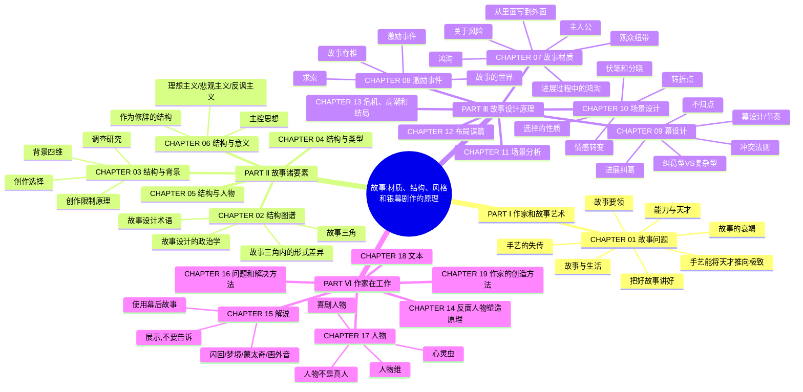

# 读书笔记 · 《故事：材质、结构、风格和银幕剧作的原理》

> 由 book-to-skill reader 抽取。块 1–4、导览、全书大纲、金句 忠于原书；块 5–7 与评价为通用示范。

## 导览 · 全书脉络与书目(faithful 抽取)

- 书名 / 作者 / 译者 / 版本:《故事:材质、结构、风格和银幕剧作的原理》(Story: Substance, Structure, Style and the Principles of Screenwriting) / 罗伯特·麦基(Robert McKee) / 周铁东 译 / 2014 年新版(作者《致中国读者》署 2014 年 2 月 14 日);本书论述原理而非规则、形式而非公式、原始模型而非陈规俗套。
- 阅读日期 / 阅读目的:(留空,读者自填)
- 一句话总结:一部关于"如何讲好一个故事"的原理手册——故事是对生活的比喻,其普遍形式(求索)可被学习,而手艺能把天才推向极致。
- 全书结构地图:
  - PART Ⅰ 作家和故事艺术 —— 为什么故事在衰竭、手艺为何失传、故事与生活的关系。
  - PART Ⅱ 故事诸要素 —— 结构术语(事件/场景/节拍/序列/幕/故事)、故事三角、背景、类型、人物、意义(主控思想)。
  - PART Ⅲ 故事设计原理 —— 故事材质(主人公/鸿沟/风险)、激励事件、幕设计、场景设计、场景分析、布局谋篇、危机·高潮·结局。
  - PART Ⅵ 作家在工作 —— 反面人物、解说(展示不要告诉)、问题与解决方法、人物、文本(对白/描写/形象系统)、作家的创造方法。
  - (书中目录从 PART Ⅲ 直接跳至 PART Ⅵ,无 PART Ⅳ/Ⅴ,此处忠实保留原书结构。)

## 全书大纲 · 思维导图(faithful 抽取)

## 1. 核心论点(Core Arguments)

1. **故事是对生活的比喻,而非生活的照搬。** 故事必须抽象于生活、提取其精华,却又必须像生活;刻板故事错把"事实逼真"当真实,奇观故事错把"模拟现实"当娱乐,二者都切断了与生活的联系(§1 故事与生活)。
2. **故事是一门可教可学的手艺,天才需要手艺才能推向极致。** 当今故事艺术在衰竭,根因是手艺失传(大学从"内在"转向"外在"的文本研究)与价值观混乱;只有燃料(天才)没有引擎(手艺),只会徒劳燃烧(§1 手艺的失传/手艺能将天才推向极致)。
3. **故事存在超越文化与历史的普遍形式(原始模型),但形式绝不是公式。** 所有故事归根结底都是"求索"形式:一个事件打破人物生活平衡,激发欲望,把他送上追寻之路,直到不可逆转的结局(§1 故事要领/§8 求索)。
4. **结构是对人物生活故事中一系列事件的选择,组合成战略序列,以激发特定情感并表达特定人生观。** "故事三角"(大情节/小情节/反情节)为形式画出宇宙地图(§2 结构/故事三角)。
5. **故事的动力来自"鸿沟":期望与结果之间的断裂。** 主人公采取最小保守行动,世界却激发对抗力量,在主观期望与客观结果间裂开鸿沟,逼他越过鸿沟、冒更大风险、采取更难行动,渐次进展到线索终点的最后行动(§7 鸿沟/进展过程中的鸿沟)。冲突法则:若无冲突,故事中的一切都不可能向前进展(§9 冲突法则)。
6. **意义(主控思想)必须靠高潮中价值的绝对、不可逆转折来戏剧化表达,绝不靠解释性对白。** 作家唯一的道德责任是"讲真话/揭示真理";故事是一门修辞——用事件的动态设计来证明一个思想(§6 作为修辞的结构/主控思想,§13 高潮)。

## 2. 心智模型(Mental Models)

- **故事三角(Story Triangle):** 经典设计(主动主人公、因果、闭合结局)居顶端,小情节、反情节居两底角。作家的全部宇宙观都被这张地图囊括,用来定位自己的形式(§2 故事三角)。
- **求索 / 五部分设计:** 激励事件 → 进展纠葛 → 危机 → 高潮 → 结局。激励事件打破平衡并投射"必备场景";危机是终极两难决定;高潮是绝对不可逆的价值转折(§8 激励事件/求索,§13)。
- **鸿沟模型(Gap):** 主观领域的"或然性感觉"与客观领域的"必然性"相撞,裂开鸿沟;人物逐次越过"不归点",风险与意志力层层加码,直到无法想象更好替代的最后行动(§7 鸿沟,§9 不归点)。
- **结构层级(节拍→场景→序列→幕→故事):** 节拍(动作/反应交替)构建场景(理想上每个场景都是转折点);场景构建序列(适中逆转);序列构建幕(重大逆转);幕构建故事(电影弧光,绝对不可逆)。没有不含转折的场景就删掉(§2 结构术语)。
- **故事脊椎 / 贯穿线(Superobjective):** 主人公自觉/不自觉欲望的能量形成统一力量,把所有场景、形象、话语绑在一起;若有无自觉欲望,不自觉欲望即脊椎(§8 故事脊椎)。
- **主控思想(Controlling Idea):** 用"价值 + 原因"一个句子表达故事核心意义;整个进展是"思想 VS 反思想"的辩证论战,高潮中一方胜出(§6 主控思想/思想VS反思想)。
- **展示,不要告诉(Show, don't tell):** 把解说转化为"弹药"——人物用他们已知的事实作武器去斗争;把最好的(最痛的真相)留到最后(§15 展示,不要告诉)。
- **人物真相 / 维(Dimension):** 人物真相只能在他压力下的两难选择中表达;维=矛盾(且必须连贯一致),主人公须是全体人物中最多维者(§17 心灵虫/人物维)。

## 3. 论证证据(Evidence)

- **故事衰竭与手艺失传(§1):** 好莱坞每年生产发行 400–500 部影片,剧本开发成本已攀升至每年 5 亿多美元,其中 3/4 付给改写永不开拍的剧本;而"一流的剧本即使不被投拍,也至少会被选定"——天才被埋没只是神话。
- **故事部而非对白部(§1 故事要领):** 作者写道"办公室门口的招牌并不是'对白部'或'描写部',而是'故事部'";在"一部完成作品所体现的全部创作努力中,作家百分之七十五以上的劳动都用在了故事设计上"。
- **两类失败剧本(§1 故事与生活):** "个人故事"坏剧本只对生活片断做呆板刻画,把表象逼真当真实;"保证商业成功"坏剧本结构性过强、用奇观取代想象——二者都错在与生活的关系:故事是生活的比喻。
- **贞德的事实相同、真谛各异(§1):** 阿努伊的精神贞德、萧伯纳的机智贞德、布莱希特的政论贞德……生活事实永远相同,但每当"真谛"被作家发现,整个样式便随之改变——证明故事抽象于生活。
- **背景四维与创作限制原理(§3):** 背景=时代/期限/地点/冲突层面;世界越大作者知识越被稀释、选择越少、越易陈词滥调,反之"世界越小,作者的知识越完善,其创作选择越多"。
- **第一步与鸿沟(§7):** 生活中人采取行动总期望世界有效反应且多半得逞(99% 情形);"但在故事中却绝非如此"——人物的最小保守行动激发对抗力量,裂开鸿沟。
- **激励事件范例(§8):** 《大白鲨》伏笔(鲨鱼吃人)+ 分晓(警长发现尸体);《克莱默夫妇》开场两分钟妻子离家出走——都不需要铺垫即可打破平衡。
- **冲突法则与法式烤面包场景(§9):** "若无冲突,故事中的一切都不可能向前进展";《克莱默夫妇》三分钟早餐场景在自信、儿子信任、家庭生存三重价值上同时转折,是"人物与所有层面复杂性同时冲突"的范例。
- **转折点四重效果(§10):** 转折带来惊奇、增加好奇心、见识、新方向;《星球大战2》"我是你父亲"制造"我所知最长的见解搜寻",将两部影片融为一体。
- **高潮"意生情"(§13):** 高潮"并不一定充满噪音和暴力,相反,它必须充满意义";威廉·戈德曼:"给予观众他们想要的东西,但不是通过他们所期望的方式";亚里士多德:"结局必须同时是不可避免而又出乎意料的"。
- **展示不要告诉(§15):** "加州场景"两个陌生人互吐童年阴影是虚假的;《卡萨布兰卡》巴黎闪回、《刺杀肯尼迪》的事实戏剧化装配,才是高明解说设计。
- **人物维=矛盾(§17):** 《银翼杀手》观众被更多维的复制人罗伊吸引,善之中心偏移致影片成"哑炮";哈姆雷特十维以上的矛盾才是复杂人物的范本。
- **库布里克的反战平衡(§6):** 三部反战片都给予"反思想"(人类好战本性)同等火力,使"善良战胜邪恶"的胜利切实可信——说教源于压抑对立声音。

## 4. 反例边界(Counterexamples / Boundaries)

- **形式 ≠ 公式(§1 故事要领):** "世上绝无银幕剧作的食谱可以保证你的蛋糕一定松软可口";相信公式者是傻瓜。原理说"这种方式有效且经时间验证",规则才说"你必须这样"。
- **CGI 不是瘟疫也不是万应灵药(§1):** 它只是调色板上几抹新色;在《阿甘正传》《黑衣人》中 CGI 消失在故事后面,但若被奇观光焰迷住眼,则找不到持久娱乐。
- **背景有自身"法则"(§3):** 每个虚构世界创立独特宇宙论与因果原理,一旦确定不可更改;观众掌握法则后,稍有违犯即视为违约。幻想片最严格、几乎不容巧合。
- **不自觉欲望并非人人都有(§8):** 若无内不自觉欲望,则自觉目标即故事脊椎(如邦德"打败魔王");只有存在不自觉欲望时,它才成为更强烈的脊椎。
- **三幕是最低要求而非公式(§9):** 也可一幕/二幕/四幕/五幕乃至八幕;但"幕的繁殖容易招致陈词滥调、削弱高潮冲击力并导致重复感",故含次情节的三幕主情节成为标准。
- **主观视点/闪回/梦境/蒙太奇/画外音(§15、§16):** 用好即好、用坏即坏;"少即是多",可删则删;通片依赖告诉性画外音会把电影蜕变为"插图有声磁带书"。
- **喜剧人物须盲目执迷(§17):** 一旦人物意识到自己的执迷(如《一条叫旺达的鱼》中阿奇意识到对尴尬的恐惧),他便从喜剧主人公变为浪漫主角——执迷是喜剧的前提。
- **多重/复合主人公的适用条件(§7):** 复合主人公须群体志同道合、共担得失;多重主人公则各谋其利、各承其害,故事变为多情节。主人公甚至可在中途更换(《惊魂记》)。

## 金句摘录(Quotable Lines)—— faithful 抽取

- "故事是人生必需的设备。"(肯尼斯·伯克,引于 §1 开篇)
- "故事并不是对现实的逃避,而是一种载体,承载着我们去追寻现实、尽最大的努力挖掘出混乱人生的真谛。"(§1 故事与生活)
- "故事是生活的比喻。"(§1 故事与生活)
- "结构是对人物生活故事中一系列事件的选择,这种选择将事件组合成一个具有战略意义的序列,以激发特定而具体的情感,并表达一种特定而具体的人生观。"(§2 结构)
- "若无冲突,故事中的一切都不可能向前进展。"(§9 冲突法则)
- "高潮必须充满意义……'意生情'……不是金钱,不是色情,不是特技,不是明星,不是炫目的摄影。"(§13 高潮)
- "展示,不要告诉。"(§15 展示,不要告诉)
- "给予观众他们想要的东西,但不是通过他们所期望的方式。"(威廉·戈德曼,引于 §13 高潮)

## 5. 与我连接(Connections)—— 以下为通用示例,读者按自己情况改写

- 我正在写的[某篇文章/某段汇报/某次分享],其"核心论点"是否也像本书说的"主控思想=价值+原因"那样,能用一句话讲清变化的方式与原因?
- 我在[某项目]里常犯"个人故事"式毛病:罗列事实却没转折。能否套用"鸿沟模型",让每一次行动都激发对抗、裂开期望与结果的缝隙?
- 我平时讲[某个观点]时,是不是也陷入了"告诉"而非"展示"?试试把要传递的信息变成人物手里的"弹药"。

## 6. 可执行下一步(Actionable Next Steps)—— 以下为通用示例,读者按自己情况改写

- [ ] 选一个我最近要讲的故事/案例,先用一句话写出它的"主控思想(价值+原因)"。
- [ ] 列出该故事的激励事件,确认它是否在"讲述过程前 1/4"内发生、且让观众脑中浮现"必备场景"。
- [ ] 检查每一个场景:押上台面的价值是否从正面转到负面(或反之)?没有转折的场景,果断删掉或重写。
- [ ] 把一处"解说性对白"改写为"展示"——让人物把已知事实当弹药去争斗。

## 7. 未解问题(Open Questions)—— 以下为通用示例,读者按自己情况改写

- 当我想表达反讽结局时,如何避免正负价值互相抵消、变成平淡中性的结局?(§13 关于反讽)
- 在短视频/交互叙事等新媒介里,"幕""场景"的层级是否还成立?鸿沟模型如何迁移?
- 本书以银幕剧作为核心案例,其原理在纯文字写作(论文、小说、朋友圈长文)中的边界在哪里?

## 评价与适合人群(Verdict)—— 综合

- 总体评分(1–10)/ 一句话总体评价:**9.5 / 10**。叙事原理的"圣经级"手册——系统、锋利、几乎无废话,唯一"代价"是篇幅长、需结合具体创作反复咀嚼。
- 适合谁读:编剧、小说家、剧作家及一切想把故事讲好的写作者;影视/游戏/内容行业从业者;想理解"为什么好故事动人"的叙事结构爱好者;带团队做"叙事型"表达的负责人。
- 不适合谁 / 局限性:寻找"爆款公式/速成模板"的人(本书明确反对公式思维);只想看剧情梗概、纯消遣阅读的人;排斥理论化拆解、偏好直觉写作的人。本书案例高度偏向好莱坞银幕剧作,部分机制需自行迁移到非影视媒介。
- 延伸阅读 / 与已读其他书的对照:
  - 亚里士多《诗学》——本书 repeatedly 援引的源头(转折数量、闭合结构)。
  - 悉德·菲尔德《电影剧本写作基础》——三幕结构的具体操作对照。
  - 克里斯托弗·沃格勒《作家之旅》——"英雄之旅"原型,可与"求索故事"互参。
  - 布莱克·斯奈德《救猫咪》——市场向节拍表,可对照本书对"公式"的批判。
  - 拉约什·埃格里《剧本创作》——人物维与"前提"思想,与"主控思想"呼应。

## 本书提及书单(Books Mentioned)—— faithful 抽取
本书正文 / 注释中引用、提及的其他书目(本书以银幕剧作为核心例证,故下表兼收其反复分析的电影作品与少量文学/理论原典)。用表格呈现(书名 / 作者 / 简介),挑重点、去重,8–15 条为宜;简介一句话说明该书与本主题的关系或核心内容。
| 书名 | 作者 | 简介 |
| --- | --- | --- |
| 《诗学》 | 亚里士多德 | 本书反复援引的叙事源头,关于转折数量与闭合结构的经典依据。 |
| 《伦理学》 | 巴鲁赫·斯宾诺莎 | 正文提及的哲学原典,用于支撑故事与价值/人生观的讨论。 |
| 《吉尔伽美什》 | 古巴比伦史诗(佚名) | 作为人类最古老故事之一被援引,说明故事的原型力量。 |
| 《卡萨布兰卡》 | 迈克尔·柯蒂兹(电影) | 解说设计范例,巴黎闪回将事实戏剧化装配。 |
| 《公民凯恩》 | 奥逊·威尔斯(电影) | 结构典范,用于讲解场景转折与主控思想。 |
| 《战舰波将金号》 | 谢尔盖·爱森斯坦(电影) | 蒙太奇与"展示不要告诉"的经典例证。 |
| 《罗生门》 | 黑泽明(电影) | 多重叙述与视角/立脚点的分析案例。 |
| 《八部半》 | 费德里科·费里尼(电影) | 反情节/内在冲突的范例,展示故事三角的另一极。 |
| 《假面》 | 英格玛·伯格曼(电影) | 极小情节(minimalist)叙事的代表作。 |
| 《七武士》 | 黑泽明(电影) | 故事设计与人物结构的范例。 |
| 《2001太空漫游》 | 斯坦利·库布里克(电影) | 视觉叙事与"展示不要告诉"的极致案例。 |
| 《虎胆龙威》 | 约翰·麦克蒂尔南(电影) | 激励事件与场景设计的通俗范例。 |
| 《大白鲨》 | 史蒂文·斯皮尔伯格(电影) | 激励事件(鲨鱼吃人+发现尸体)的教科书式范例。 |
| 《星球大战2:帝国反击战》 | 乔治·卢卡斯(电影) | "我是你父亲"转折,用于讲解场景转折的"见解搜寻"。 |
