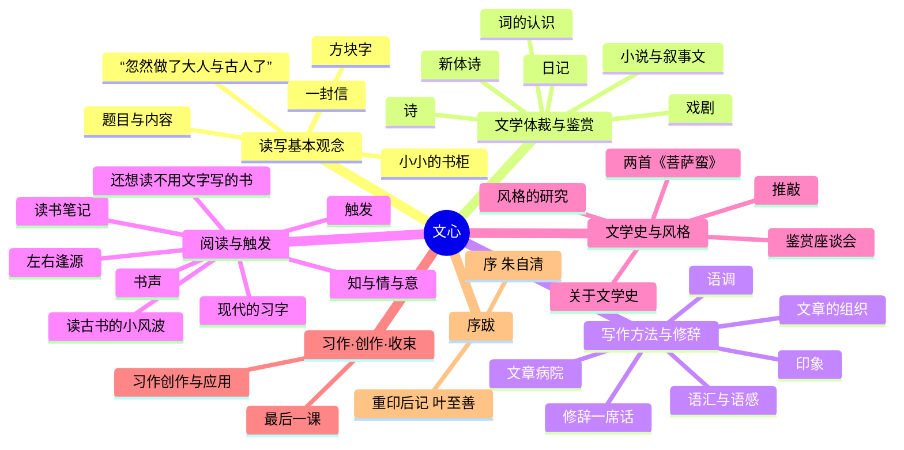

# 读书笔记 ·《文心》

> 由 book-to-skill reader 抽取生成。块 1–4、导览、全书大纲、金句摘录忠于原书;块 5–7 与评价为通用示范,读者按自身情况改写。

## 导览 · 全书脉络与书目(faithful 抽取)

- **书名 / 作者 / 译者 / 版本**:《文心》/ 夏丏尊、叶圣陶 著 / 无译者 / 江苏凤凰文艺出版社,2022 年 5 月第 1 版,ISBN 9787559467195(书末附叶至善《重印后记》)。
- **阅读日期 / 阅读目的**:(留空,由读者填写)
- **一句话总结**:以一群初中生的国文学习生活为线索,用 32 堂"故事体国文课"串起阅读、写作、修辞、文学鉴赏与文学史,把"作文是生活"的国文教育主张讲透。
- **全书结构地图**:正文三十二课,无分卷,但内容可归为六条线索——① 读写基本观念(经验、汉字、题目与内容、书信、书柜读书法);② 文学体裁与鉴赏(日记、诗、词、戏剧、小说、新体诗);③ 写作方法与修辞(文章病院、印象、语汇与语感、修辞、文章组织、语调);④ 阅读与触发(知与情与意、触发、书声、读书笔记、古书、习字、左右逢源、不用文字的书);⑤ 文学史与风格(文学史、鉴赏座谈、风格研究、菩萨蛮、推敲);⑥ 习作·创作·应用与收束(习作创作与应用、最后一课)。前有朱自清序,后有重印后记。

## 全书大纲 · 思维导图(faithful 抽取)

## 1. 核心论点(Core Arguments)

这本书最根本的主张是什么?用 3–7 条要点概括。

- **作文是生活,不是生活的点缀**:作文同吃饭、说话、做工一样,是生活中缺不得的一个项目;把作文当游戏或文字把戏是根本误解(§三 题目与内容)。
- **读书与作文是两件事,作文材料到处都是**:书籍用文字写成,但不应只当文字读;作文材料"并非仅在书中",专从书上学文字只会得到陈言老套,须从生活与"无字的书"中取材(§十三 触发)。
- **读懂他人的文章,是收得别人内外经验的过程**:所读多是大人/古人写自己经验的文字,读者须从文字里收得经验、学习其经验程度,而非强求解(§一 忽然做了大人与古人了)。
- **语文能力靠"习惯养成"而非死记知识点**:教师流转不定,中学生须自主用功,把作文混和进自己的生活,有实际需要时能自由应付(§一、§三十二 最后一课)。
- **好文字讲究组织与语感,且能避开常见毛病**:文章须讲秩序、联络、统一;语汇要丰富且用语贴切;《文章病院》所归纳的用词不当、意义缺略累赘、前后不连贯是最易犯的病症(§九、§十七、§二十七)。
- **接受"文学遗产"是消化为自身荣养,而非炫耀知识**:读过的名篇、认识的作家、历代源流,要当作文化的一部分容纳消化,产生自己的新血肉,而不是用来夸耀广见多闻(§三十二 最后一课)。

## 2. 心智模型(Mental Models)

作者提供的、可复用的思维 / 行动框架。优先来自书里标志性的比喻或结构。

- **经验二分法**:文字经验分"外面的经验"(景物状况,人人共同)与"内部的经验"(作者感想,各人不同);读懂文字靠收得内外两种经验,纯内部经验最难解(§一)。
- **题目与内容的自然顺序**:正常是先有内容、后有题目;练习作文是"先给题目再搜内容"的不得已倒置,完篇后才取题,题目只便于称说(§三)。
- **文章组织三原则**:秩序(材料排成适宜次第)、联络(从头至尾顺当连续)、统一(通体维持一致意见与情调);具体方法是"回问自己"——为着说什么才写这篇文章(§二十七)。
- **语汇系串法**:每遇一词,联想其相近/相似词,在胸中编成系串,比较范围广狭、语气强弱、情味雅俗,用时择最相当者;词类如衣服,什么时地该着什么衣(§十七)。
- **触发功夫**:由一件事感悟到其他事——读书时觉某句与所读某处有关、与生活有涉、可作将来理论之例,或对眼前事物发现旁的意思,都是触发,是作文好材料(§十三)。
- **文章病院分类模型**:文字毛病归为三类——用词用语不适当、意义的缺略与累赘、前后不相连贯;知病即知健康(§九)。
- **文章三分法**:应用之作(书信、便条)、习作(课堂作文、练习)、创作(自由发挥天分的真成绩);创作贵精不贵多,忠于创作即忠于自己(§二十九)。
- **风格双轴模型**:姚鼐以"阳刚之美 / 阴柔之美"两大类包举风格;司空图《诗品》分二十四品;皆借景物事态显示风格,非绝对标准(§三十一)。

## 3. 论证证据(Evidence)

支撑上述论点的关键例子、原书引文、数据。标注出处章节以便回查。

- **内外经验说**:枚叔以鲁迅《秋夜》"一株是枣树,还有一株也是枣树""夜的天空,奇怪而高"为例,说明字字认识却连不起来看不明白,是经验未到作者程度;"星在眨眼"是外面经验,"星在冷眼"是内部经验(§一、§二)。
- **文白区别只两点**:王先生讲《登泰山记》"泰山之阳,汶水西流",文言与白话区别仅在"用字多少"与"关系词不同"(如"之"=白话"的");并点出"苍山负雪"的"负"、"半山居雾"的"居"因所处地位而词性变易,我国文字是"方块字"(§二 方块字)。
- **作文是生活**:王先生课堂发问"在怎样的情形之下我们才提起笔来作文",归结"作文是生活中间的一个项目""作文是生活,而不是生活的点缀";并批《太阳晒屁股赋》及乱出《秦始皇论》《救国的方针》给无能力学生的做法无异游戏且有害(§三)。
- **文章病院三病例**:《辞源续编说例》"去取之目的"不当(应为"标准")、《国民党四中全会宣言》"促进自治制度"动宾不配、《江苏省立中等学校校长劝告学生复课书》"重新收拾精神"累赘不通,三者皆犯用词不当、意义缺略累赘或前后不连贯(§九 文章病院)。
- **语汇系串实例**:杜振宇见"学习"联想"练习、研究、探讨、考究、用功",见"怒"联想"愤、恨、动气、火冒、不高兴、不愉快";并以"富人四季衣穿,穷人衣穿四季"比喻词类须恰合身段时地(§十七)。
- **触发家书**:枚叔信中告乐华"读书贵有新得,作文贵有新味。最重要的是触发的功夫",并劝"于有字的书以外,更留心去读读没有字的书";乐华由蝉声悟韵律、由日影悟明暗、由盆栽裁剪悟文字繁简布置(§十三)。
- **组织比喻**:锦华演说以"一篇文章犹如一个团体,每一节就同团体中的每个人一样,都应该担任相当的职务""犹如一所房子,每一节同每间房间一样,都应该有它的适宜的位置"(§二十七)。
- **读书笔记范例**:《困学纪闻》辨"言"与"句"、《读书杂志》断"未问则不立"之"立"为"言"字之误、《苕溪渔隐丛话》论"黄花"与"晚节"关系,说明笔记材料可大可小(§二十五)。
- **创作三分与古训**:王先生区分应用之作/习作/创作,引古山水画家"五日成一山,十日成一水"、左太冲作赋费十年,证"创作贵精不贵多,时间和劳力是不能计较的"(§二十九)。

## 4. 反例边界(Counterexamples / Boundaries)

作者自己承认的例外、明确说"不适用于"的情形、或你读出的适用边界。

- **触发须是自己的、新鲜的才好**:用"月圆缺喻人事盛衰""逝水喻年华难再""夕阳喻老年"在最初是好触发,若袭用则"等于一味说人家说过的话,自己不说什么了"(§十三)。
- **作文不可当游戏**:无实际需要而被迫作《太阳晒屁股赋》,或把《秦始皇论》《救国的方针》出给不想作、没能力作的学生,与游戏同害(§三)。
- **组织公式不可当定法套用**:"起承铺叙过结""序论立论论证结论"等由来有据,但若当作一定公式硬套,会"反客为主",拘束说话作文;应化为"秩序、联络、统一"的原则随地应用(§二十七)。
- **风格品目非绝对标准**:《诗品》二十四品、曾国藩八言皆可增补合并,"并非绝对的标准,又何能据此来衡量一切的作品"(§三十一)。
- **小说 ≠ 叙事文**:仅据实事记叙(报纸记事、历史传载如《史记·项羽本纪》)是叙事文;小说即使据实事,还须含"与人生重大关系的意义"才是本质,不能凭"是否真有此事"来评判(§二十 小说与叙事文)。
- **读书笔记不必怕与前人重复**:只要见解出于自己思索,"与人家说过不说过毫无关系";写笔记本意为自己记述心得以备查考,非为刊行(§二十五)。

## 金句摘录(Quotable Lines)—— faithful 抽取

写推文 / PRD / 笔记时最想直接抄的原句。每条附出处章节。

- "作文是生活,而不是生活的点缀。"(§三 题目与内容)
- "读书贵有新得,作文贵有新味。最重要的是触发的功夫。"(§十三 触发)
- "文字是无须花钱的,尽可照了富人对于'四季衣穿'的态度,尽量搜罗,使其恰合身段、时令与场所。"(§十七 语汇与语感)
- "组织文章的原则只有三项,便是'秩序、联络、统一'。"(§二十七 文章的组织)
- "一篇文章犹如一个团体,每一节就同团体中的每个人一样,都应该担任相当的职务。"(§二十七 文章的组织)
- "读书要精细,才能写出读书笔记,反过来说,试写读书笔记,也就是使读书不苟且的一种方法。"(§二十五 读书笔记)

## 5. 与我连接(Connections)—— 以下为通用示例,读者按自己情况改写

它和我已有的知识 / 项目 / 习惯有什么关系?

- 我日常写文档/报告,常陷入"先想题目再硬凑内容"的倒置;可借"先有内容后有题目"与"回问自己为着说什么才写"调整写作起点。
- 我做笔记/读专业书时容易浮光掠影;可借"试写读书笔记即是不苟且的阅读法"把读与写绑定。
- 我积累的词汇偏贫乏,表达常"词不达意";可试"语汇系串法",遇到一个词就联想近义词并比较语气强弱与情味雅俗。
- 我读古诗文常卡在"内部经验"难以共鸣;可提醒自己这是经验未到作者程度,属正常,不必强解。

## 6. 可执行下一步(Actionable Next Steps)—— 以下为通用示例,读者按自己情况改写

基于这本书,我具体能做的一件小事?

- [ ] 下一次动笔前,先用一句话写下"我这篇到底为着说什么",再回问自己材料怎样排序、怎样连贯、怎样统一。
- [ ] 建一个"语汇系串"小本:每天遇到一个新词,联想 3–5 个近义词并记录其语气/情味差别。
- [ ] 选一本正在读的书,试写一条读书笔记(小到一个字/词的辨正,大到一种写法归纳),不追求发表。
- [ ] 读文时练习区分"外面经验"与"内部经验",对难懂处先标注是哪一种经验未到。

## 7. 未解问题(Open Questions)—— 以下为通用示例,读者按自己情况改写

我哪里不同意?还想追问什么?

- "作文是生活"在今日短视频/碎片表达盛行的语境下,边界如何重划?是否仍适用?
- 书中以中学生为对象,对已有写作习惯的成人,哪些主张需打折或重构?
- "触发"强调新鲜独有,但写作教学又鼓励模板与范式,二者如何调和?
- 风格"阳刚/阴柔"二分是否足以描述现代多元文本(如技术写作、数据叙事)?

## 评价与适合人群(Verdict)—— 综合

- **总体评分(1–10)/ 一句话总体评价**:9 / 把国文读写讲成生活本身,故事体不枯燥、观点历久弥新,是中文语境下难得的"读写启蒙经典"。
- **适合谁读**:中学生与语文教师(正本清源的国文课);写作/阅读初学者;对民国语文教育与叶圣陶/夏丏尊教育思想感兴趣者;想系统补"语感与文章组织"底子的成人。
- **不适合谁 / 局限性**:想找"速成写作技巧""爆款文案模板"的人会失望(本书重习惯与底子,不教套路);纯文学理论或考据研究者会觉得偏入门;部分举例与时代背景(如《中学生杂志》"文章病院"、会考)离今日较远。
- **延伸阅读 / 与已读其他书的对照**:叶圣陶《文话七十二讲》《怎样作文》、夏丏尊《文章作法》、朱自清《经典常谈》(同出开明系,可对照"该读什么、怎么读");梁启超《中学以上作文教学法》;以及本书序作者朱自清的《朱自清全集·语文教育论》。
