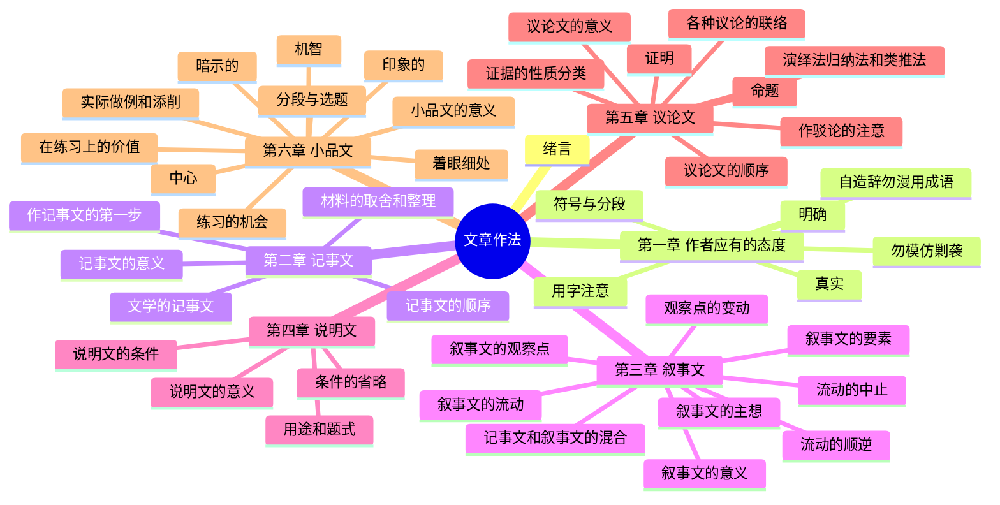

# 读书笔记 · 文章作法

## 导览 · 全书脉络与书目(faithful 抽取)
- 书名 / 作者 / 译者 / 版本:《文章作法》,夏丏尊、刘薰宇 著;无译者。属"跟大师学语文"丛书,中华书局,2007(2007 年 8 月第 1 版,2011 年 9 月重印,ISBN 978-7-101-05768-3)。其原型为夏丏尊在长沙第一师范、白马湖春晖中学的讲义,经开明书店初版(1922),后由刘薰宇结合教学实践修改编辑成书。
- 阅读日期 / 阅读目的:(读者自填)
- 一句话总结:按文体(记事/叙事/说明/议论/小品)逐章拆解写作方法——从作者态度到材料取舍、主想观察点、说明六要件、议论三法、小品文五注意,是一册体系化的写作入门。
- 全书结构地图(分几部分、每部分讲什么,便于回查):
  - 绪言:破"文无定法、神而明之"旧见,立"文章是工具、形式有法可学、法则必要而不充足、多读多作多商量"。
  - 第一章 作者应有的态度:好文章两基本条件——真实、明确,及四项具体戒律。
  - 第二章 记事文:意义、第一步(集材)、材料取舍整理、顺序、文学的记事文。
  - 第三章 叙事文:意义、与记事文混合、要素(主体/事实/时间/场所)、主想(善/真/美)、观察点及变动、流动及其中止/顺逆。
  - 第四章 说明文:意义、用途题式、条件(类+种差及六要件)、条件省略。
  - 第五章 议论文:意义、命题、证明、演绎/归纳/类推、证据分类、议论联络、顺序、驳论注意。
  - 第六章 小品文:意义、练习价值与机会、作法五注意(着眼细处/印象的/暗示的/中心/机智)、实际做例与添削、分段与选题。

## 全书大纲 · 思维导图(faithful 抽取)

## 1. 核心论点(Core Arguments)
这本书最根本的主张是什么?用 3–7 条要点概括。
- 文章为传达意思或情感而作,只是一种工具;有内容(意思/情感)与形式(文字结构)两面,形式之美丑有基本方法可学——作文法讲形式之法。(§绪言)
- 法则对技术"必要而不充足":不知法者亦有成功(暗合法则),但知法并经练习更快更正确;"多读,多作,多商量"是颠扑不破之训。(§绪言)
- 好文章两基本条件:真实(有实感,可扩大缩小但不虚空妄造)、明确(使读者了解不误解);由此派生四项戒律——勿模仿剿袭、须自造辞勿漫用成语典故、注意符号和分段、用字上求明确。(§第一章)
- 记事文写"静"的状态/性质/效用,叙事文写"动"的现象演变,含四要素:主体、事实、时间、场所;主想分授教训(善)/授知识(真)/授趣味(美)三类,主想定则取舍标准定。(§第二、三章)
- 说明文最简形式是"类+种差",完备须六要件:所属种类、所具特色、所含种类、显明实例、对称疑似、语义限定。(§第四章)
- 议论文以证明自己的判断为主,用演绎/归纳/类推三法;小品文贵"细处、印象、暗示、中心、机智",以寡兵抵大敌、用少数的部份暗示全体。(§第五、六章)

## 2. 心智模型(Mental Models)
作者提供的、可复用的思维 / 行动框架。优先来自书里标志性的比喻或结构。
- 内容/形式两面观(文章=工具):意思情感是内容、文字结构是形式;作文法只管形式之法,内容靠经验修养自修。
- 法则必要而不充足模型:渔父之子善泳却逊于"有知识再经练习"的专门家;法则指示必由途径,成功终靠练习暗合法则。(§绪言)
- 真实/明确二条件模型:真实(有实感、不虚空不妄造)∩ 明确(不费解不误解);由它推四项戒律(勿模仿、自造辞、符号分段、用字)。(§第一章)
- 记事/叙事二分模型:记事文写静的状态性质效用,叙事文写动的现象演变且须含四要素(主体/事实/时间/场所)。(§第二、三章)
- 主想三类模型:善/真/美三类主想决定材料取舍(如岳飞三法:传记重家教轶事、史书重生卒官职、小说重趣味)。(§第三章 叙事文的主想)
- 说明文"类+种差"六要件模型;小品文五注意模型:细处、印象、暗示、中心、机智——以罗丹"先作全像再截胸像"喻用少数部份暗示全体。(§第四、六章)

## 3. 论证证据(Evidence)
支撑上述论点的关键例子、原书引文、数据。标注出处章节以便回查。
- 绪言:"文章本是为了传达自己的意思或情感而作的,所以只是一种工具。……意思或情感是文章的内容,文字的结构是文章的形式。"(§绪言)
- 绪言:"多读,多作,多商量。这话虽然简单,实在是很中肯綮,颠扑不破。"(§绪言)
- 绪言:"法则对于技术是必要而不充足的条件,真正凭着练习成功的,必是暗合于法则而不自知的。"(§绪言)
- 第一章以"白发三千丈,缘愁似个长""朝如青丝暮成雪"为例,说明名句有价值"就因它们是表现作者的实感"——即便夸张,仍以实感为真实。(§第一章 真实)
- 第三章 叙事文要素例:宝玉看《会真记》收拾落花——主体宝玉、事实看书记收拾落花、时间三月中浣、场所沁芳闸桥,四要素俱全。(§第三章 叙事文的要素)
- 第三章 主想例:岳飞第一类(善)详家教轶事略生卒,第二类(真)详生卒官职,第三类(美)小说叙法;《少年丛书》《宋史》《说岳传》三法对照。(§第三章 叙事文的主想)
- 第四章 说明文:"人是有理性的动物","有理性的"是种差;"书籍是印刷物"(所属类)、"预备永久保存给多数人看"(特色)。(§第四章 说明文的条件)
- 第六章 小品文:崔护"去年今日此门中……"因取偶发断片而动人;罗丹刻胸像"先做一全像,完成了再截去手足";《柿树》前后两例一叙述说明、一印象暗示,后者效佳。(§第六章 小品文)

## 4. 反例边界(Counterexamples / Boundaries)
作者自己承认的例外、明确说"不适用于"的情形、或你读出的适用边界。
- 文章"内容是否充实关系作者的经验、智力、修养",形式之法"毕竟有些基本方法可以遵照",但两面"同样地没有成法可依赖"——作文法只管形式,内容须自修,不能靠法补全。(§绪言)
- "专一依赖法则固然是不中用,但法则究竟能指示人以必由的途径"——只依赖不行,只信"神而明之"也错。(§绪言)
- 真实"不是开发票或记账式地将事实一件一件地照样写出,应当有所选择";但"把很微细的事物说得很夸张……或竟把有说成无,把无说成有,都不免成为虚空"。扩大缩小须以作者心情为基础,不能凭空妄造。(§第一章 真实)
- 模仿古来"不以为非"(桐城派、西昆体等),"其实文章原无所谓派别……仅仅像得哪一家,哪一篇,决不能当作好的标准";剿袭模仿会抑灭个性、不真实不明确。(§第一章 勿模仿)
- 成语典故"如果真和自己所要表示的内容吻合,用也无妨,但事实上很难得有这样凑巧的事情";如"暮色苍然"暮色不一定苍然,"阳关三叠"今土风已无,滥用则不真实。(§第一章 自造辞)
- 分段标准"或依空间、或依时间、或依事理自然的秩序";"每段的长短,这是全无关系的"——长短不论,只论每小中心一段。(§第一章 符号和分段)

## 金句摘录(Quotable Lines)—— faithful 抽取
写推文 / 笔记时最想直接抄的原句。每条附出处章节。
- "文章本是为了传达自己的意思或情感而作的,所以只是一种工具。"(§绪言)
- "意思或情感是文章的内容,文字的结构是文章的形式。"(§绪言)
- "多读,多作,多商量。"(§绪言)
- "法则对于技术是必要而不充足的条件,真正凭着练习成功的,必是暗合于法则而不自知的。"(§绪言)
- "所谓好文章,就是达意表情,使读者读了以后能明了作者的本意,感到作者的心情的文章。"(§第一章 作者应有的态度)
- "描写!描写!部份的精细的分写,胜于全体的叙述和说明!再进一步说,要印象的描写!"(§第六章 小品文)

## 5. 与我连接(Connections)—— 以下为通用示例,读者按自己情况改写
它和我已有的知识 / 项目 / 习惯有什么关系?
- 我写说明文档 / 需求文档本质是"说明文",可照"类+种差六要件"检查:是否漏了实例、对称疑似或语义限定。
- 我写周报 / 项目记录是"叙事文",可用四要素(主体/事实/时间/场所)与"主想(善/真/美)"先定调再选材。
- 我做 PPT / 短文是"小品文",可练"着眼细处 + 印象 + 暗示 + 中心 + 机智",避免写成地图式的轮廓。

## 6. 可执行下一步(Actionable Next Steps)—— 以下为通用示例,读者按自己情况改写
基于这本书,我具体能做的一件小事?
- [ ] 写一篇说明文(如介绍一个工具),逐条核对六要件,补上缺失的实例与对称疑似。
- [ ] 写一段叙事前,先填四要素 + 定主想(善/真/美),再据此取舍材料。
- [ ] 模仿"小品文五注意"写 300 字:只写一个细处、用印象笔法、暗示全体、守住一个中心。
- [ ] 改一篇旧文:删去模仿腔与空洞成语,换成"自己造辞"的切实表达。

## 7. 未解问题(Open Questions)—— 以下为通用示例,读者按自己情况改写
我哪里不同意?还想追问什么?
- 书中以"记事(静)/叙事(动)"二分,但很多好文动静交织、难以归类,二分是否过简?
- "真实/明确"二条件对诗歌、虚构文学是否适用?书中主要针对实用文,文学性表达边界在哪?
- 1922 年的文体框架(尤其小品文)如何映射到今天的新媒体短文、短视频文案?

## 评价与适合人群(Verdict)—— 综合
- 总体评分(1–10)/ 一句话总体评价:9 / 按文体把"怎么写"拆成可操作的方法清单,系统、朴素、能直接上手,是写作入门的扎实骨架。
- 适合谁读:中学生与语文教师、写作初学者、做文档 / 说明 / 运营文案需要打底的人、想理清文体写法的人。
- 不适合谁 / 局限性:想学文学性创作灵感或高级修辞的人会觉得偏工具理性;1922 年框架与例证带旧语境,部分(如文言用字、小品文定义)需读者自行转译到今天。
- 延伸阅读 / 与已读其他书的对照:同丛书《文话七十二讲》《文章讲话》《怎样写作》《语文随笔》;与《文章例话》互为表里(一本讲方法、一本从名篇反推),与《人间草木》对照"平淡而妥当"的写作面。

## 本书提及书单(Books Mentioned)—— faithful 抽取
本书正文 / 注释中引用、提及的其他书目。用表格呈现(书名 / 作者 / 简介),挑重点、去重,8–15 条为宜;简介一句话说明该书与本主题的关系或核心内容。
| 书名 | 作者 | 简介 |
| --- | --- | --- |
| 《文话七十二讲》 | 夏丏尊、叶圣陶 | 作文法讲稿;本书多处呼应其体例与说法。 |
| 《文章讲话》 | 夏丏尊、叶圣陶 | 文章学专著;本书讲文章体制时参照其划分。 |
| 《国文百八课》 | 夏丏尊、叶圣陶等编 | 国文教材;以其中选文为各体范例。 |
| 《文心》 | 夏丏尊、叶圣陶 | 故事体读写读物;观点相互印证。 |
| 《怎样写作》 | 叶圣陶 | 叶圣陶写作论集;本书参考其主张。 |
| 《语文随笔》 | 叶圣陶 | 语文教育随笔;相互参照。 |
| 《红楼梦》 | 曹雪芹(清) | 小说典范;引其人物、对话描写讲写法。 |
| 《水浒》 | 施耐庵(明) | 小说典范;引其叙事与白描。 |
| 《西厢记》 | 王实甫(元) | 戏曲典范(书中亦作《会真记》);引其曲白讲对话。 |
| 《儒林外史》 | 吴敬梓(清) | 小说;引其讽刺笔法讲描写。 |
| 《复活》 | [俄] 托尔斯泰 | 外国小说;引其心理描写作为对照。 |
| 《三国志》 | 陈寿(晋) | 史传;引其记事讲传记写法。 |
| 《潘先生在难中》 | 叶圣陶(现代) | 现代短篇小说;引作范例讲小说写法。 |
| 《孟子》 | 孟轲(战国) | 儒家经典;引其议论笔法讲说理文。 |
