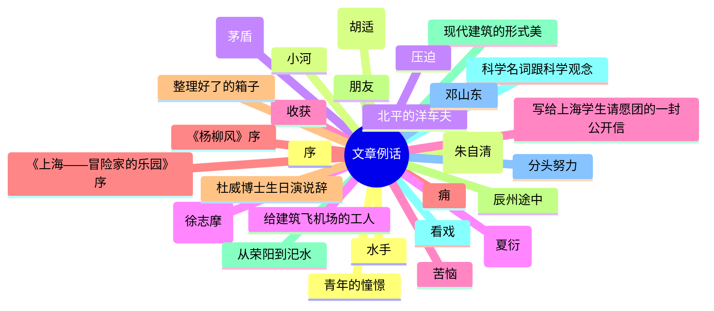

# 读书笔记 · 文章例话

## 导览 · 全书脉络与书目(faithful 抽取)
- 书名 / 作者 / 译者 / 版本:《文章例话》(副题"叶圣陶的二十七堂作文课"),叶圣陶 著;无译者。原连载于《新少年》杂志"文章展览"栏,1936 年 12 月结集成书(据序末署"一九三六年十二月二十日")。本书电子本选录廿馀篇现代文章逐篇评说。
- 阅读日期 / 阅读目的:(读者自填)
- 一句话总结:以"选好文章 + 在后面说些话"的方式,把写作还原为人人能做的事——材料是经验与意思、依据是语言,好文章不过是选材精当、说话确切周密,而读写终须养成习惯。
- 全书结构地图(分几部分、每部分讲什么,便于回查):
  - 序:交代编书旨趣——文章不是消遣,好文章必有不得不写的缘故;写作即生活本身;读写须养成习惯。
  - 正文廿馀篇"例话":每篇先录一文(或节选),后附叶圣陶的评说,角度不一(或指好处、或讲做法、或说全篇、或说局部)。所析文章含《背影》《浴池速写》《我所知道的康桥》《收获》《痈》《整理好了的箱子》《朋友》《现代建筑的形式美》《科学名词跟科学观念》《分头努力》《青年的憧憬》《差不多先生传》《北平的洋车夫》《包身工》《写给上海学生请愿团的一封公开信》《〈杨柳风〉序》《杜威博士生日演说辞》《辰州途中》《从荣阳到汜水》《看戏》《邓山东》《水手》《小河》《压迫》《给建筑飞机场的工人》《苦恼》《〈上海——冒险家的乐园〉序》等。

## 全书大纲 · 思维导图(faithful 抽取)

## 1. 核心论点(Core Arguments)
这本书最根本的主张是什么?用 3–7 条要点概括。
- 文章不是消遣游戏,凡好文章必有"不得不写"的缘故:或为记录自己生活,或向他人倾诉经验意思;学校作文虽似"出题硬写",但善教者出题不越学生经验意思范围,便与一般写作无二。(§序)
- 写文章并非神秘艰难:材料是"经验和意思",依据是"语言";只要会说话、能识字写字,就能写,"所谓好文章,也不过是材料选的精当一点,话说得确切一点周密一点儿罢了"。(§序)
- 生活是源泉、文章是溪流:泉源丰盈,溪流自然活活泼泼昼夜不息;工人、农人、店员、码头工都能写文章,写作不是生活的点缀,而就是生活本身。(§序)
- 读一篇文章要明白它的"主旨",只知零碎事情等于白读;选材以"与全篇主脑有无关系"为去取标准。(§背影)
- 作文要没有多余的文句:读者自能领会的就不写,明白写下反成多余;一词一字(连"的""了")也是必须用才用。(§背影)
- 阅读与写作都是人生行为,必须养成习惯,在不知不觉间受用,才是真正的受用。(§序)

## 2. 心智模型(Mental Models)
作者提供的、可复用的思维 / 行动框架。优先来自书里标志性的比喻或结构。
- 生活—文章源泉模型:生活(经验、意思)是泉源,文章是溪流;丰富真实的生活自然流出好文章,而非铺纸硬想。(§序)
- 主旨 / 主脑模型:每篇有主脑(如《背影》的"父亲的背影"),凡与主脑无关的不写,凡写的都与主脑有关——用"关系"这一个标准做去取。(§背影)
- 无多余文句模型:"说话要没有多余的话,作文要没有多余的文句";读者能自领会的留白,强写反损。(§背影)
- 词划分模型:给句子加"无形的符号"划分词,再辨明最主要词(如"叫—茶房—去"),才不致误会文意。(§背影)
- 实写 / 虚写模型:动作描写以实写为宜,唯"心里很轻松似的"一类作者眼中所见为虚写,恰可点明人物心情。(§背影)
- 习惯养成模型:读写知识必须化为习惯,"临时搬出些知识来"会把饱满的兴致割裂得支离破碎。(§序)

## 3. 论证证据(Evidence)
支撑上述论点的关键例子、原书引文、数据。标注出处章节以便回查。
- 序:"从前人以为写文章是几个读书人特有的技能,那种技能奥妙难知,几乎跟方士的画符念咒相仿。这种见解必须打破……不论什么人都能写文章。"(§序)
- 序:"生活犹如源泉,文章犹如溪流,泉源丰盈,溪流自然活波泼地昼夜不息。"(§序)
- 序:"阅读和写作的知识必须化为习惯,在不知不觉之间受用它,那才是真正的受用。读者看这本小书,请不要忘了这一句:养成习惯。"(§序)
- 《背影》把"父亲的背影"作主脑;游逛等无关事只用一句话带过——"凡是和父亲的背影没有关系的事情都不用写;凡是要写出来的事情都和父亲的背影有关系"。(§背影)
- 《背影》作者不写读者已可领会的深情,只写"我的泪很快地流下来了";记父亲四处极简的话,皆因是"深情的流露"才特地记下来。(§背影)
- 《背影》"通体干净,没有多余的话,没有多余的字眼,即使一个'的'字一个'了'字也是必须用才用。多读几遍,自然有数。"(§背影)

## 4. 反例边界(Counterexamples / Boundaries)
作者自己承认的例外、明确说"不适用于"的情形、或你读出的适用边界。
- 学校作文"并没有不得不写的缘故,似乎近于笔墨游戏",但善教者出题不越学生经验意思范围,学生便"大有可写",与一般写作过程无二——说明"硬出题"并非本质障碍。(§序)
- 书中只选现代人的文章,且"有些是文艺作品,但是我也把它们看做普通文章,就普通文章的道理跟读者谈谈"——以普通文章道理谈,不限于文学。(§序)
- "我决不说这些文章以外再没有好文章",选廿馀篇只为示范"这样的文章就是好文章",并非定标准、排座次。(§序)
- 评说并非一味叫好:文中若有"不妥当的地方或者不合法度的地方,自然也能随时看出来,不至于轻轻滑过"——例话也教人挑毛病。(§序)

## 金句摘录(Quotable Lines)—— faithful 抽取
写推文 / 笔记时最想直接抄的原句。每条附出处章节。
- "凡是好的文章必然有不得不写的缘故。"(§序)
- "文章的材料是经验和意思,文章的依据是语言……所谓好文章,也不过是材料选的精当一点,话说得确切一点周密一点儿罢了。"(§序)
- "生活犹如源泉,文章犹如溪流,泉源丰盈,溪流自然活波泼地昼夜不息。"(§序)
- "阅读和写作的知识必须化为习惯,在不知不觉之间受用它,那才是真正的受用。"(§序)
- "说话要没有多余的话,作文要没有多余的文句。"(§背影)
- "凡是和父亲的背影没有关系的事情都不用写;凡是要写出来的事情都和父亲的背影有关系。"(§背影)

## 5. 与我连接(Connections)—— 以下为通用示例,读者按自己情况改写
它和我已有的知识 / 项目 / 习惯有什么关系?
- 我写东西常"为写而写"、硬凑字数,可借"不得不写的缘故"自检:这篇到底因何而非写不可?
- 我读文只记情节,可学"先抓主旨":读完问一句"这篇主脑是什么",免得白读。
- 我带新人 / 出题目时,可借鉴"出题不越对方经验意思范围",让人"大有可写"而非干瞪眼。

## 6. 可执行下一步(Actionable Next Steps)—— 以下为通用示例,读者按自己情况改写
基于这本书,我具体能做的一件小事?
- [ ] 下次动笔前,先写一句话:"我非写这篇不可,是因为____。"填不出就先别写。
- [ ] 重读一篇自己满意的文章,标出"与主脑无关"的句子,试着删到不能再删。
- [ ] 挑一篇好文,仿叶圣陶的办法在文后写 200 字"例话":指好处 / 讲做法 / 说局部。
- [ ] 连续一周,每天读一文后口头说出"主旨",练成"不白读"的习惯。

## 7. 未解问题(Open Questions)—— 以下为通用示例,读者按自己情况改写
我哪里不同意?还想追问什么?
- "好文章 = 选材精当 + 说话确切周密"是否低估了风格、修辞与想象力?有些好文章恰恰"不周密"却动人。
- "读写须养成习惯"对成人是否有效?成年后才开始练,还能"不知不觉受用"吗?
- 书中以 1930 年代白话文 / 现代文为样本,今天短视频、碎片化表达下,"普通文章的道理"是否要重写?

## 评价与适合人群(Verdict)—— 综合
- 总体评分(1–10)/ 一句话总体评价:9 / 用"名篇 + 旁批"把写作讲成人人可学的平常事,亲切、不玄虚,是读写启蒙的范本。
- 适合谁读:中学生与语文教师、写作初学者、想学"怎么读文章"的读者、带人写作的编辑 / 老师。
- 不适合谁 / 局限性:想学文学性创作或高级修辞的人会觉得偏基础;所析多为 1930 年代白话文,部分篇目与今天语境有距离。
- 延伸阅读 / 与已读其他书的对照:同作者《文心》《语文随笔》《怎样写作》;可与《文章讲话》《文话七十二讲》《文章作法》并读,构成"跟大师学语文"读写方法论体系;与《人间草木》对照"平淡而妥当"的写作面。
