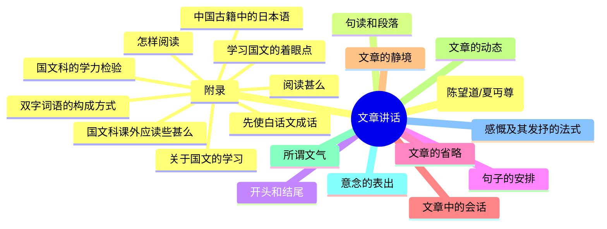

# 读书笔记 · 文章讲话

## 导览 · 全书脉络与书目(faithful 抽取)
- 书名 / 作者 / 译者 / 版本:《文章讲话》,夏丏尊、叶圣陶 著;无译者。属"跟大师学语文"丛书,中华书局,2007(书末"出版说明"署 2007 年 7 月 中华书局编辑部)。前七篇 1935–1937 连载于《中学生》"文章偶话"栏,后三篇 1937 年夏写成,1938 年开明书店结集。
- 阅读日期 / 阅读目的:(读者自填)
- 一句话总结:把"写文章"拆成十项可逐项磨练的微处功夫——从句读到文气、从静境到感慨,主张好文章是工匠式推敲出来的,而非靠灵感。
- 全书结构地图(分几部分、每部分讲什么,便于回查):
  - 序(陈望道、夏丏尊):点出本书在语文教育上的独特贡献。
  - 正文十篇:句读和段落、开头和结尾、句子的安排、文章的省略、文章中的会话、文章的静境、文章的动态、所谓文气、意念的表出、感慨及其发抒的法式。
  - 附录九篇:关于国文的学习、国文科课外应读些甚么、国文科的学力检验、阅读甚么、怎样阅读、学习国文的着眼点、先使白话文成话、中国古籍中的日本语、双字词语的构成方式。

## 全书大纲 · 思维导图(faithful 抽取)

## 1. 核心论点(Core Arguments)
这本书最根本的主张是什么?用 3–7 条要点概括。
- 写文章如同当众演说,须先认定中心、写成"一件独立的东西";与中心无关的材料(即便好意思、好比喻)也要丢掉,头尾亦是中心的一部分而非外加。(§开头和结尾)
- 文气并非玄妙神秘,可落实为念诵时的"一口气":文气强弱关乎句式构造,而与文章好坏无必然关系。(§所谓文气)
- 文章有"动境"与"静境":事物自身动作是动境;事物本无动作而作者以感觉/解释赋之以动作(如"数峰清苦,商略黄昏雨")是静境;句中只有形容词、不见动词则更静。(§文章的静境)
- 句子的安排以"谐和"为判据,而判据是"读";文法上无误的句子放入文章未必妥帖,须依上下文改换句式使前后调和。(§句子的安排)
- 感慨成立于"今昔对比"且"今不如昔",并须情绪退婴消极、无恢复改进的积极意志;有积极意志者(岳飞、诸葛亮)笔下无感慨。(§感慨及其发抒的法式)
- 省略、会话、意念表出等皆有具体技法与适用边界,文章之妙常在这些"看不出功夫"的细处。(§文章的省略 / 文章中的会话 / 意念的表出)

## 2. 心智模型(Mental Models)
作者提供的、可复用的思维 / 行动框架。优先来自书里标志性的比喻或结构。
- 中心独立说:动笔前认定中心,把所有材料围绕它组织成"独立的一件";类比"当众演说"须对准中心,而"信口漫谈"则藤蔓乱爬、全体无中心。(§开头和结尾)
- 文气 = 念诵的"一口气"模型:用口念、以快慢体会节奏;三法加强文气——以一词句统率多句、叠用同调词句、多用接续词使上下关联;同中须求小变化以免平板。(§所谓文气)
- 动静两境模型:先辨"事物自身的动作"(动境),再辨"作者赋给的动作"(静境),并识别"纯形容词、无动词"的最静描写。(§文章的静境)
- 句子谐和模型:以"读"为检验,将句式随上下文调节(同位置对应、甲乙丙丁戊呼应),使连读串成一气。(§句子的安排)
- 感慨发生条件模型:今昔对比(今不如昔)∩ 退婴消极 ∩ 无积极意志,三者俱足才生感慨;有恢复意志则感慨无从乘隙而入。(§感慨及其发抒的法式)

## 3. 论证证据(Evidence)
支撑上述论点的关键例子、原书引文、数据。标注出处章节以便回查。
- 演说者惯用"兄弟今天不曾预备""随便说说"等客套,书评其"对演说是没有帮助反而有损害";老套"兄弟能在这里说几句话,十分荣幸"令听众自动放松——说明头尾须新鲜适宜。(§开头和结尾)
- 《核舟记》末"魏子详瞩既毕,诧曰……技亦灵怪矣哉"被评"画蛇添足",因全篇记述已暗示精巧;作者自述华山风景片用"点明"(此处叫长空栈)收场,不离中心。(§开头和结尾)
- 王昌龄《塞下曲》与杜甫《春望》同四十言,念诵一快一慢,因前者两句合成一义、须一口气,后者每句自成一义、句间可久停——以此演示文气强弱。(§所谓文气)
- 司马迁《报任少卿书》"仆之先……"、贾谊《过秦论》"秦孝公……"以一词句统率一串文句,非连念至"也/心"字不能停,故气势旺盛。(§所谓文气)
- "三月廿九日七十二烈士在广州殉难;革命军于十月十日起义于武昌"两句文法无误却连读不串气,改为"乙丙"式(同位置对应)即调和。(§句子的安排)
- 桓温"木犹如此,人何以堪"流涕、岳飞《满江红》、诸葛亮《后出师表》对读:前二者有悲愤却因有"收拾旧山河""鞠躬尽瘁"的积极意志而无感慨;《桃花扇·哀江南》"以感慨始以感慨终"因全无积极意志。(§感慨及其发抒的法式)

## 4. 反例边界(Counterexamples / Boundaries)
作者自己承认的例外、明确说"不适用于"的情形、或你读出的适用边界。
- 书信的"前文/后文"(寒暄招呼)是规定格式,寄尊长或客气朋友须具备以合礼意;唯寄亲密朋友可省略——并非所有文章都该删客套。(§开头和结尾)
- 同调词句须"运用得适可而止,于必要时善为变化";全平板如"宣卷"反足减损文气,唐宋古文家鄙视骈文正因其变化少。(§所谓文气)
- 文气强弱"和文章的好坏本来没有密切的关系",不能以文气强弱判文章高下。(§所谓文气)
- 感慨文章"以感慨始以感慨终"者往往无积极意志;史可法、郑成功、张苍水等有恢复意志者笔下不会有此类文字。(§感慨及其发抒的法式)
- 胡适《文学改良刍议》把"不作无病呻吟"列入"八不",提醒青年勿染感慨滥调——反对为感慨而感慨。(§感慨及其发抒的法式)

## 金句摘录(Quotable Lines)—— faithful 抽取
写推文 / 笔记时最想直接抄的原句。每条附出处章节。
- "写一篇文章,预备给人家看,这和当众演说很相像,和信口漫谈却不同。"(§开头和结尾)
- "文气这东西,看是看不出的,闻也闻不到的,唯一领略的方法,似乎就在用口念诵。"(§所谓文气)
- "原来,文法上的句子和文章中的句子,研究目标彼此不同。从文法上看来毫无毛病的句子,摆入文章中去并不一定就妥帖。"(§句子的安排)
- "文章的静境……事物本身原无动作,那动作是作者故意赋给它的。"(§文章的静境)
- "感慨的成立由于今昔对比,今不如昔是一个条件。"(§感慨及其发抒的法式)
- "在有这样意志的人,感慨的情绪是无从乘隙而入的。"(§感慨及其发抒的法式)

## 5. 与我连接(Connections)—— 以下为通用示例,读者按自己情况改写
它和我已有的知识 / 项目 / 习惯有什么关系?
- 我写报告 / 文档常"开头客套、结尾喊口号",可借"中心独立说"重砍头尾,让开头结尾真正服务于中心。
- 我改稿只改"对不对"(文法),可加一道"读一读"检查句子是否串气、是否谐和。
- 我做复盘 / 随笔易滑入"今不如昔"的感慨腔,可用"感慨三条件"自检:是否真无积极意志、是否在无病呻吟。

## 6. 可执行下一步(Actionable Next Steps)—— 以下为通用示例,读者按自己情况改写
基于这本书,我具体能做的一件小事?
- [ ] 改一篇自己的旧文:删去与中心无关的好意思、好比喻,并把头尾改成"点明中心"而非客套。
- [ ] 选一段文字出声念两遍,标出"读起来断气/不串"的句子,照"乙丙对应"改句式。
- [ ] 写一段"静境"描写:只写事物、不写自己,尝试用纯形容词句营造最静的画面。
- [ ] 下次想发"怀旧感慨"前,先问:我有积极意志去改变吗?没有就少写。

## 7. 未解问题(Open Questions)—— 以下为通用示例,读者按自己情况改写
我哪里不同意?还想追问什么?
- "文气=念诵快慢"的判据,对默读为主的当代读者还灵吗?视觉节奏(标点、排版)是否已成新变量?
- 书中以 1930 年代白话文为语境,今天网络语、多模态表达下,"谐和""中心独立"是否仍够用?
- "感慨三条件"把积极意志视作感慨的对立面,那悲壮(有意志却仍感慨)如何归类?

## 评价与适合人群(Verdict)—— 综合
- 总体评分(1–10)/ 一句话总体评价:9 / 把"写好文章"还原成一组可逐项练习的微处功夫,例证密、说法实,是写作基本功的绝佳匠人手册。
- 适合谁读:中学生与语文教师、写作初学者、编辑 / 文案 / 运营等"靠文字吃饭"的人、想打磨句子节奏的人。
- 不适合谁 / 局限性:想找文学性创作灵感或纯文学赏析的人会觉得偏"工具理性";部分附录(国文科、日本语、双字词语)带 1930 年代语境,应用文具体格式已随时代变迁。
- 延伸阅读 / 与已读其他书的对照:同丛书《文话七十二讲》《文章作法》《怎样写作》《语文随笔》;可与《人间草木》对照"淡而妥帖"的写作面,与《文章例话》对照"从名篇反推写法"。
