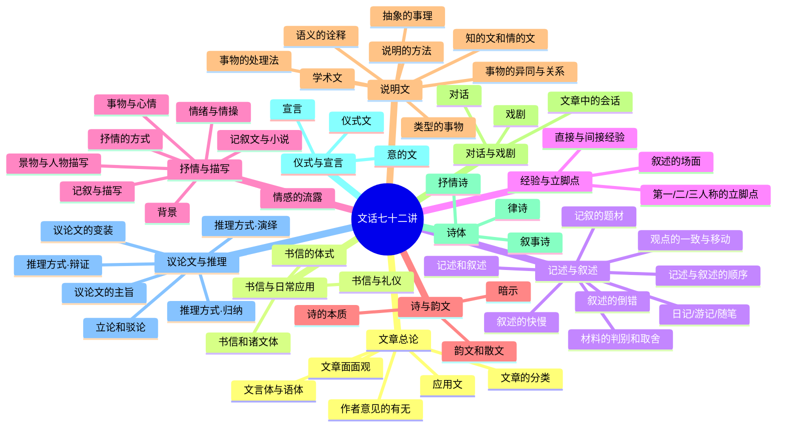

# 读书笔记 · 文话七十二讲——跟大师学语文

## 导览 · 全书脉络与书目(faithful 抽取)
- 书名 / 作者 / 译者 / 版本:《文话七十二讲——跟大师学语文》,夏丏尊、叶圣陶 著;属"跟大师学语文"丛书,中华书局(出版说明署 2013 年 1 月)。无译者。原书系从《国文百八课》("文话"部分)抽出之单行本。
- 阅读日期 / 阅读目的:(读者自填)
- 一句话总结:用七十二个主题,把"怎么读、怎么写"的文章学知识拆成可逐一留意的体制、语汇、文法、修辞、鉴赏、风格、章法七项目,系统讲清记叙文、说明文、议论文的写作门径。
- 全书结构地图(分几部分、每部分讲什么,便于回查):
  - 一、文章总论:文章的面面观、文言体与语体、作者意见有无、文章分类、应用文。
  - 二、书信与日常应用:书信的体式、书信与礼仪、书信和诸文体。
  - 三、记述与叙述:记述/叙述、顺序、题材、材料取舍、快慢、倒错、过去的现在化、观点一致与移动、日记/游记/随笔。
  - 四、经验与立脚点:直接/间接经验、间接经验证明、第一/二/三人称立脚点、叙述场面。
  - 五、抒情与描写:事物与心情、情感流露、抒情方式、情绪与情操、记叙与描写、印象、景物/人物描写、背景、记叙文与小说、小说真实性。
  - 六、诗与韵文:韵文和散文、诗的本质、暗示。
  - 七、说明文:报告书、说明书、说明和记述/叙述/议论、说明方法、类型事物、抽象事理、异同、关系、处理法、语义诠释、独语式与问答式、知的文与情的文、学术文。
  - 八、对话与戏剧:对话、戏剧、文章中的会话。
  - 九、诗体:抒情诗、叙事诗、律诗。
  - 十、仪式与宣言:仪式文(一)(二)、宣言、意的文。
  - 十一、议论文与推理:议论文主旨、立论和驳论、议论文的变装、推理方式(演绎/归纳/辩证)。

## 全书大纲 · 思维导图(faithful 抽取)

## 1. 核心论点(Core Arguments)
这本书最根本的主张是什么?用 3–7 条要点概括。
- 文章有"内容"(写什么:事物、事理、意思、情感)与"形式"(怎么写:用词、造句、分段落、定题目、加标点)两面;阅读与写作的学习都要从"形式的探究"着手。(§第一讲 文章面面观)
- 文章最基本的分类是"作者自己不说话的记叙文"与"作者自己说话的论说文";再细分为记述文、叙述文、说明文、议论文四种,实际多为两种以上性质混合。(§第五讲 文章的分类)
- 取少数文章精读,按文章学的七个项目(体制、语汇、文法、修辞、鉴赏与批评、风格、章法布局)逐一留意,即可经济地学得文章学的一切。(§第一讲 文章面面观)
- 一切文章都以读者为对象,"写作的态度和方法因读者的不同而变换";书信、应用文尤受形式与礼仪限制。(§第八讲 书信与礼仪 / §第六讲 应用文)
- 说明文靠六项条件把事物说清楚;议论文的主旨在于论证作者自己的判断,并以演绎、归纳、辩证三种推理方式为支柱。(§第四十七讲 说明的方法 / §第六十七、七十、七十一、七十二讲)
- 记叙文并非纯客观照抄,作者的"主观心情"会照射到客观事物上;抒情文须依托事物才能把感情传达给读者。(§第二十八讲 事物与心情 / §第二十九讲 情感的流露)

## 2. 心智模型(Mental Models)
作者提供的、可复用的思维 / 行动框架。优先来自书里标志性的比喻或结构。
- 内容与形式两面观:读任何一篇文章都同时做"内容探究"(事物是否真确、意思是否正当、情感是否真挚)与"形式探究"(怎样说起、怎样接说、怎样收场、怎样用词造句分段)。(§第一讲)
- 文章七项目 checklist:体制 → 语汇 → 文法 → 修辞 → 鉴赏与批评 → 风格 → 章法布局;读文时逐项留意,即得文章学各部门知识。(§第一讲)
- 记叙 / 论说二分 + 四体模型:作者"不说"= 记叙文(记述形状 / 叙述变化);作者"说"= 论说文(说明事理 / 议论主张)。以成份多者定类。(§第五讲)
- "心情照射"模型:客观事物 + 主观心情 = 各不相同的记叙文;如同照相,焦点与光线因摄影者意趣而异——故同题材记叙人人不同。(§第二十八讲)
- 叙述快慢模型:详写 → 流动"慢"(显事件状况,具体);略写 → 流动"快"(显事件梗概,抽象)。依文章意味决定何处快何处慢。(§第十五讲)
- 第三人称两态度:客观态度(知什么写什么,以直接经验为基础)vs 全知态度(如神俯视,可写人物内心);前者宜眼前事,后者宜离作者较远者。(§第二十六讲)
- 说明文六要件:所属种类 → 所具有特点 → 所含种类 → 显明实例 → 对称/疑似对照 → 语义限定。(§第四十七讲)
- 议论文推理三式:演绎(三段论:大前提—小前提—断案)、归纳(从个别到普遍)、辩证(矛盾对立 / 量变质变 / 否定之否定)。(§第七十、七十一、七十二讲)
- 抒情两方式:明显(直抒"快活极了")vs 含蓄(寄托于事物,如枇杷树);无论哪种都须先选适宜事物好好记叙。(§第三十讲)

## 3. 论证证据(Evidence)
支撑上述论点的关键例子、原书引文、数据。标注出处章节以便回查。
- 文言体与语体的混合"可以看作从文言体改革到语体的桥梁":曲词用文言、说白用语体(白话的"白"字即由此来),演义体小说、宋元语录、寻常家书里都保存言语原样。(§第二讲 文言体和语体(一))
- 同写"月":天文书记其生成、直径、光度、绕地运转(知识);诗歌或比之"弓""蛾眉"、或"把酒问月"、或以"圆缺"譬喻离合悲欢(情味)——意味不同则材料取舍不同。(§第十四讲 材料的判别和取舍)
- 同一题材教几十个同学写记叙文"写成之后彼此调看,竟难看到完全相同的两篇":差异来自顺序不同、取舍不一、看法(心情)各异三项。(§第二十八讲 事物与心情)
- 归有光《先妣事略》末"世乃有无母之人,天乎痛哉"为明显的抒情;《项脊轩志》"庭有枇杷树,吾妻死之年所手植也,今已亭亭如盖矣"为含蓄的抒情。(§第三十讲 抒情的方式)
- 书信三段组织(前文—事务—后文)类比登门访问:进门先寒暄,再谈借书,拿了书还要说"再会",不能突然起止。(§第七讲 书信的体式)
- 演绎三段论示例:"凡人是要死的(大前提)/ 圣人是人(小前提)/ 故圣人是要死的(断案)"。(§第七十讲 推理方式(一)·演绎)
- 辩证示例:漫然说"金钱是有用的"或"有害的"都不合实际;"金钱"的功用要看分量、所有者态度手腕用法及社会复杂情形而定。(§第七十二讲 推理方式(三)·辩证)

## 4. 反例边界(Counterexamples / Boundaries)
作者自己承认的例外、明确说"不适用于"的情形、或你读出的适用边界。
- 纯单一性质的文章"不能说没有,可是很少见";实际一篇普通文章往往含两种以上性质,或以某成份较多而定类。(§第五讲 文章的分类)
- 应用文须遵守刻板形式,否则不合适;普通文自由。书信比言语更须重礼仪,因文字之外无常举动、神情、态度辅助,易失礼使读者不快。(§第六讲 应用文 / §第八讲 书信与礼仪)
- 第二人称文章"不如别的立脚点的文章的能够统一",长篇文章全体用第二人称写的很少见;对手心理情形只能作表面叙述,无法彻底表达。(§第二十五讲 第二人称的立脚点)
- 第三人称"全知的态度"宜用于离开作者自己较远者;若叙述眼前人事漫然用全知,会"到处发生不合理",不如取客观态度。(§第二十六讲 第三人称的立脚点)
- 教科书、章程、契据等文章"只叙述事物而无所谓作者的心情",因其范围限定,作者心情搀不进去——这是记叙文无主观照射的例外。(§第二十八讲 事物与心情)
- 变装的议论文在"讲话不能自由的时代,变装的议论文也越多";真正事实往往复杂难暗示主张,故常由作者虚构。(§第六十九讲 议论文的变装)
- 辩证法的诸原则"只为便于说明起见,并非可作为推理的定律或公式";其精神在排除静止孤立的事物观,把事物当动的连续进展的东西看。(§第七十二讲 推理方式(三)·辩证)

## 金句摘录(Quotable Lines)—— faithful 抽取
写推文 / 笔记时最想直接抄的原句。每条附出处章节。
- "文章是记载世间事物、事理和抒述作者意思、情感的东西。每一篇文章有着内容与形式的两方面。"(§第一讲 文章面面观)
- "取少数的文章来精读,学得文章学上的一切,这才是经济的办法。"(§第一讲 文章面面观)
- "客观的事物呈现在作者的面前,作者把主观的心情照射上去,然后写述出来。"(§第二十八讲 事物与心情)
- "世间事物除了本身以外,决不会有另外一件事物和它完全相同……抛开这些小节目不管,就见得许多事物相同了。"(§第四十八讲 类型的事物)
- "凡是文章都以读者为对象,都有读者的预想。"(§第六十七讲 议论文的主旨)
- "必须是一个含有诗的本质的意思,用精粹的语言表达出来,那才是'诗'。"(§第四十讲 诗的本质)

## 5. 与我连接(Connections)—— 以下为通用示例,读者按自己情况改写
它和我已有的知识 / 项目 / 习惯有什么关系?
- 我在写周报 / 文档时,常只堆事实而缺"形式探究";可用"文章七项目 checklist"回看自己的文字是否体制得当、章法清晰。
- 我做的产品说明、需求文档本质是"说明文",可对照"说明文六要件"检查是否漏了实例或对称对照。
- 我和同事争论方案时,本质是"议论文";可借"演绎/归纳/辩证"三式检验自己的论证链是否站得住。

## 6. 可执行下一步(Actionable Next Steps)—— 以下为通用示例,读者按自己情况改写
基于这本书,我具体能做的一件小事?
- [ ] 下次读一篇文章,用"内容/形式两面 + 七项目"做一页摘记,连续做满 5 篇。
- [ ] 把一篇自己写过的记叙文按"心情照射"模型重读,标出哪几处是主观心情而非客观照抄。
- [ ] 写一份说明文档时,逐条核对"说明文六要件",补上缺失的实例与对称对照。
- [ ] 下次要说服别人前,先把主张写成"大前提—小前提—断案"的三段论,找漏洞。

## 7. 未解问题(Open Questions)—— 以下为通用示例,读者按自己情况改写
我哪里不同意?还想追问什么?
- 书中以 1930 年代白话文 / 文言对照为语境,今天网络语、多模态表达下,"文章七项目"是否仍够用?
- "记叙文极少纯客观"与新闻客观报道的理想如何调和?作者心情的照射边界在哪?
- 辩证推理被作者说"非定律或公式",那它到底怎样才算用对、用错?有无可操作的检验标准?

## 评价与适合人群(Verdict)—— 综合
- 总体评分(1–10)/ 一句话总体评价:9 / 把"怎么读、怎么写"拆成可逐项练习的文章学骨架,清晰、经济、历久弥新,是写作基本功的绝佳系统地图。
- 适合谁读:中学生与语文教师、写作初学者、想系统理清文章分类与写法的人、做内容 / 文档 / 运营文案需要打底的人。
- 不适合谁 / 局限性:想找文学性创作灵感或纯文学赏析的人会觉偏"工具理性";部分内容(书信敬语、文言/语体对照、仪式文)带有 1930 年代语境,应用文具体格式已随时代变迁,需读者自行转换。
- 延伸阅读 / 与已读其他书的对照:同作者《文心》《文章作法》《怎样写作》、叶圣陶《语文随笔》;可与《文章讲话》互为补充,构成"跟大师学语文"丛书的写作方法论体系。

## 本书提及书单(Books Mentioned)—— faithful 抽取
本书正文 / 注释中引用、提及的其他书目(含同作者语文教育系列与用作范例的文学名篇)。用表格呈现(书名 / 作者 / 简介),挑重点、去重,8–15 条为宜;简介一句话说明该书与本主题的关系或核心内容。
| 书名 | 作者 | 简介 |
| --- | --- | --- |
| 《国文百八课》 | 夏丏尊、叶圣陶 | 本书即抽自该教材的"文话"部分,是其母本。 |
| 《文心》 | 夏丏尊、叶圣陶 | 同作者语文教育名著,以故事体讲读写,宜与本书互参。 |
| 《文章作法》 | 夏丏尊 | 同作者文章学著作,系统讲文章写作门径。 |
| 《文章讲话》 | 夏丏尊、叶圣陶 | 同作者文集,可与本书互为补充。 |
| 《怎样写作》 | 叶圣陶 | 叶圣陶谈写作的文集,同属"跟大师学语文"系列。 |
| 《语文随笔》 | 叶圣陶 | 叶圣陶语文教育随笔,延伸阅读本书的推荐对照。 |
| 《略读指导举隅》 | 叶圣陶、朱自清 | 同系列阅读指导书,与精读指导配套。 |
| 《精读指导举隅》 | 叶圣陶、朱自清 | 同系列阅读指导书,提供精读范式。 |
| 《背影》 | 朱自清 | 书中用作记叙文与抒情方式的分析范例。 |
| 《项脊轩志》 | 归有光 | 明代散文名篇,书中作含蓄抒情与描写范例。 |
| 《先妣事略》 | 归有光 | 归有光悼母文,书中用以讲解明显抒情的方式。 |
| 《闲情记趣》 | 沈复 | 出自《浮生六记》,书中作记叙与描写的范例。 |
| 《最后一课》 | 阿尔丰斯·都德 | 外国短篇小说名篇,书中用作叙述立脚点等范例。 |
| 《项链》 | 居伊·德·莫泊桑 | 短篇小说名篇,书中用以讨论小说真实性与叙述。 |
