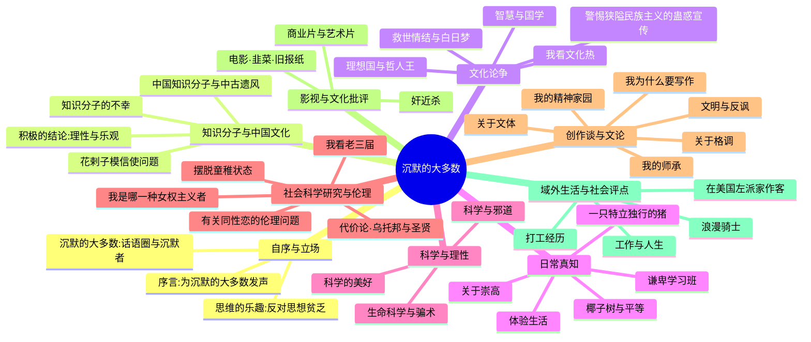

# 《沉默的大多数》读书笔记(王小波)

> 由 book-to-skill reader 使用。抽取自《沉默的大多数》杂文随笔全编;块 1–4 与导览/大纲/金句忠实于原书,块 5–7 与评价为通用示范。

## 导览 · 全书脉络与书目(faithful 抽取)

- 书名 / 作者 / 译者 / 版本:
  - 《沉默的大多数》,作者王小波(1952–1997)。本书为杂文随笔"全编",收得最全的一本(此前两个集子为北岳文艺《思维的乐趣》、文化艺术《我的精神家园》)。
  - 序言写于 1997 年 3 月 20 日,作者去世前 22 天;前言由李银河撰写(1997 年 8 月 23 日)。无译者(中文原创随笔集)。
- 阅读日期 / 阅读目的:(留空,由读者填写)
- 一句话总结:王小波以自由人文主义的犀利与幽默,为"沉默的大多数"发声,反对愚蠢与无趣、拆穿虚伪的崇高,捍卫理性、科学与参差多态的生活乐趣。
- 全书结构地图(便于回查):全书 96 篇杂文随笔,可归为九大块——① 自序与立场(前言、序言、沉默的大多数、思维的乐趣);② 知识分子与中国文化(中国知识分子与中古遗风、知识分子的不幸、花剌子模信使问题、积极的结论、跳出手掌心、道德相关诸篇);③ 文化论争(我看文化热、文化之争、"行货感"、洋鬼子与辜鸿铭、我看国学、智慧与国学、理想国与哲人王、救世情结、警惕狭隘民族主义等);④ 日常真知(肚子里的战争、一只特立独行的猪、椰子树与平等、体验生活、皇帝做习题、关于崇高、谦卑学习班等);⑤ 科学与理性(科学与邪道、科学的美好、生命科学与骗术);⑥ 社会科学研究与伦理(我是哪一种女权主义者、有关伟大一族、我看老三届、摆脱童稚状态、有关同性恋的伦理问题、代价论与乌托邦等);⑦ 创作谈与文论(我为什么要写作、我的师承、我的精神家园、小说的艺术、关于文体、关于格调、文明与反讽等);⑧ 影视与文化批评(奸近杀、电影·韭菜·旧报纸、商业片与艺术片、欣赏经典等);⑨ 域外生活与社会评点(在美国左派家作客、打工经历、环境问题、工作与人生、王朔的作品、浪漫骑士等)。

## 全书大纲 · 思维导图(faithful 抽取)

## 1. 核心论点(Core Arguments)

- **反对愚蠢与无趣**:伦理领域最该反对的是"愚蠢"(凭胸中浩然正气妄断是非、认定一切不言而喻)与"无趣"(庄严肃穆的假正经);"参差多态,乃是幸福的本源"。(§序言、§思维的乐趣)
- **沉默是一种生活方式,也是弱势者的表征**:话语圈常像"声名狼藉的疯人院";沉默者或因没能力/没机会,或因厌恶话语;所谓"弱势群体,就是有些话没有说出来的人"。(§沉默的大多数)
- **理性与科学精神是立身之本**:"凡不可信的东西就不信";科学是平等、自由、理性、可验证的事业,它"比人类本身更为美好"。(§积极的结论、§科学的美好)
- **拒绝虚伪的崇高与煽情的伦理**:崇高不等于不讲道理;"有些崇高是人所共知的虚伪,这种东西比堕落还要坏";高调加虚伪才构成可行生活方式。(§关于崇高)
- **智慧与思想的乐趣本身就是好的**:求学不该是痛苦;人应"爱平等、爱自由、爱智慧",做聪明人比当笨蛋有前途。(§智慧与国学、§思维的乐趣)
- **写作是减熵的严肃事业**:严肃作家写自己相信的好小说/好文章,不为迎合市场、不为格调公式而牺牲真实。(§我为什么要写作、§关于格调)

## 2. 心智模型(Mental Models)

- **话语即权力 / 花剌子模信使模型**:君王赏好消息信使、把坏消息信使喂老虎;学者若按"受欢迎"而非"真实"汇报,就会变滑头。用法:警惕组织对"好消息"的制度性奖励,凡结论先问是否忠实于事实。(§花剌子模信使问题)
- **参差多态=幸福本源(罗素标尺)**:单调机械、统一思想是最大不幸。用法:把"是否保全了多样性"当作判断一种社会/产品/生活方式是否值得的标尺。(§思维的乐趣、§理想国与哲人王)
- **减熵过程(热力学隐喻)**:写作/创造是逆熵增的"减熵",顺坡下溜(熵增)只会像粪缸里的蛆汇在一处;做值得做的事需要逆本能的努力。(§我为什么要写作)
- **特立独行的猪**:对生活"设置"说"不"的范本;多数人安于被设置或热衷于设置别人,猪兄是少数无视设置者。用法:遇到被安排的活法,先想"我是猪兄还是被安排者"。(§一只特立独行的猪)
- **格调的量表(定比尺度)**:用定类/定序/定距/定比四种科学尺度类比"格调",说明"事急从权"需要可操作的尺度而非空话。用法:评价作品/行为时,避免把一切折算成单一的"格调得分游戏"。(§关于格调)
- **蛊惑宣传三要素**:不是真话也非蓄意假话,而是"半疯不傻的话 + 给人虚妄快感 + 正派人宽容使其得逞"。用法:识别煽动性话语,先看它是否靠制造仇恨/快感而非论证。(§警惕狭隘民族主义的蛊惑宣传)

## 3. 论证证据(Evidence)

- 肖斯塔科维奇沉默中写回忆录、往别人水壶里吐痰的细节,说明沉默是一种有内容的生存方式,而非怯懦。(§沉默的大多数)
- "亩产三十万斤粮""土平炉炼钢出牛屎样的东西"的亲身经历,证伪话语的可靠性;"与任何话语相比,饥饿是更大的真理"。(§沉默的大多数、§积极的结论)
- 插队时《变形记》被翻烂看没、军代表用毛泽东思想"占领思想二十四小时",论证"得不到思想的乐趣"比死亡更可怕。(§思维的乐趣)
- 荷兰牧场精巧排水系统 vs 老家推独轮车送粪上山,说明人应善用工程与智慧而非用蛮力比拼"不知劳苦"。(§荷兰牧场与父老乡亲)
- 诸葛亮砍椰树"向下拉平"的野史,论证最大的不平等是知识的差异、是"幸福能力的差异"。(§椰子树与平等)
- 马寅初新人口论被批、作者与李银河研究同性恋挨批,证明"坏消息信使"在中国的真实处境与"花剌子模"逻辑。(§花剌子模信使问题)

## 4. 反例边界(Counterexamples / Boundaries)

- **反对愚蠢≠鄙视天生愚笨**:作者明言"反对愚蠢,不是反对天生就笨的人";且承认"大多数愚蠢里都含有假装和弄假成真的成分",对善人也要保持警惕。(§序言、§思维的乐趣)
- **乌托邦/哲人王的边界**:一种思想再好,若由哲人王统一设计生活方式、消灭参差多态,就成灾难;"我不想把自己的未来交给任何人,尤其是哲人王"。(§理想国与哲人王、§代价论·乌托邦与圣贤)
- **科学不是巫术/宗教**:不能把气功、特异功能当科学;但合理的宗教信仰应被尊重,科学无权侵犯合理信仰。(§生命科学与骗术)
- **反讽/有趣的边界**:幽默需一定文明程度才被理解;不能以"有趣"为名写出"没劲(贫)"的东西,文学使命是制止整个社会变得无趣。(§文明与反讽)
- **救世情结的边界**:真解放(曼德拉、甘地、革命先烈)值得尊敬,假解放(瞎浪漫、意淫)只是满足自身情绪,对旁人毫无益处。(§救世情结与白日梦)

## 金句摘录(Quotable Lines)—— faithful 抽取

- "在一个喧嚣的话语圈下面,始终有个沉默的大多数。"(§序言)
- "须知参差多态,乃是幸福的本源。"(§思维的乐趣 / §序言引罗素)
- "话语即权力。这话应该倒过来说:权力即话语。"(§沉默的大多数)
- "人活在世上,不可以有偏差;而且多少要费点劲儿,才能把自己保持在理性的轨道上。"(§积极的结论)
- "智慧本身就是好的。有一天我们都会死去,追求智慧的道路还会有人在走着。"(§智慧与国学)
- "我开始得太晚了,很可能做不成什么,但我总得申明我的态度,所以就有了这本书——为我自己,也代表沉默的大多数。"(§序言)

## 5. 与我连接(Connections)—— 以下为通用示例,读者按自己情况改写

- 示例:当我在团队/组织里发现"报喜不报忧"的氛围时,可联想到花剌子模信使模型,反思自己是否也在递送"受欢迎的结论"而非真实情况。
- 示例:面对"统一标准、一刀切"的方案,用"参差多态是幸福本源"作为判断是否接受的标尺,而非盲从效率叙事。
- 示例:把日常阅读与写作当作"减熵"的小实践,对抗顺坡下溜的惰性,有意识地保留一点特立独行的趣味。

## 6. 可执行下一步(Actionable Next Steps)—— 以下为通用示例,读者按自己情况改写

- [ ] 列一份"自己常被迫说出的漂亮话"清单,挑一条改用直白的真话表达。
- [ ] 本周读一篇王小波提到的原著(如罗素、萧伯纳、卡尔维诺),核对作者的引述与自己的理解。
- [ ] 在面临"从众还是特立独行"的选择时,写下一条猪兄式的"无视设置"行动项并真的执行一次。

## 7. 未解问题(Open Questions)—— 以下为通用示例,读者按自己情况改写

- 示例:当"真实"与"不得罪人/不付出代价"冲突时,普通读者如何在保持理性的同时把代价控制在可承受范围?
- 示例:在算法推荐制造"信息茧房"的今天,"沉默的大多数"是被放大了,还是被进一步淹没?
- 示例:作者推崇科学理性,但科学本身也需权力与资源支撑,二者的张力应当如何安放?

## 评价与适合人群(Verdict)—— 综合

- 总体评分(1–10)/ 一句话总体评价:**9** / 自由、理性与幽默的典范,几乎每篇都可读出"有趣"的反骨,是难得的能让人捧腹又掩卷沉思的杂文集。
- 适合谁读:喜欢独立思考、对平庸与虚伪敏感、想提升写作与思辨、关心文化与知识分子处境的读者;写作/内容创作者寻找"说真话"的范本时尤宜。
- 不适合谁 / 局限性:偏好体系化学术论述的人可能嫌其零散随性;部分议论带有九十年代语境,需读者自行向当下迁移;对"格调/有趣"的执念并非人人认同。
- 延伸阅读 / 与已读其他书的对照:《思维的乐趣》《我的精神家园》(同作者其他集子);罗素《西方哲学史》《西方的智慧》;卡尔维诺《我们的祖先》;乔治·奥威尔《1984》;米兰·昆德拉《被背叛的遗嘱》;尤瑟纳尔、杜拉斯、君特·格拉斯的现代小说。
