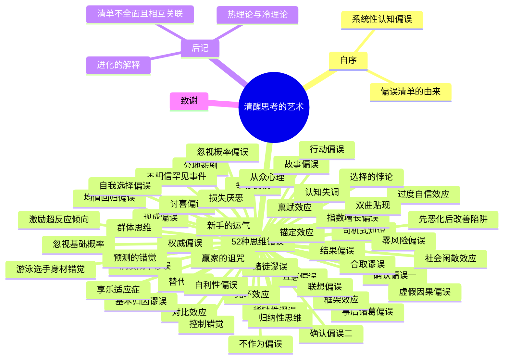

# 读书笔记：《清醒思考的艺术》

> 由 book-to-skill reader 使用。七块骨架 + 4 个通用块。
> 块 1–4 与导览 / 大纲 / 金句 忠实抽取自原书;块 5–7 与评价为通用示范(读者按自身情况改写)。

## 导览 · 全书脉络与书目(faithful 抽取)
- 书名 / 作者 / 译者 / 版本:《清醒思考的艺术——你最好让别人去犯的 52 种思维错误》/[德] 罗尔夫·多贝里(Rolf Dobelli)著 / 朱刘华 译(自序落款 2011 年)。
- 阅读日期 / 阅读目的:(留空,读者自填)
- 一句话总结:人并非天生理性,我们会在同一方向上系统性地反复犯错;本书用 52 个短章逐一拆解这些「认知偏误」,并给出识别与抵御的清单。
- 全书结构地图:自序(为何写这份偏误清单)→ 52 个独立短章,每章讲一种思维错误(标题 + 一句副标题 + 案例与结论)→ 后记(从「热理论 / 冷理论」解释非理性的进化根源)→ 致谢。各章彼此独立、可任意顺序阅读;作者在后记承认清单不全面、错误间相互关联。

## 全书大纲 · 思维导图(faithful 抽取)

## 1. 核心论点(Core Arguments)
- 认知偏误是「系统性、可预测」的:我们不是随机犯错,而是在同一方向(如高估自己、高估成功概率、厌恶损失)上反复偏离理性。§自序
- 非理性根植于进化:我们本质上是「穿西装的狩猎采集者」,大脑适配的是 5 万年前简单稳定的环境,而现代世界(股市、复杂组织、海量信息)与那时天差地别,旧本能失效。§后记
- 理性思维本身有缺陷(「冷理论」):高智商者同样会掉入思维陷阱,漏洞普遍存在于每个人身上,而非仅由情绪失控造成。§后记
- 清醒思考成本高昂:在重大私人 / 商业决策时应像飞行员执行检查单一样逐项核对偏误清单;在损失微小的情境下可放心交给直觉。§后记
- 目的不是消除错误,而是筑起防线:本书「或许无法直接带来好运,但至少能为你抵御因自身决策失误造成的厄运」。§自序

## 2. 心智模型(Mental Models)
- 幸存偏误棱镜:成功者被媒体放大,失败者「墓地」隐形 → 任何高曝光群体都先怀疑「这是筛选结果还是真实概率」。何时用:评估创业、投资、成功学案例时。§1 幸存偏误
- 选择标准 ≠ 结果(游泳选手身材错觉):把「被选中标准」误当「训练结果」就会上当 → 凡被广泛推崇的(身材、名校、高收入、幸福)都先照镜子。何时用:看广告、选校、信成功学书时。§2 游泳选手身材错觉
- 沉没成本归零:已付出成本不是继续的理由,唯一重要的是当下与未来判断。何时用:是否终止项目 / 关系 / 持仓时。§5 沉没成本谬误
- 决策检查单:在重大决策前拿出偏误清单逐项打勾,如同飞行员操作清单。何时用:重要商业 / 私人决策前。§后记
- 损失厌恶框架:说服他人时强调「避免损失」优于「获得收益」(负面比正面更有驱动力)。何时用:沟通、营销、谈判。§33 损失厌恶
- 直觉 vs 理性分工:直觉快、省、自然;理性慢、耗能。后果微小用直觉,后果重大用理性核查。何时用:日常小选择与重大抉择的分工。§后记

## 3. 论证证据(Evidence)
- 阿希实验(1950):房间有 7 名演员故意答错线段长度,约 30% 受试者会跟随群体给出错误答案,证明从众心理扭曲常识判断。§4 从众心理
- 过度自信测试:马克·阿尔佩特与霍华德·雷法发现,要求 98% 置信区间时,实际高达 40% 的人范围偏离真实值(密西西比河长度、空客油耗等)。§3 过度自信效应
- 林格尔曼实验(1913):拔河时 2 人组每人出 93% 力,3 人组 85%,8 人组仅 49% → 社会闲散效应。§34 社会闲散效应
- 乳腺癌筛查宣传对照:A 版「每年筛查可早治」vs B 版「不筛查会错失机会」,B 版拨打咨询电话人数显著更多 → 损失厌恶驱动。§33 损失厌恶
- 协和效应:英法明知超音速飞机永难回本仍持续巨额投入仅为维护国家形象;越南战争「已牺牲那么多士兵,放弃即错误」→ 沉没成本谬误。§5 沉没成本谬误
- 普朗克与司机:司机能倒背量子力学演讲却答不出教授提问 → 「司机式知识」(能复述 ≠ 真懂)。§15 司机式知识

## 4. 反例边界(Counterexamples / Boundaries)
- 从众的唯一合理场景:在陌生城市拿着球赛票却不知体育场在哪时,跟着像球迷的人走是明智的。§4 从众心理
- 过度自信的「例外」:作者明确「不存在所谓的低估自信效应」;且男性更易受影响、女性相对理性,悲观者也会高估只是程度轻。但这是程度差异,非真正反例。§3 过度自信效应
- 损失厌恶的例外:「唯有涉及自身时」,负面比正面更有影响力的规律会出现例外。§33 损失厌恶
- 团队并非总更差:作者承认日本工厂团队模式成功,欧美团队要「成员尽可能多元化、各有所长」且个人绩效可追溯到专业领域时才表现更佳。§34 社会闲散效应
- 清单本身有限:作者自认「我做不到不犯这些错误」,纠正始终是有限的、不可能彻底消除;且清单不全面、错误间相互关联。§后记
- 直觉有时更优:在信息不足时,启发式直觉决策反而有效(如择偶、择业);理性并非万能,需与直觉分工。§后记

## 金句摘录(Quotable Lines)—— faithful 抽取
- 「认知偏误在本书中指的是我们在理性、最优、有逻辑和明智的思考及行为过程中,反复出现的系统性偏误。」(§自序)
- 「如果你想规避幸存偏误,只能由你自己来完成。」(§1 幸存偏误)
- 「凡是被广泛推崇的东西——无论是强健的肌肉、美貌、更高的收入、长寿、个人魅力还是幸福——都值得你认真审视。」(§2 游泳选手身材错觉)
- 「请对所有预测保持怀疑,尤其是那些所谓专家的预测。」(§3 过度自信效应)
- 「就算有数百万人坚称一件蠢事是对的,它也不会因此变成真理。」(§4 从众心理,引萨默塞特·毛姆)
- 「理性决策的核心就是要忽略过去的投入。不管你已经投入了多少,唯一重要的是当下和你对未来的判断。」(§5 沉没成本谬误)

## 5. 与我连接(Connections)—— 以下为通用示例,读者按自己情况改写
- 示例:我在做「是否继续一个长跑项目」的复盘时,发现自己多次用「已经投入这么多」当理由,正是沉没成本谬误;可对照本书把决策锚点改为「未来回报」。
- 示例:写周报 / 汇报时常陷入「结果偏误」(用结果好坏反推决策好坏),可提醒自己决策质量应独立于结果评价。
- 示例:读行业「成功案例」时容易忽略幸存偏误,可建立「先找失败样本」的习惯。

## 6. 可执行下一步(Actionable Next Steps)—— 以下为通用示例,读者按自己情况改写
- [ ] 下次做重大购买 / 投资前,先写下「如果现在空仓,我还会以当前价买入吗?」以规避锚定与沉没成本。
- [ ] 建一份个人「偏误检查单」,在季度复盘时逐项自查(从众、过度自信、确认偏误、损失厌恶)。
- [ ] 读到「最畅销 / 名校出身 / 成功学秘诀」类主张时,先问「这是选择标准还是结果?」。

## 7. 未解问题(Open Questions)—— 以下为通用示例,读者按自己情况改写
- 示例:作者说纠正「始终是有限的」,那是否存在系统化训练能显著降低某些偏误的发生频率?
- 示例:52 种错误相互关联,是否有一两条「元偏误」能解释大部分?能否用更少维度覆盖?
- 示例:在 AI / 算法决策盛行的今天,人类的认知偏误会被放大还是被对冲?

## 评价与适合人群(Verdict)—— 综合
- 总体评分(1–10)/ 一句话总体评价:9 / 用极短篇幅把「人为什么系统性不理性」讲得既好懂又好用,是决策自查的随身手册。
- 适合谁读:投资者、创业者、管理者(决策高频且后果重大者);爱反思、想提升判断力的普通读者;写作 / 科普时需要案例与金句的人。
- 不适合谁 / 局限性:期待严密学术论证或量化模型者(本书是随笔体、非系统学术);已深读塔勒布《黑天鹅》《思考,快与慢》者可能感到重叠;每章过短,深度有限。
- 延伸阅读 / 与已读其他书的对照:纳西姆·塔勒布《黑天鹅》《随机漫步的傻瓜》(本书灵感来源);丹尼尔·卡尼曼《思考,快与慢》(系统化双系统理论);查理·芒格《穷查理宝典》(心智模型 / 误判心理学清单)。
