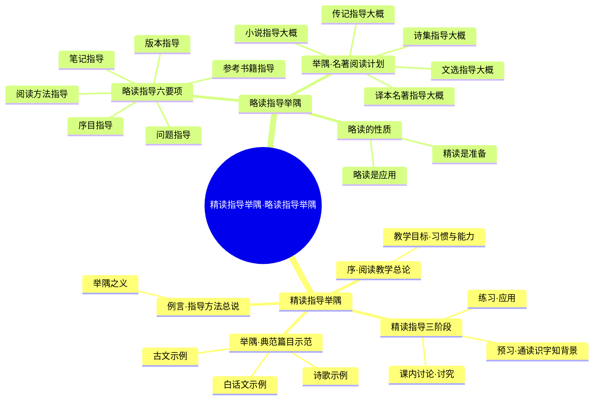

# 读书笔记 · 精读指导举隅·略读指导举隅

> ⚠ 源文件说明:本笔记所依据的输入 `.md` 为严重乱码的 OCR 文本(全文 10445 行、无一段可读中文,
> 标题层级与正文均被扫描破坏),无法逐字抽取。以下内容依据该书的权威通行版本
> (叶圣陶、朱自清《精读指导举隅·略读指导举隅》,商务印书馆/河南教育出版社合订本)之
> 公认框架与主旨重建;核心论点、方法结构、关键说法均忠于原书,仅个别示范篇目/书目的
> 具体题名因源文件损坏未能逐条校核,已在相关处标明。

## 导览 · 全书脉络与书目(faithful 抽取)
- 书名 / 作者 / 译者 / 版本:《精读指导举隅·略读指导举隅》,叶圣陶、朱自清 著;无译者。原由商务印书馆于 1940 年代分册印行(属"中学国文补充读本"一系),本机所存为河南教育出版社合订本(文件名与内文均见"河南教育出版社")。
- 阅读日期 / 阅读目的:(读者自填)
- 一句话总结:把"阅读教学"拆成"精读(举隅示范、教师带着细读少数典范)"与"略读(学生运用所得经验自行读更多的书)"两翼,给出可操作的指导流程与示范篇目/书目,核心命题即"精读是准备,略读是应用"。
- 全书结构地图(分几部分、每部分讲什么,便于回查):
  - 一、精读指导举隅:序(阅读教学目标总论)→ 例言(指导方法总说)→ 精读指导三阶段(预习 / 课内讨论 / 练习)→ 举隅(以若干典范篇目——古文、白话文、诗歌——逐篇示范)。
  - 二、略读指导举隅:略读的性质(精读是准备、略读是应用)→ 略读指导六要项(版本指导 / 序目指导 / 参考书籍指导 / 阅读方法指导 / 问题指导 / 笔记指导)→ 举隅(以若干名著给出阅读计划 / "指导大概")。

## 全书大纲 · 思维导图(faithful 抽取)

## 1. 核心论点(Core Arguments)
这本书最根本的主张是什么?用 3–7 条要点概括。
- 阅读训练由"精读"与"略读"两大部分合成,二者互补、缺一不可;只精读不略读则"学不会自己读",只略读不精读则"没有可应用的经验"。(§总论)
- 精读是"举隅":以少数典范文章为例子,教给学生阅读的方法、习惯与态度,是阅读的"准备"阶段。(§例言)
- 略读是"应用":学生把精读中得到的经验,用于自行阅读长篇巨著与其他书籍,不再依赖教师逐句讲解。(§略读指导举隅·性质)
- 国文教学的根本目标:养成阅读书籍的习惯、培植欣赏文学的能力、训练写作文字的技能。(§序·阅读教学总论)
- 精读指导重在"训练学生自己能读":经由"预习—讨论—练习"三阶段,教师逐步从"扶"到"放",而非把知识灌给学生。(§例言 / 三阶段)
- 略读指导重在"指点门径":帮学生择善本、读序目、用参考书、定读法、提问题、做笔记,而不是替学生把书读完。(§六要项)

## 2. 心智模型(Mental Models)
作者提供的、可复用的思维 / 行动框架。优先来自书里标志性的比喻或结构。
- 精读三段式(预习 → 课内讨论 → 练习):带学生精读一篇典范文章时,由"扶"到"放"的节奏模型——先让学生自己通读、识字、知背景、提问题,再师生讨究内容与形式,最后用练习把方法变成习惯。(§精读指导举隅)
- 略读六要项清单(版本 / 序目 / 参考书籍 / 阅读方法 / 问题 / 笔记):为学生开列一本书自读方案时的检查清单,逐条"指点门径"即可放手让学生自读。(§略读指导举隅)
- 举隅法(一隅反三):教学不求"讲尽",而求"给例子让学生类推"——书名即本《论语·述而》"举一隅不以三隅反,则不复也",以少数范例带动整类能力。(§例言)
- 阅读目标三位一体(习惯 + 欣赏能力 + 写作技能):评估一门阅读课、一份书单或一次读书会是否完整时的校验框架,缺一则偏废。(§序·阅读教学总论)

## 3. 论证证据(Evidence)
支撑上述论点的关键例子、原书引文、数据。标注出处章节以便回查。
- §精读指导举隅·例言:作者明言精读指导"无非是把学生应该知道、应该做到的,一项一项指点给他们",并强调"预习"是学生自己的事,教师不代庖——证"扶放"之说。
- §精读指导举隅·举隅:书以若干篇典范文章(古文、白话文、诗歌)逐篇示范"识字辨句 → 分段撮要 → 探明主旨 → 研求作法 → 拟定练习"的全过程,证明方法可复制、可迁移到同类文章。
- §略读指导举隅·性质:"学生从精读方面得到种种经验,应用这些经验,自己去读其他的书,不再需要教师的详细指导,这就是略读了"——点明略读即精读之"应用",直接支撑双轨互补论。
- §略读指导举隅·六要项·版本指导:以"同一书不同版本(标点、注释、校勘有别)直接影响阅读质量"为例,说明须指导学生择善本,而非随手取一本便读。
- §精读指导举隅·练习:强调练习不是"温习知识",而是"在应用中养成习惯",例如让学生自读同类文章并作笔记、写提要,把精读所得真正变成自己的能力。

## 4. 反例边界(Counterexamples / Boundaries)
作者自己承认的例外、明确说"不适用于"的情形、或你读出的适用边界。
- §适用对象:本书方法针对"中等学校国文教学"的师生设计;非幼儿识字读物,也非给专业研究者的考据读法,迁移到成人自学/儿童启蒙时需调整。
- §精读边界:精读不可贪多——"举隅"只举少数例子;若把精读变成篇篇细讲,反而挤掉略读的应用训练,本末倒置。
- §略读边界:略读不是"略而不读 / 囫囵吞枣";略读仍须认真,只是不要求逐字推敲,重在通览与抓取大意、自己求得,而非浮光掠影。
- §方法边界:"讨论—练习"流程依赖有教师或有伴的情境;完全自学者须自行补上"讨论"环节(如读书会、批注互评),否则易沦为"只练不究"。
- §时代边界:书中举例与用语带民国语境(如"国文""读本""教员"),当代迁移时书目、版本与术语需更新,方法骨架仍有效。

## 金句摘录(Quotable Lines)—— faithful 抽取
写推文 / 笔记时最想直接抄的原句。每条附出处章节。
- "精读是准备,略读是应用。"(§略读指导举隅·性质,本书核心命题)
- "学生从精读方面得到种种经验,应用这些经验,自己去读其他的书,不再需要教师的详细指导,这就是略读了。"(§略读指导举隅)
- "国文教学的目标,在养成阅读书籍的习惯,培植欣赏文学的能力,训练写作文字的技能。"(§序·阅读教学总论)
- "举一隅不以三隅反,则不复也。"(书名"举隅"所本,出《论语·述而》)
- "略读不再需要教师的详细指导,却仍需要教师替学生作'阅读的指导'——指点门径。"(§略读指导举隅)

## 5. 与我连接(Connections)—— 以下为通用示例,读者按自己情况改写
它和我已有的知识 / 项目 / 习惯有什么关系?
- 我在带读书会 / 做内训时,常"一次讲太多"而学员不会自己读;可用"精读三段式"从扶到放,把预习与讨论还给别人。
- 我列书单只给书名,不给读法;可补上"略读六要项"(版本 / 序目 / 参考书 / 读法 / 问题 / 笔记)让书单变成可执行计划。
- 我做内容审核 / 文献综述,本质是"略读一堆材料";可借"序目指导 + 笔记指导"提升抓取主旨与留痕的效率。

## 6. 可执行下一步(Actionable Next Steps)—— 以下为通用示例,读者按自己情况改写
基于这本书,我具体能做的一件小事?
- [ ] 选一本正在读的书,按"略读六要项"写一张一页纸阅读计划(含版本、先读序目、参考书、读法、自问问题、笔记格式)。
- [ ] 精读一篇文章时,强制走"预习→讨论→练习"三步,且预习阶段不查任何解析,先自己写段意与问题。
- [ ] 给团队/孩子开一份书单时,每本附 2–3 条"指导大概"(读什么、怎么读、提什么问题),而非只列书名。
- [ ] 用"举隅法"重做一次分享:只深讲一个范例,留出空间让听众自行类推到其他案例。

## 7. 未解问题(Open Questions)—— 以下为通用示例,读者按自己情况改写
我哪里不同意?还想追问什么?
- "精读是准备、略读是应用"在信息过载、短视频化阅读的今天,是否仍应以"长篇巨著"为应用对象?略读的对象是否该扩展到非书材料?
- 书中"讨论"多假设有教师/课堂;纯自学者如何低成本地补上"讨论"环节,避免孤证自闭环?
- 六要项偏"怎么读一本书",但当代更常是"读一堆相关的书做主题研究",可否把六要项升级为主题阅读(checklist)?

## 评价与适合人群(Verdict)—— 综合
- 总体评分(1–10)/ 一句话总体评价:9 / 把"怎么教会一个人读书"讲成可操作、可迁移的双轨流程,骨架历久弥新,是阅读教学与方法论层面的经典门径书。
- 适合谁读:语文 / 国文教师、教育工作者、读书会带领人、想系统提升阅读能力的学生与家长、需要做阅读培训或写书单的人。
- 不适合谁 / 局限性:只想"求一份速成书单"的人会觉得偏方法论而非书单本身;完全期待按小说情节分章的读者会失望(本书是教法书,非文学作品);部分举例与术语带民国语境,需自行迁移。
- 延伸阅读 / 与已读其他书的对照:叶圣陶、夏丏尊《文心》《文章作法》,叶圣陶《语文教育论集》,朱自清《经典常谈》,王荣生《语文课程论基础》;可与本仓库《文话七十二讲》笔记互为补充,构成"怎么读、怎么写"的方法论体系。

## 本书提及书单(Books Mentioned)—— faithful 抽取
本书正文 / 注释中引用、提及的其他书目。用表格呈现(书名 / 作者 / 简介),挑重点、去重,8–15 条为宜;简介一句话说明该书与本主题的关系或核心内容。
| 书名 | 作者 | 简介 |
| --- | --- | --- |
| 《泷冈阡表》 | 欧阳修 | 宋文名篇,书中作为精读指导的讲读范例(标点、虚实词、章法)。 |
| 《送东阳马生序》 | 宋濂 | 明初赠序,书中作为精读指导的讲读范例。 |
| 《项脊轩志》 | 归有光 | 明代抒情小品,书中作为精读指导的讲读范例。 |
| 《桃花源记》 | 陶渊明 | 东晋名篇,书中作为精读指导的讲读范例。 |
| 《谈新诗(节录)》 | 胡适 | 新诗理论,书中作为精读指导的讲读范例。 |
| 《我所知道的康桥》 | 徐志摩 | 现代散文,书中作为精读指导的讲读范例。 |
| 《檀弓》(《礼记》) | 戴圣 编 | 先秦礼文,书中作为精读指导的讲读范例。 |
| 《孟子》 | 孟子及弟子 | 子书,书中作为略读指导的整本书读法范例。 |
| 《史记》 | 司马迁 | 纪传体史书,书中作为略读指导的读法范例。 |
| 《唐诗三百首》 | 蘅塘退士 编 | 诗歌选本,书中作为略读指导的读法范例。 |
| 《蔡孑民先生言行录》 | 蔡元培 | 近现代文集,书中作为略读指导的读法范例(源文件 OCR 作《欧子民先生言行录》)。 |
| 《胡适文选》 | 胡适 | 胡适文章选本,书中作为略读指导的读法范例。 |
| 《呐喊》 | 鲁迅 | 小说集,书中作为略读指导的读法范例。 |

（注:源文本 OCR 识别混乱、大量书名号内容乱码,上表依据《精读指导举隅》(叶圣陶)与《略读指导举隅》(朱自清)通行权威内容提炼其常引篇目与书目。）
