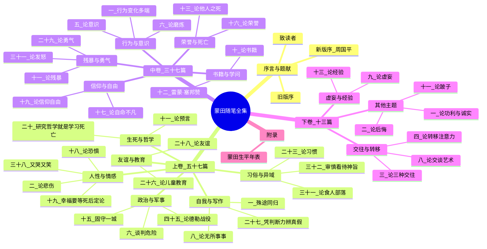

# 蒙田随笔全集 · 读书笔记

> 来源:《蒙田随笔全集(上中下卷)》,【法】米歇尔·德·蒙田 著,潘丽珍、王论跃、丁步洲 等译,译林出版社(ISBN 9787544785853)。许渊冲推荐译本,季羡林、周国平导读。全书为随笔集,由 107 篇独立随笔(上卷 57 篇、中卷 37 篇、下卷 13 篇)加附录年表组成。本笔记块 1–4、导览、大纲、金句均忠实抽取自原书;块 5–7 与评价为通用示范,不暴露读者个人身份。

## 导览 · 全书脉络与书目(faithful 抽取)
- 书名 / 作者 / 译者 / 版本: 《蒙田随笔全集(上中下卷)》/【法】米歇尔·德·蒙田(Michel de Montaigne, 1533—1592)/ 潘丽珍、王论跃、丁步洲 等 / 译林出版社,ISBN 9787544785853;许渊冲推荐译本,季羡林、周国平导读。
- 阅读日期 / 阅读目的: (留空,读者自填)
- 一句话总结: 一部以"认识自己"为方法的随笔巨著——作者把自我当作研究对象,借由诚实观察内心来揭示普遍人性,并以朴实、自由的笔法谈论生死、友谊、习惯、教育与怀疑。
- 全书结构地图(随笔集,按卷次与主题概括):
  - 序言与题献:新版序(周国平)、旧版序、致读者(作者自陈写作动机与"我自己是这部书的材料")。
  - 上卷(57 篇):聚焦人性情感(悲伤、恐惧、友谊)、生死哲学(研究哲学就是学习死亡)、教育与政治军事、习俗与异域(论食人部落)等。
  - 中卷(37 篇):行为变化与意识、书籍与学问(论书籍、雷蒙·塞邦赞)、残暴与勇气、信仰自由与自命不凡、荣誉与死亡。
  - 下卷(13 篇):交往与转移注意力、虚妄与经验(著名的"论经验")、功利与诚实、后悔等。
  - 附录:蒙田生平年表、注释。

## 全书大纲 · 思维导图(faithful 抽取)
用 mermaid mindmap 呈现三卷随笔的层级(取自书真实篇目结构,略作主题归并以便鸟瞰)。

## 1. 核心论点(Core Arguments)
这本书最根本的主张是什么?用 6 条概括。
- 作者本人即书的材料:开宗明义"读者,我自己是这部书的材料",全书是对自我内心世界的诚实观察记录,借研究自己来研究普遍人性("我研究别的课题不如研究自己多。这就是我的形而上学,这就是我的物理学")。
- 以平凡真实的人性为楷模:人皆有弱点、变化无常,承认并宽待这些弱点是健康的人生态度;"坐上世界最高的宝座也只能靠自己的屁股""帝王哲人大便,女士们也大便"。
- 智慧在于认识自己的无知:"我知道什么?"是座右铭;温和的怀疑论,不做独断,任何意见与信仰都不因其与自己格格不入而令他吃惊或生气。
- 研究哲学就是学习死亡:所有哲学规则都在"蔑视死亡"上汇合,要习惯死亡、随时准备上路,才能摆脱对死亡的奴役("把照亮你的每一天当作最后一天")。
- 顺乎自然、依经验生活:亲身经验比书本教条更亲切可靠,"单纯依靠自然便是最明智地依靠自然";反对繁复法律与过度注释("最令人企望的法律是数量最少,最简明,也最普通的法律")。
- 自由而非矫饰的写作与人生:写作如家常闲谈,朴实、自由、形散神不散;人生亦应可屈可伸、不固执于规则("靠规则及纪律维持的生活方式是最愚蠢也最脆弱的生活方式")。

## 2. 心智模型(Mental Models)
作者提供的、可复用的思维 / 行动框架。
- 自我镜鉴模型:把自己当作人性的标本,"给自己就像给第三者一样坦然做证",通过长期观察自己训练对他人的判断。何时用:想理解人性或他人行为、做自我反思时。
- "我知道什么?"怀疑标尺:对任何断言先问"我凭什么知道",把此句作为天平铭文。何时用:面临独断、争论、或自以为正确时,用以克制自负与偏见。
- 习惯塑造模型:习惯可使人适应任何生存方式,也能训练适应变化;"必须立即选定习惯给我们提供的最好的生存方式"。何时用:想改变习惯、培养韧性、或理解异文化习俗差异时。
- 死亡熟思模型:想象死亡各种情形(从马上跌下、被针刺),习惯它的平常;把每一天当作最后一天。何时用:焦虑未来、畏惧死亡、或做长远计划时。
- 友谊交融模型(完美友谊):两个意志水乳交融、不可分割,不掺杂利益与目的("因为是他,因为是我")。何时用:思考亲密关系、区分功利之交与真心之谊时。
- 经验优先模型:理性推理不足时运用经验,但经验缺陷亦多;"想从事件相似性中得出结果靠不住,事件永远各不相同"。何时用:依赖案例类比做决策、或评估规则普适性时。

## 3. 论证证据(Evidence)
支撑上述论点的关键例子、原书引文、数据。标注出处章节以便回查。
- 致读者中蒙田声明"我写这本书纯粹是为了我的家庭和我个人……我自己是这部书的材料",并说自己描绘的是自己,缺点与朴素作风都将活生生展现(§致读者)。
- 论友谊:蒙田与拉博埃西"因为是他,因为是我"的至高友谊,心灵"再也找不到联结处";举欧达米达斯临终遗嘱让朋友赡养其母、嫁其女,二友欣然接替履约(§二十八 论友谊)。
- 研究哲学就是学习死亡:引西塞罗"研究哲学就是为死亡做准备",并列举布列塔尼公爵被人群挤死、埃斯库罗斯被飞鹰坠龟壳砸死、一人被葡萄噎死等无数突然死亡方式,论证"死亡无处不在"(§二十)。
- 论食人部落:借一位朴实的共事者之口描述新大陆部族"没有任何不开化或野蛮,除非把不合自己习惯的东西称为野蛮",并对比"吃活人折磨致死比吃死人更野蛮",批判以自身习俗为准则的傲慢(§三十一)。
- 论经验:以法官判案为例,指出法律再多也跟不上人类活动的无限差异,"最令人企望的法律是数量最少、最简明、也最普通的法律";又以注疏者越注越疑、狗见水中假尸淹死作喻(§十三 论经验)。
- 论书籍:蒙田自陈读书只为"寻找认识我自己的学问,即一门能使我愉快生活、安然死去的学问",推崇普鲁塔克与塞涅卡独立成篇、可随时中断的写法(§中卷十 论书籍)。

## 4. 反例边界(Counterexamples / Boundaries)
作者自己承认的例外、明确说"不适用于"的情形、或你读出的适用边界。
- 完美友谊不可分享:蒙田明言那种至高无上的友谊"是不可分割的",不能与第三者分享;普通友谊才可与多人分享(§二十八 论友谊)。
- 怀疑论不等于虚无或放纵:蒙田的"我知道什么"是温和怀疑,他仍"对规定的信仰毕恭毕敬",并非否定一切;且他仇恨狂妄自大(§十三 论经验)。
- 顺乎自然≠任由本能:他反对过度注释法律,却也承认"宁可一点没有,也别拥有我们这么多法律",并强调应主动选定好习惯,并非无为(§十三)。
- 经验可靠但有缺陷:他承认经验"缺点更多、更不值得重视",理性不足才用经验,且"事件永远各不相同",不可机械类比(§十三)。
- 习惯可塑性有界:习惯能训练适应力,但"靠规则及纪律维持的生活方式是最愚蠢也最脆弱的",需保持可屈可伸而非固执(§十三)。
- 斯多葛派对怜悯的反对被质疑:蒙田说自己"本性更倾向于同情,而不是钦佩",对斯多葛派不容怜悯表示异议(§一 殊途同归)。

## 金句摘录(Quotable Lines)—— faithful 抽取
写推文 / 笔记时最想直接抄的原句。每条附出处章节。
- "读者,这是一本真诚的书。……我自己是这部书的材料。"(§致读者)
- "我知道什么?"——铭刻在天平上的格言,蒙田自称的座右铭(§新版序 / §十三 论经验)
- "研究哲学就是学习死亡。"(§二十 研究哲学就是学习死亡,引西塞罗)
- "把照亮你的每一天当作最后一天,赞美它赐给你意外的恩惠和时间。"(§二十)
- "任何漂亮的描绘,都会在朴实无华的真实面前黯然失色。"(§新版序引蒙田,亦见论写作相关篇目)
- "坐上世界最高的宝座也只能靠自己的屁股。"(§新版序引蒙田)
- "单纯依靠自然便是最明智地依靠自然。"(§十三 论经验)

## 5. 与我连接(Connections)—— 以下为通用示例,读者按自己情况改写
- 读者可对照自己是否有"目光总朝向外面的别人、很少向内看自己"的习惯,试着每天留一点时间观察自己的内心波动与情绪来源。
- 读者在面对与自己格格不入的观点时,可尝试以蒙田"任何意见都不令我吃惊"的态度,先去了解其产生的原委,而非立即反驳。
- 读者若常为长远计划焦虑,可借鉴"人生苦短,何必那么多计划",把精力放在当下可完成、可掌控的事情上。
- 读者在人际交往中,可区分哪些是掺入利益与目的的"普通友谊",哪些才是心灵交融的"完美友谊",据此调整期待。

## 6. 可执行下一步(Actionable Next Steps)—— 以下为通用示例,读者按自己情况改写
- [ ] 读者可挑选一个自己常感焦虑或矛盾的主题(如死亡、习惯、交友),重读对应随笔篇目,写下 3 条自己的观察。
- [ ] 读者可在一天结束时,用一句话记录"今天我对自己有了什么新认识",坚持一周。
- [ ] 读者遇到与自己强烈冲突的观点时,先列出对方立场可能成立的三条理由,再决定如何回应。
- [ ] 读者可每周选读 1–2 篇随笔(上中下卷任选),不求通读,只做"自我镜鉴"式的批注。

## 7. 未解问题(Open Questions)—— 以下为通用示例,读者按自己情况改写
- 读者是否同意"完美的友谊不可分割、只能有一个"?在当代多重社交关系中,这种理想是否仍有意义?
- 蒙田的"温和怀疑论"与当代信息环境中的相对主义有何区别?如何既保持怀疑又不被虚无吞没?
- "顺乎自然"与"主动自我塑造"之间,读者自己更偏向哪一端,依据是什么?
- 如果每个人都是人性的合法标本,那么在评判他人之前,读者是否先足够诚实地审视过自己?

## 评价与适合人群(Verdict)—— 综合
- 总体评分(1–10)/ 一句话总体评价: 9 / 10。一部以"认识自己"为方法的随笔巨著,平实、自由、温暖,四百年后仍是最亲切的人生哲学伙伴。
- 适合谁读: 想做自我反思与内观的人;喜欢散文化、非系统哲学的读者;写作者(随笔体裁的范本);对人性、生死、友谊、教育、怀疑论感兴趣者。
- 不适合谁 / 局限性: 寻求严密体系或确定性答案的读者可能觉得"散""无结论";部分篇章夹带大量古希腊罗马引证,对古典背景不熟悉的读者偶有隔阂;全书 107 篇篇幅巨大,需选择性阅读而非通读。
- 延伸阅读 / 与已读其他书的对照: 培根《随笔》、卢梭与奥古斯丁《忏悔录》、塞涅卡《道德书简》、普鲁塔克《希腊罗马名人传》(蒙田最推崇的两位作家);周国平关于蒙田与尼采的论述可作为中文导读对照。
