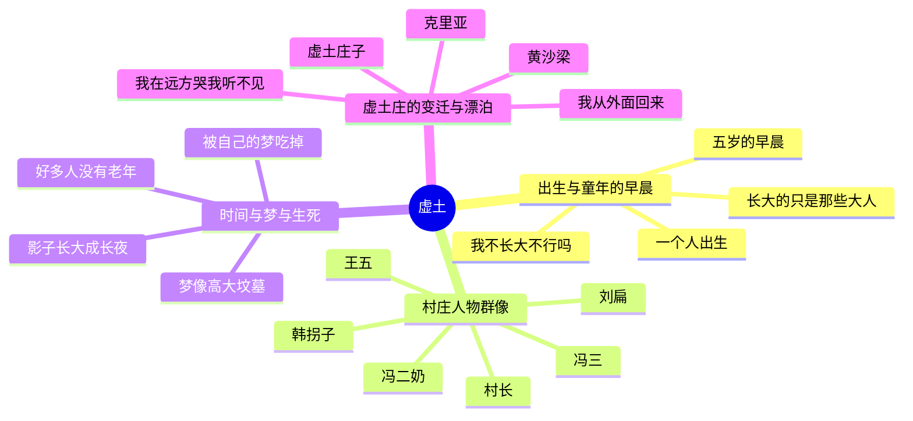

# 读书笔记 ·《虚土》

## 导览 · 全书脉络与书目(faithful 抽取)

- **书名** / **作者** / **译者** / **版本**:
  - 书名:虚土
  - 作者:刘亮程(当代作家)
  - 译者:(无,中文原创)
  - 版本:江西人民出版社 电子书(设计:近浔;排版:林阔阔)。
- **阅读日期** / **阅读目的**:(留空,读者自填)
- **一句话总结**:一个始终停在五岁早晨、没有长大的孩子,在虚土梁上的村庄里看见所有人长大走远、名字被埋、时间分岔、梦与死亡交织——一部以"未成长的一生"为内核的诗意小说。
- **全书结构地图**(分几部分、每部分讲什么,便于回查):
  - 本书为散文体诗化小说,由约九十个带标题的片段连缀而成,无明显分卷;依叙述脉络可归为四组:
  - 一、出生与童年的早晨:五岁的早晨 / 我不长大,不行吗? / 长大的只是那些大人 / 一个人出生。
  - 二、村庄人物群像:冯三 / 冯二奶 / 刘扁 / 韩拐子 / 王五 / 村长等(虚土庄的"人名即存在")。
  - 三、时间·梦境·生死:梦就像一座一座的高大坟墓 / 我们有可能被自己的梦吃掉 / 一个人的影子长大成长夜 / 好多人没有老年。
  - 四、虚土庄的变迁与漂泊:虚土庄子 / 克里亚 / 黄沙梁 / 我从外面回来 / 我在远方哭我听不见。

## 全书大纲 · 思维导图(faithful 抽取)

## 1. 核心论点(Core Arguments)

- 叙述者"我"在"不向中午移动的早晨"醒来,看见村庄却始终没有长大;生命在五岁停住,其他人一岁岁走远——这是一个关于"被错过、未成长的一生"的寓言。
- 名字是被他人叫亮的:"一个名字若两三天没人叫,名字上会落一层土";冯三的大名"冯得财"被全村埋没五十年,人活在小名里——名字即存在,被遗忘即被埋葬。
- 村庄是"虚"的:虚土梁上的房子"比一场梦还短暂地居住",墙不用心垒、椽子不直;虚土庄终将被风蚀成孤峰(乌尔禾魔鬼城隐喻)。
- 时间不是线性向前:人们"往明天走的时候,一些人朝去年去了";过去是所有人的,未来只是另一部分人的;黄昏时一个人的影子膨胀成长夜。
- 梦与死亡交织:梦像高大坟墓堆在夜空;"我们有可能被自己的梦吃掉";先人追进活人梦里,呼唤他们往回走。
- 童年是人的老家:"只有童年岁月最广阔,盛得下人一生的生活和梦想";五岁的早晨是停住的原点,远处的好日子被别人过掉了。

## 2. 心智模型(Mental Models)

- **名字=被叫亮的生铁**:存在的确认来自他人的呼唤——何时用:思考"被记住/被遗忘"如何定义一个人。
- **"虚土"隐喻**:居住的不踏实、根基的虚浮与终被风蚀——何时用:理解乡土记忆的脆弱。
- **时间的非线性/环形**:向前走即向回走,未来是另一个过去——何时用:解读书中"朝去年去"的错位。
- **影子长大成长夜**:每个人在各自影子(各自时间)里过夜,无人在同一夜——何时用:体会个体的孤独与时间错位。
- **童年=老家**:一生都住在童年——何时用:反思"我们一次次梦回的老家其实是童年"。

## 3. 论证证据(Evidence)

- 五岁的早晨:"我在五岁的早晨,突然睁开眼睛,仿佛那以前,我的眼睛一直闭着。"村庄里多数人被鸡叫醒,而"被开门唤醒的,可能就我一个人"(§五岁的早晨)。
- 名字:"人的名字是一块生铁,别人叫一声,就会擦亮一次。一个名字若两三天没人叫,名字上会落一层土。"(§冯三)
- 冯三:"冯三的名字被人忘记五十年了。人们扔下他的真名不叫,都叫他冯三。"大名"冯得财"五十年无人叫,像几根枯柴般朽掉(§冯三)。
- 虚土庄子风蚀:"一场飓风刮走所有的草木土地……每个峰顶站着一个人或一头牲畜",乌尔禾魔鬼城即前车之鉴(§虚土庄子)。
- 梦的坟墓:"梦就像一座一座的高大坟墓,堆在夜晚的天空。我们没法挖开它。"(§梦就像一座一座的高大坟墓)
- 童年老家:"只有童年岁月最广阔,盛得下人一生的生活和梦想。童年才是人的老家。"(§我在远方哭我听不见)
- 影子长夜:"黄昏时一个人的影子就膨胀成长夜,一只鸡的影子也长大成一个长夜。"(§一个人的影子长大成长夜)

## 4. 反例边界(Counterexamples / Boundaries)

- 叙述者自己"没长大"是特例:村里其他孩子"早长大走了",只留下他一个五岁孩子;并非所有人停滞(§我不长大,不行吗?)。
- 并非所有人都被遗忘:刘榆木、王木叉因名字"不惹人"反被叫本名,王五爷以此解释村庄的"命名政治"(§冯三)。
- "死亡只是一个借口,灾年让人有了出逃的念头",但即使不饿死人也会死——死亡不可避免(§我们有可能被自己的梦吃掉)。
- 时间是相对的、带人物视角的"边界"而非作者断言:有人潜入夏天割麦、有人蹲在过去享福,"只有木头脑子的人,才在今天的地里下苦力"——这是书中人物的看法,非普适真理(§一个人的影子长大成长夜)。

## 金句摘录(Quotable Lines)—— faithful 抽取

- "人的名字是一块生铁,别人叫一声,就会擦亮一次。"(§冯三)
- "我在五岁的早晨,突然睁开眼睛,仿佛那以前,我的眼睛一直闭着。"(§五岁的早晨)
- "梦就像一座一座的高大坟墓,堆在夜晚的天空。"(§梦就像一座一座的高大坟墓)
- "只有童年岁月最广阔,盛得下人一生的生活和梦想。童年才是人的老家。"(§我在远方哭我听不见)
- "黄昏时一个人的影子就膨胀成长夜。"(§一个人的影子长大成长夜)
- "我们在虚土梁上等亲人、等待后人的时候,祖先也在那里等候我们。"(§我们有可能被自己的梦吃掉)

## 5. 与我连接(Connections)—— 以下为通用示例,读者按自己情况改写

- 读者可回想:自己是否也有一个"被叫错/被简化"的名字或绰号,它如何悄悄改写了别人对自己的认知。
- 读者若离开故乡多年,可借"童年才是人的老家"对照自己反复梦回的究竟是哪个年龄的自己。
- 读者做家族口述史时,可用"名字被叫亮/被埋没"的视角,去打捞那些只活在绰号里、墓碑上的长辈。

## 6. 可执行下一步(Actionable Next Steps)—— 以下为通用示例,读者按自己情况改写

- [ ] 写下自己名字的由来与被叫法,梳理"哪个名字下的我"最常出现。
- [ ] 挑一个安静的早晨,像书中"被开门声唤醒"那样,记录一次对故乡/童年的清晰记忆。
- [ ] 读完后,重读刘亮程《一个人的村庄》,对比两部作品的"村庄"意象。

## 7. 未解问题(Open Questions)—— 以下为通用示例,读者按自己情况改写

- "我"始终五岁、众人长大走远,这是否隐喻某种集体性的"未成长"或"出走"?作者想说的究竟是个人还是村庄?
- 时间环形、未来是"另一个过去",在小说里是诗意设定还是某种哲学立场?
- 若"童年才是人的老家",那么成年的"出走与回归"是否注定是一场无人回应的等待?

## 评价与适合人群(Verdict)—— 综合

- **总体评分(1–10)/ 一句话总体评价**:9/10。语言质地极高、意象密度惊人,是把"时间、名字、村庄、梦"焊在一起的散文诗式小说;但无传统情节,阅读门槛高。
- **适合谁读**:喜欢诗意/散文体小说的读者;《一个人的村庄》的刘亮程粉丝;对乡土、时间、记忆、存在主题感兴趣的文学读者。
- **不适合谁 / 局限性**:期待强情节、完整故事线的传统小说读者;不耐碎片化、非线性叙事者可能中途放弃。
- **延伸阅读 / 与已读其他书的对照**:刘亮程《一个人的村庄》《凿空》;梭罗《瓦尔登湖》;《百年孤独》(魔幻与时间循环);可对照《我自己的陌生人》中"自我图式"思考"名字如何构成自我"。
