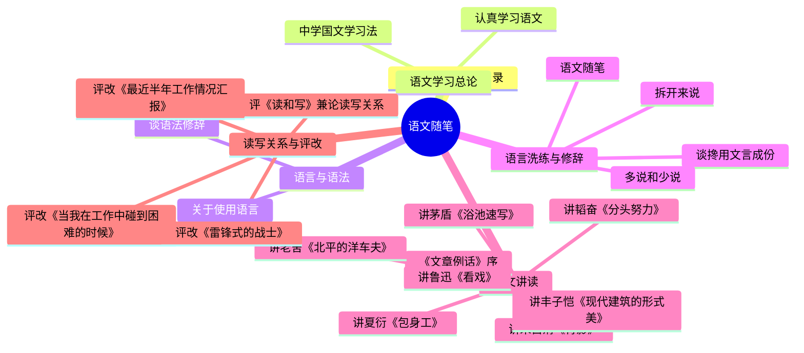

# 语文随笔 · 读书笔记

## 导览 · 全书脉络与书目(faithful 抽取)
- 书名 / 作者 / 译者 / 版本:《语文随笔——跟大师学语文》,叶圣陶 著(无译者)。中华书局"跟大师学语文"丛书本(2007 年),系叶圣陶中学语文教学随笔集,收文十四篇。
- 阅读日期 / 阅读目的:(留空,读者自填)
- 一句话总结: 把"语文"还原为吸收与表达的工具,以"多读多写多改、练基本功、不能速成、为读者着想"为纲,讲清普通人如何把话写通、写像样。
- 全书结构地图: 十四篇可归五路——语文学习总论(认真学习语文 / 中学国文学习法)、语言与语法(关于使用语言 / 谈语法修辞)、语言洗练与修辞(语文随笔 / 谈搀用文言成份 / 拆开来说 / 多说和少说)、范文讲读(《文章例话》序 + 讲七篇名家散文)、读写关系与评改(评《读和写》+ 三篇评改例文)。

## 全书大纲 · 思维导图(faithful 抽取)
用 mermaid `mindmap` 呈现全书篇目层级(取自真实章节,按主题略作归并以便鸟瞰)。

## 1. 核心论点(Core Arguments)
这本书最根本的主张是什么?用 3–7 条要点概括。
- 语文是工具: 就个人是"想心思的工具",就人际是"交际和交流思想的工具";语 = 口头语言,文 = 书面语言。
- 阅读是吸收,写作是表达: 一进一出,"无论做什么工作都是经常需要的"。
- 学习语文不能速成: 要养成运用语文的好习惯,习惯靠实践一点点积累,非一封信 / 一次演讲能解决。
- 要练基本功: 识字写字、用字用词、辨析句子、文章结构,这四桩都得从多读多写来练。
- 认真是学得好不好的关键: 马虎是认真的反面;"重要的还在自学",听过的不一定全接受。
- 写作先有"意思"和"需要"再动笔;好文章是"深度生活的产品",生活的深度不够勉强不来。

## 2. 心智模型(Mental Models)
作者提供的、可复用的思维 / 行动框架。优先来自书里标志性的比喻或结构。
- 吸收—表达双通道模型: 阅读如吃饭吸收营养料,写作如把营养拿出来让人看;一进一出。
- 基本功四桩: 字 → 词 → 句 → 篇,逐层打磨(识字写字 / 用字用词 / 辨析句子 / 文章结构)。
- 多读多写多改循环: 读人家好习惯,写自己好习惯;写后念几遍、请人改、自己改。
- "为读者 / 听者着想"准则: 复句太繁就拆开来说,少用文言成份,多说少说皆失当。
- 美读—以意逆志: 叙事抒情文要"美读",设身处地传达作者情感,与作者心灵相感通。
- 靠自己的力: 阅读多靠自己(查字典词典、留心听话、看参考书),积蓄越厚能力越强。

## 3. 论证证据(Evidence)
支撑上述论点的关键例子、原书引文、数据。标注出处章节以便回查。
- "语言是一种工具……思想是凭借语言来想的,不凭借语言的思想是不存在的。"(§认真学习语文)
- "阅读是什么一回事?是吸收。……写作是什么一回事?是表达。"(§认真学习语文)
- 游泳比喻: 学语文如学游泳,光看书不下水不行;勉强阶段过去了,不用想手该怎样脚该怎样,才算养成习惯(§学习语文不能要求速成)。
- 基本功例: "弃甲拽兵而走",小学生只知"放弃 / 抛弃",不知"拽 = 拖、兵 = 武器、走 = 逃跑"(§学习语文要练基本功)。
- 拆开来说例: 把 55 字"为了配合……通告"的长目的状语拆成几个单句,读者少费心思一下就了解(§拆开来说)。
- 多说少说例: "对电话费无力负担"弯曲累赘,应直说"无力负担电话费";"产、销区"省说一个"区"念出来就听不懂(§多说和少说)。

## 4. 反例边界(Counterexamples / Boundaries)
作者自己承认的例外、明确说"不适用于"的情形、或你读出的适用边界。
- 语文好不等于思想好: "只要思想内容好,语言差些没关系"是错的;半通不通的文章反映半通不通的思想(§正确认识)。
- 语文好也不自动解决内容: 工作总结写不好,可能因没参加实践、材料不充分(§正确认识)。
- 不能速成: 指望"一封信 / 一次演讲"学会语文是办不到的(§不能速成)。
- 多说(罗嗦)与少说(漏说)皆失当: 简捷须以"传达意思不误会"为前提(§多说和少说)。
- 搀用文言成份须"为看的人听的人着想",广播 / 读报场景尤忌,否则是"自由主义"(§谈搀用文言成份)。
- 好文章"可遇不可求",是深度生活的产品,超出国文学习的范围(§写作须知)。

## 金句摘录(Quotable Lines)—— faithful 抽取
- "阅读是什么一回事?是吸收。……写作是什么一回事?是表达。"(§认真学习语文)
- "语言是一种工具。"(§认真学习语文)
- "学习语文不能要求速成。"(§认真学习语文)
- "多读,才能广泛地吸取。要多写,越写越熟,熟极了才能从心所欲。"(§学习语文要练基本功)
- "为看的人听的人着想。"(§谈搀用文言成份 / §拆开来说)
- "好文章是深度生活的产品,生活的深度不够,是勉强不来的。"(§写作须知)

## 5. 与我连接(Connections)—— 以下为通用示例,读者按自己情况改写
- 它和我已有的知识 / 项目 / 习惯有什么关系?
  - 示例: 读者若常写工作报告 / 公众号,可借"吸收—表达双通道"复盘: 自己是不是读得少、写得多,导致词汇贫乏?
  - 示例: 若读者带团队做文档规范,本书"为读者着想"与"拆开来说"可直接变成写作评审清单的一条。

## 6. 可执行下一步(Actionable Next Steps)—— 以下为通用示例,读者按自己情况改写
- [ ] 示例: 本周写任何一段文字后,出声念两遍,把"念不顺"的地方改掉——实践"多念多改"。
- [ ] 示例: 挑一篇自己旧文,检查有无"多说"(冗余修饰)与"少说"(省略导致歧义),各改三处。
- [ ] 示例: 建立一个"字词辨析"小本,每次遇到易混词(如精密 / 周密)记一笔,练基本功。

## 7. 未解问题(Open Questions)—— 以下为通用示例,读者按自己情况改写
- 示例: 今天人人用输入法、语音转文字,"识字写字"这项基本功是否还应按书中标准训练?哪些该保留、哪些已过时?
- 示例: "为读者着想"与"保持作者个人语感"如何平衡?过度顺读者会不会磨平风格?
- 示例: 书中强调"不能速成",但现代人时间碎片化,能否用更短路径逼近"像样"?读者自己的方法是什么?

## 评价与适合人群(Verdict)—— 综合
- 总体评分(1–10)/ 一句话总体评价: 9 / 把"把话写通"这件小事讲得通透扎实,是语文学习与写作教学的常读常新之本。
- 适合谁读: 中学生与语文教师;写作初学者、常写报告 / 公文却总"词不达意"的职场人;想厘清读与写关系的人。
- 不适合谁 / 局限性: 寻求文学性创作灵感或修辞炫技的读者可能嫌其平实;部分例证取自早年报刊语境,需自行迁移。
- 延伸阅读 / 与已读其他书的对照: 夏丏尊、叶圣陶《文话七十二讲》《文章作法》;叶圣陶《怎样写作》;朱自清《经典常谈》;与《蒙田随笔》《雅舍小品》对照: 一本教"怎么写通",另两本示范"写得从容 / 写得自在"。

## 本书提及书单(Books Mentioned)—— faithful 抽取
本书正文 / 注释中引用、提及的其他书目。用表格呈现(书名 / 作者 / 简介),挑重点、去重,8–15 条为宜;简介一句话说明该书与本主题的关系或核心内容。
| 书名 | 作者 | 简介 |
| --- | --- | --- |
| 《文话七十二讲》 | 夏丏尊、叶圣陶 | 同属"跟大师学语文"系列,以七十二讲系统讲解文章知识与读写方法,本书多处参照。 |
| 《文章作法》 | 夏丏尊、刘薰宇 | 同系列姊妹篇,分体裁讲记叙文、议论文、小品文等作法基础,书中列为其写作指导参考。 |
| 《文章讲话》 | 夏丏尊、叶圣陶 | 同系列,专论文章的组织、体制与修辞,本书在谈文章结构时提及。 |
| 《怎样写作》 | 叶圣陶 | 同系列姊妹篇,集中讲写作的态度、方法与习惯养成,与本书互为补充。 |
| 《文心》 | 夏丏尊、叶圣陶 | 同系列,以故事体娓娓讲透国文读写知识,本书视作语文学习范本。 |
| 《国文百八课》 | 夏丏尊、叶圣陶 | 同系列国文教材,读写训练按单元体系化编排,书中引为教材范例。 |
| 《文章例话》 | 叶圣陶 | 叶圣陶评讲二十七篇名家文章,本书专为之作序并据此讲读范文。 |
| 《包身工》 | 夏衍 | 报告文学名篇,本书收入"范文讲读"作为讲解示例。 |
| 《背影》 | 朱自清 | 散文名篇,本书收入"范文讲读"作为讲解示例。 |
| 《看戏》 | 鲁迅 | 散文名篇,本书收入"范文讲读"作为讲解示例。 |
| 《浴池速写》 | 茅盾 | 散文名篇,本书收入"范文讲读"作为讲解示例。 |
| 《儒林外史》 | 吴敬梓 | 古典小说,书中论阅读与范文取材时提及。 |
