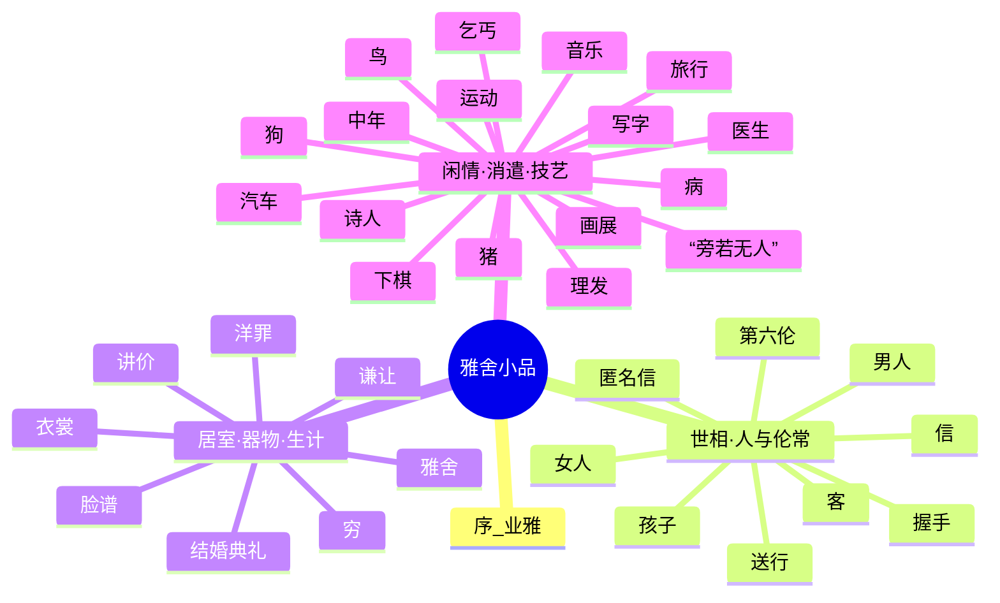

# 雅舍小品 · 读书笔记

## 导览 · 全书脉络与书目(faithful 抽取)
- 书名 / 作者 / 译者 / 版本:《雅舍小品》,梁实秋 著(无译者)。初版 1949 年,本书目据"写作的书"整理本(以《星期评论》《世纪评论》等抗战时期连载结集为底)。
- 阅读日期 / 阅读目的:(留空,读者自填)
- 一句话总结: 以"雅舍"为名的战时闲适小品,于柴米油盐、人情世态中见幽默与通达,主张"有个性就可爱"的从容生活观。
- 全书结构地图: 一篇序(业雅)+ 34 篇短文。题材大致分三路——人与伦常(孩子 / 女人 / 男人 / 第六伦 / 客 / 握手 / 送行 / 信 / 匿名信)、居室与器物生计(雅舍 / 衣裳 / 结婚典礼 / 脸谱 / 穷 / 谦让 / 洋罪 / 讲价)、闲情与技艺消遣(音乐 / 下棋 / 写字 / 画展 / 旅行 / 运动 / 诗人 / 汽车 / 理发 / 医生 / 鸟 / 猪 / 狗 / 乞丐 / 中年 / 病 / 旁若无人)。

## 全书大纲 · 思维导图(faithful 抽取)
用 mermaid `mindmap` 呈现全书结构(序 + 34 篇,按题材略作归并以便鸟瞰)。

## 1. 核心论点(Core Arguments)
这本书最根本的主张是什么?用 3–7 条要点概括。
- 小品文"与抗战无关"亦可成文: 文学的趣味不只在宏大叙事,身边琐事、一器一物皆足成篇。
- "雅舍"虽陋而有个性,"有个性就可爱"——居所与人生皆然,不必强求华屋。
- 以幽默自嘲化解困顿: 穷、病、中年、流离皆可入文而不怨怼,把窘迫化作可观照的笑料。
- 人情世态的冷静洞察: 写孩子、女人、男人、主客、买卖,揭出"孝子""演剧术"一类世相。
- 雅俗之辨与中西文化对照: 陈设宜疏落参差、最忌排偶;批评盲目趋洋的"洋罪"与不伦不类的杂糅。
- 通达的穷达生死观: 穷非美德亦非罪过,中年如登临高峰,人生本如寄,"似家似寄"不必分辨。

## 2. 心智模型(Mental Models)
作者提供的、可复用的思维 / 行动框架。优先来自书里标志性的比喻或结构。
- 雅舍精神: 随遇而安、安之若素——把"不能蔽风雨"也活出趣味,有个性就可爱。
- 幽默自嘲透镜: 用夸张与反语(如"没有法子""穷酸")把窘迫转成可端详的喜剧。
- 显微镜式观察: 从鼠子、蚊子、胡琴、理发馆等微小事物抽绎普遍人性。
- 中西文化对照尺: 遇事物先问"这是中菜西吃还是西菜中吃",警惕不伦不类。
- 排偶破除术: 陈设与生活都"宜求疏落参差之致,最忌排偶",不从俗而求合用。

## 3. 论证证据(Evidence)
支撑上述论点的关键例子、原书引文、数据。标注出处章节以便回查。
- 雅舍实况: 竹篦墙、无玻璃、鼠子搬核桃而下、蚊子"聚蚊成雷"、月夜清光,证"有个性就可爱"(§雅舍)。
- "孝子"新解: 今之孝子是"孝顺其孩子之父母",孩子为一家之主,父母皆为其服务(§孩子)。
- 音乐侵略性: 声音侵入不设防的耳朵;四人合唱竟有五种不同的调子乱擂耳鼓(§音乐)。
- 中年写照: "耳畔频闻故人死,眼前但见少年多";中年如登临最高峰,回望才看懂路上绊脚石(§中年)。
- 穷的挣扎: "人的一生,就是和穷挣扎的历史";穷一经酸化便成"穷酸",支持人穷志不短(§穷)。
- 洋罪 / 讲价: 批评盲目趋洋的心理与市井讲价的机心(§洋罪、§讲价)。

## 4. 反例边界(Counterexamples / Boundaries)
作者自己承认的例外、明确说"不适用于"的情形、或你读出的适用边界。
- 题材自觉设限: 小品文"与抗战有关的他不会写",本书自觉避开宏大主题,不以此自任(§序)。
- "雅舍"非作者所有,只是房客,"似家似寄"本就分辨不清——从容不必以"拥有"为前提。
- 幽默不等于刻薄: 自嘲可,嘲人(如对孩子、对"大腹贾")点到即止,非尖酸攻讦。
- 陈设疏落非为标新立异,"一物一事之安排俱不从俗"但仍求合用,非为怪而怪。
- 穷酸"不可厚非"但"究竟不是美德,值不得夸耀",不可真以穷傲人(§穷)。
- 作者自陈"雅舍小品不过是一面",并非其全貌(§序)。

## 金句摘录(Quotable Lines)—— faithful 抽取
- "有个性就可爱。"(§雅舍)
- "天地者万物之逆旅,人生本来如寄。"(§雅舍)
- "音乐这样东西,在所有的艺术里,是最富于侵略性的。"(§音乐)
- "今之所谓'孝子',乃是孝顺其孩子之父母。"(§孩子)
- "中年的妙趣,在于相当的认识人生,认识自己,从而做自己所能做的事,享受自己所能享受的生活。"(§中年)
- "人的一生,就是和穷挣扎的历史。"(§穷)

## 5. 与我连接(Connections)—— 以下为通用示例,读者按自己情况改写
- 它和我已有的知识 / 项目 / 习惯有什么关系?
  - 示例: 读者可对照自己写随笔 / 公众号的习惯——是否也常从一件小物(一杯茶、一段通勤)起笔,再落到一点态度?可借"显微镜式观察"打磨自己的选题。
  - 示例: 若读者正为"中年 / 职场瓶颈"焦虑,本书"中年如登临最高峰"的转念,可作为缓解非黑即白思维的素材。

## 6. 可执行下一步(Actionable Next Steps)—— 以下为通用示例,读者按自己情况改写
- [ ] 示例: 本周挑一个身边琐事(如一次排队、一顿饭),用"幽默自嘲 + 一个普遍人性"的结构写 300 字小品练笔。
- [ ] 示例: 重读自己旧文,标出"排偶堆砌 / 从俗"的段落,试着改成"疏落参差"的布置。
- [ ] 示例: 列一张"我的雅舍清单"——哪些处境我本可"安之若素"却一直在抱怨?

## 7. 未解问题(Open Questions)—— 以下为通用示例,读者按自己情况改写
- 示例: 作者把"与抗战有关"的内容让给别人写,这种"闲适"在动荡年代是逃避还是另一种坚守?读者自己的写作该偏向哪一端?
- 示例: "有个性就可爱"放到今天,会不会滑向对不文明现象的宽容?个性与教养的边界在哪?
- 示例: 本书的幽默以"旁观者"姿态居多,若身份是被调侃的一方,同样的笔法是否还成立?

## 评价与适合人群(Verdict)—— 综合
- 总体评分(1–10)/ 一句话总体评价: 9 / 举重若轻的闲适典范,把寻常日子写成可供反复回味的从容哲学。
- 适合谁读: 想学白话语序与幽默笔调的散文写作者;在忙碌 / 困境中寻求"安之若素"心态的普通读者;民国散文与梁实秋爱好者。
- 不适合谁 / 局限性: 期待强情节、社会批判或系统思想的读者可能嫌其"散";部分人情描摹带时代烙印与男性视角,需带批判性眼光。
- 延伸阅读 / 与已读其他书的对照: 林语堂《生活的艺术》、周作人《雨天的书》(同属闲适小品);蒙田《随笔集》(自我观察的西方同源);汪曾祺《人间草木》(草木与日常的另一路写法)。
